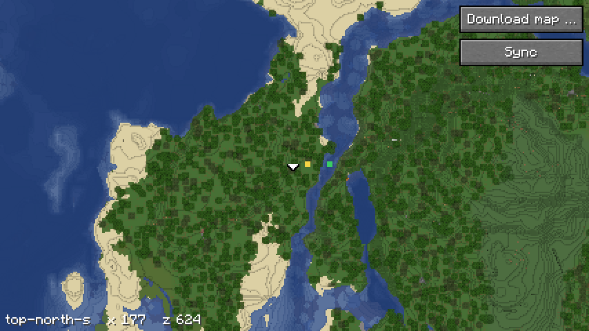

# Bauen und testen

Der Mod baut mit Gradle über den Wrapper und Fabric Loom. Er braucht
Java 25; Gradle holt es über die Toolchain in `build.gradle.kts`.

## Versionen

- **Minecraft, Fabric Loader, Fabric API, Loom und JUnit** stehen in
  `gradle/libs.versions.toml`. Minecraft folgt dem Server.
- **Gradle** steht in `gradle/wrapper/gradle-wrapper.properties`.
- **TwelveMonkeys** steht auch in `gradle/libs.versions.toml`. Wer es hebt,
  prüft die Kopie seines Dekoders, siehe
  [Vollbildkarte](vollbildkarte.md), „Farbindex hinter der Palette“.

## Bauen

```bash
./gradlew build
```

Das baut das Jar nach `build/libs/` und lässt die Tests laufen.

## Tests

| Test | prüft |
|---|---|
| `ProjektionTest` | die Projektion gegen `projektion.json` des Renderers, braucht Netz, siehe [Projektion](projektion.md) |
| `LadenTest` | den Download gegen einen kleinen Server auf loopback: 8 Verbindungen zugleich, Fortsetzen, geänderte und gelöschte Kacheln, die Prozent, abgerundet, höchstens 100, ohne gesamt „…“; der Fortschritt eines Abgleichs, zuerst unbekannt, ohne Fehlendes ohne Kasten und über dem Deckel, Stufen, Prüfsumme, Token, Budget, Stand zum Fortsetzen, Heimnetz, alle harten Grenzen, Fristen, keine Weiterleitung, den Index während des Downloads, den alten Ordner `overlay` beim Start löschen, siehe [Download](download.md) |
| `FreigabeTest` | die `freigabe` lesen, auch mit `port` statt `url`, reservierte Namen, das Präfix der eigenen Karte, und wann der Mod fragt, siehe [Download](download.md), „Zustimmung und Grösse“ |
| `ReiheTest` | Downloads nacheinander, je Baum höchstens einer, auch nach einem `Error`, ein gehaltener Schlüssel beim Löschen, siehe [Download](download.md), „Reihe“ |
| `AblageTest` | der Ordner der Welt je Wahl und je Dimension, mit dem Namen vom Server statt der Adresse, Backends hinter einem Proxy, ein neuer Login ohne wartende `freigabe`n, gleiche Hashes, Umzug ins Leere ohne `overlay/`, die Kartenliste über alle Ablagen, unlesbare Ordner, Abbruch, Symlinks und Junctions, siehe [Download](download.md), „Ablage“ |
| `ServernameTest` | der Name vom Server: nur ein Hostname, gemerkt je eingetippter Adresse in `namen.txt`, der Umzug des Ordners der Welt, nicht über einen vorhandenen, nicht während eines Downloads; siehe [Download](download.md), „Ablage“ |
| `KartennameTest` | die Karte vom Plugin an `show`: nur ein gültiger Name, der Ordner `karte-<karte>` je Wahl, Umzug aus dem Ordner ohne Karte, nicht während eines Downloads, ein vorhandener Ordner der Karte gilt, einmal je Sitzung und je Hash, auch eine später betretene Welt, das Gedächtnis `karten.txt` je Adresse und Hash, das gleich beim Betreten gilt und die erste Antwort korrigiert, die Kartenliste eine Ebene tiefer; siehe [Download](download.md), „Ablage“ |
| `GeheimbannerTest` | die Sprites geheimer Banner über den Kanal: einmal fragen, höchstens 8 offen und 20 je Sekunde, ohne Antwort oder `png` nicht wieder, eine neue `version` gibt frei, die Antwort lesen; siehe [Ebenen](ebenen.md), „Geheime Banner“ |
| `KanalTest` | die `anfrage`, `neu` nur, wenn wahr, und `show`, siehe [Download](download.md), „Kanal“; die Frage `banner` und ihre Antwort durch den Codec; der Klick `knopf` wie im Plugin und unter 1024 Bytes, siehe [Ebenen](ebenen.md), „Knöpfe“ |
| `AdresseTest` | die Prüfung der Adresse, siehe [Download](download.md), „Sicherheit“ |
| `KartenblickTest` | wie die Vollbildkarte Kacheln auf den Schirm legt, Zoom über Stufen und Lupe, das Mausrad zur Maus auf jeder Stufe und Lupe, links oben, rechts unten und in der Mitte, an den Grenzen nichts, Schieben, Platzhalter aus gröberen Stufen, siehe [Vollbildkarte](vollbildkarte.md); Lage merken je Satz und geklemmt stellen, die offene Liste der Ebenen, siehe [Vollbildkarte](vollbildkarte.md), „Lage merken“; Marken auf dem Raster der Kacheln und am Rand neben den Knöpfen, siehe [Wegpunkte](wegpunkte.md), „Am Rand“; Chunklinien auf dem Raster bis zum Rand und nicht zu dicht, auch bei GUI-Massstab 1 auf 4K, je ein Pixel des Geräts auf der Kante 16·c bei Lupe 1 bis 4 und GUI-Massstab 1 bis 4, siehe [Minimap](minimap.md), „Chunklinien“; die Chunklinie nächst der Maus fürs Einrasten, siehe [Wegpunkte](wegpunkte.md), „Einrasten“ |
| `TeleportTest` | der Befehl zum Teleportieren, nur mit `tp` im Befehlsbaum, `tp` ohne `execute`, auf die Mitte des Blocks und genau zurück an den Start; der freie Platz in einer Säule unter der Decke, nahe der Höhe des Spielers, mit Flüssigkeit und zu wenig Luft; wann der Mod korrigiert; die sichere Höhe ohne Daten, ohne Decke oben in der Welt, mit Decke die des Spielers; die Grenzen des offenen Teleports, 4 Blöcke und 10 s, ohne Höhe alle 10 Ticks nach oben und nach 5 s zurück; ein schwebender Teleport bleibt unter der Grenze des Servers für Befehle; die Quelle der Höhe aus `map.json`, Boden vor Höhen und nur in der Ablage einer Wurzel; die Datei der Region, genau so viel entpackt, wie sie hat, der Wert plus 1 je Block und je 4 × 4, ohne Wert keine Höhe; holen gegen einen Server auf loopback, mit 404, zu grosser Datei und einem Ziel, das die Prüfung der Adresse abweist; siehe [Vollbildkarte](vollbildkarte.md), „Teleportieren“ |
| `WebkarteTest` | „Im Browser öffnen“: die Wurzel aus der Basis der Kacheln, mit Präfix, `/tiles/`, IPv6, ohne `/tiles` keine; der Link mit dem Token nur im Fragment; das Token in Fassung 2 bis 256 Zeichen, nichts anderes; das Feld `web` der Antwort auf `show`; die Gründe in ihrer Reihe; die Absagen, bei `rate` mit den Sekunden; siehe [Vollbildkarte](vollbildkarte.md), „Im Browser öffnen“ |
| `NeueVersionTest` | der Hinweis auf eine neue Version: die Frage nur für Fabric und die Version des Spiels, ohne Changelogs; der User-Agent mit dem Repo, ohne Mail; die höchste Version nach Semver, ohne Vorabversionen, Kaputtes und zu Langes, gleich oder älter kein Hinweis, eine Antwort ohne Liste keiner; holen gegen einen Server auf loopback mit User-Agent, 404, über 256 KiB und einem Server, der schweigt; siehe [Vollbildkarte](vollbildkarte.md), „Neue Version“ |
| `DrehungTest` | wie die Minimap ihr Bild auf den Schirm bringt: Schnitt konvexer Vielecke, Vieleck um den Kreis, Rand mit und ohne Rahmen gedeckt, mit Abstand gegen das Einrasten, Umriss wie auf main, ungedreht auf dem Raster, Fächer, Chunklinien in der Form, siehe [Minimap](minimap.md), „Form“; Blickrichtung oben, Drehung und zurück, Marken auf der Mitte der Bänder, genordet fest und gedreht starr mit, auf ganzen Pixeln, ohne zier, Reichweite √2, Wegpunkt in Blickrichtung, siehe [Minimap](minimap.md), „Drehen“; Formen am Ort der Marken, gedreht und ungedreht, und auf der Karte, siehe [Ebenen](ebenen.md), „Flächen, Kreise und Linien“ |
| `KachelnTest` | WebP lesen, samt Alpha, die Grösse aus dem Kopf vor dem Dekodieren, genau so gross wie eine Kachel; die Grenzen der Banner prüft `SymboleTest`, siehe [Vollbildkarte](vollbildkarte.md), „Kacheln“; Pixel mit einem Index hinter der Palette durchsichtig, alle anderen wie TwelveMonkeys, siehe [Vollbildkarte](vollbildkarte.md), „Farbindex hinter der Palette“ |
| `ZeigerTest` | der Zeiger: nur Ordner derselben Welt unter derselben Adresse als Ziel, ohne Karte zuerst; der Download im Ziel vor der eigenen Karte, die Wahl geht vor, `@` wählt im Ziel, nie die eigene Karte im Ziel, ein fehlendes Ziel gilt nicht und der Zeiger bleibt; nur ein Name, nicht auf sich selbst, keinem Link; der Übergang von `karte.von` genau einmal, gelöst nicht wieder, ohne Ordner des Ziels kein Zeiger; siehe [Download](download.md), „Ablage“ |
| `KarteJeServerTest` | was ein Server zeigt: ohne Wahl mit Namen erst der Download, ohne Namen die eigene, die Wahl in `zeigt.txt` je Server, nie die eigene Karte eines anderen, auch nicht mit Wahl, eine Wahl auf einen fehlenden Baum gilt nicht, ruhende Bäume, die Namen der Bäume je Server, kaputte Zeilen, `backend` aus der Antwort auf `show`; siehe [Selbst gezeichnete Karte](selbst.md), „Wahl“ |
| `SatzTest` | den Satz zur Dimension finden, zwei Bäume nach dem Namen, Grenzen für `map.json`, siehe [Vollbildkarte](vollbildkarte.md), „Welcher Satz“ |
| `EbenenTest` | die Ebenen vom Plugin: Liste, Teile in jeder Reihenfolge, die alte Ebene bis die neue ganz ist, halbe verworfen, keine Ebene aus zwei Versionen, auch nicht bei doppelter Kennung, zu viele Nadeln, Teile und zu lange Texte, nur Nadeln mit ihren Vorgaben, Grenzen, kaputte Nachrichten, Reihenfolge und Name, schlichter Text, Banner mit Bild, Nadeln und Banner zusammen, Farben, die Wahl je Welt über den Neustart und eine kaputte Wahl, siehe [Ebenen](ebenen.md); Formen mit Vorgaben, Grenzen und Verworfenen, `#00000000`, Kappen, Punkte über alle Ringe, Deckel der Punkte je Teil, Ebene und über alle Ebenen, ersetzter Teil, verworfene Ebene übergeht ihre Teile, winziges Muster, 10 000 grosse Dreiecke, siehe [Ebenen](ebenen.md), „Grenzen“; Kartenschrift mit Vorgaben, Grenzen und Grenzfällen wie die Webkarte, NFC, siehe [Ebenen](ebenen.md), „Kartenschrift“; Banner mit Entwurf und Krone, ein ungültiger Entwurf zählt nicht, der Kasten eines Sprites um seinen Fuss; geheime Ebenen aus der Liste |
| `TafelTest` | die Infotafel: das Beispiel des Formats, Grenzen und Tiefe, 64 Bausteine, Setzen mit Umbruch, Bilder verkleinert und nie vergrössert, Spalten und Wertung, siehe [Ebenen](ebenen.md), „Infotafel“; Knöpfe nur oben, höchstens 4 hinter 64 Bausteinen, kaputte und doppelte, Label nach Codepoints und Sprache, Setzen unter dem Inhalt, siehe [Ebenen](ebenen.md), „Knöpfe“ |
| `TafelnTest` | Tafeln vom Plugin: je Objekt und version einmal, keine Tafel gemerkt, fremde Antwort übergangen, neue version leert, höchstens 256, Zeigen nach Ruhe und Nachlauf, Klick hält, Treffer in Fläche mit Loch und Kreis, Frage und Antwort im Kanal, siehe [Ebenen](ebenen.md), „Infotafel“; ein Klick bis zum neuen Zustand, Nachfragen nach 0,3 bis 3 s und frei nach 3,5 s, Knopf weg oder neue version, Ziel nicht mehr gültig still weg, beim Aufgehen neu gefragt, nur Knöpfe sind eine Tafel, siehe [Ebenen](ebenen.md), „Knöpfe“ |
| `TrapezeTest` | die Füllung einer Fläche als Trapeze: Quadrat in beiden Umlaufsinnen, schräge Kante genau, L-Form, Loch in beiden Umlaufsinnen, Überlappen und Schleife nach gerade/ungerade, Fläche wie der Umriss, Stücke mit den Punkten bei Kreis und Treppe, Deckel der Arbeit beim Kamm, die Säge in beiden Richtungen mit derselben Fläche, siehe [Ebenen](ebenen.md), „Flächen, Kreise und Linien“ |
| `FormenTest` | Gehrung mit geteilter Kante, Claim ohne Lücke und ohne Doppeltes, 200 gedrehte Quadrate mit gebrochener Mitte, Ring mit erstem Punkt draussen, Fase an spitzen Ecken, Striche über die Ecke mit Gehrung, Strecken neben dem Schnitt schieben nur das Muster, gestrichelte Weltgrenze nur im Bild, winziges Muster durchgezogen, Kreise nur im Kasten, 10 000 grosse Kreise, Budget der Ecken, Kappen in Doubles, Ecken des Kreises, Umlaufsinn und Schnitt, ganz innen ohne Schnitt, Schlüssel des Speichers, siehe [Ebenen](ebenen.md), „Flächen, Kreise und Linien“; Kartenschrift mittig auf dem Pfad, nie auf dem Kopf, um die Ecke, über die Enden und an einem Punkt, Höhe in Einheiten des GUI mit den Schwellen und der Grenze der Minimap, erst die Kontur, Zeichen ausserhalb der Form, Budget, sichtbar durch den Text, siehe [Ebenen](ebenen.md), „Kartenschrift“; der Name im Bogen nach oben und unten, ohne Biegung wie bisher, auf einem Pfad mit mehreren Punkten ohne Bogen (`FormenTest.schriftImBogen`); der Bogen eines Bannernamens bytegleich wie vor mod#150 (`FormenTest.bannerBogenWieVorher`) |
| `SymboleTest` | die Symbole der Nadeln und Bilder der Banner: Adresse aus `url` oder `port`, Banner bis 32 × 64 und Symbole genau, ein Banner als WebP 22 × 40 aus `src/test/resources/banner.py`, nur Bilder unter `images/` der eigenen Ebene, Holen mit dem Client der Produktion gegen einen Server auf loopback mit falscher Grösse, 404, genau und über 256 KiB, Weiterleitung, Heimnetz und einem Server, der nach den Headern schweigt; Seite im Schlüssel, Freigabe bei neuer `version` und wenn die Ebene wegfällt, höchstens 200 je Ebene, Banner zählen mit und teilen sich ein Bild, höchstens 1000 über alle Ebenen, nach dem Leeren keine Anfrage, siehe [Ebenen](ebenen.md), „Symbole“; Adressen der Sprites und von `satz.json`, `satz.json` lesen, Sprite mit Fuss, ohne `satz.json` oder mit dem Fuss daneben kein Sprite |
| `MitspielerTest` | die Nachricht `spieler` lesen, kaputte Einträge, Obergrenze, verfallen nach 5 s und beim Verlassen, die Antwort auf `show`, der Grund ohne Plugin, siehe [Minimap](minimap.md), „Mitspieler“ |
| `MinimapTest` | den Bereich der Minimap, siehe [Minimap](minimap.md), „Neu zeichnen“; der Rahmen mit Variante je Familie gespeichert, die alten Skins ziehen in Familie und Variante um, siehe [Rahmen](rahmen.md), „Wahl“; der Balken des Fortschritts, wo sonst die Koordinaten stehen, und die Koordinaten eine Zeile weiter, unter und über der Minimap; Form, Lage, Einstellungen und Auflösung, die Zeit am Todespunkt reihum und gespeichert, Grösse nach dem Fenster, auch aus einer Datei von vor dem Anteil, siehe [Minimap](minimap.md), „Bedienung“; Grösse des Kopfes, Marken am Rand und auf dem Pixel der Karte, siehe [Wegpunkte](wegpunkte.md); Chunklinien auf dem Raster der Karte, ein Pixel breit auf dem ersten Pixel von Block 16·c, erste und letzte im Bild, Kreuzungen einfach gedeckt, siehe [Minimap](minimap.md), „Chunklinien“; Koordinaten in den drei Modi, gespeichert, unter oder über der Minimap, siehe [Minimap](minimap.md), „Koordinaten“; die Zeile der Koordinaten in den Ecken bündig mit der Minimap, in der Mitte mittig, ohne Platz darunter und darüber unten am Schirm, breiter als der Schirm am Rand (`MinimapTest.koordinatenGanzAufDemSchirm`); die 9 Stufen des Zooms, reihum und in der Datei, ihre Beschriftung als Bruch, die Stufe der Kacheln und ihre Seite auf dem Schirm, die Reichweite höchstens bis zur Sichtweite, siehe [Minimap](minimap.md), „Weit heraus“; die Marken des Rahmens je für sich durchsichtig, als Text hin und zurück, eine alte Datei mit `verzierungen=false` heisst alle vier, ohne N drei Marken und keine oben; „Technik“ gemerkt, siehe [Rahmen](rahmen.md), „Verzierungen“ |
| `EinstellungenTest` | das L um die Minimap: bei drei Fenstern, GUI-Massstab 1 bis 4, Ecken, Mitte und Rändern, klein bis gross ganz auf dem Schirm, nichts übereinander, nicht auf der Zeile der Koordinaten, die Form in der Ecke, Platz für die Rasten; der Nordpfeil fern der Reihe, das Raster fern der Spalte; wo der Regler „Auflösung“ steht: hinter der Zeile der Koordinaten auf ihrer Seite, sonst auf der anderen, sonst innen über der Zeile, auch ohne Zeile; wo der Regler „Zoom der Minimap“ im Menü steht: links im Abstand des Randes, sonst rechts, sonst innen; bei 854 × 480, 1280 × 720 und 1920 × 1080, GUI-Massstab 1 bis 4, die Minimap in Ecken, Mitte und an den Rändern, klein bis gross, immer ganz auf dem Schirm und nicht auf ihr, solange daneben Platz ist; siehe [Minimap](minimap.md), „Bedienung“ |
| `BiomTest` | der Rahmen „biom“: jedes Biom der Oberwelt in 26.3 mit seiner Kategorie, gegen die Tags des Spiels und von Fabric API auf dem Klassenpfad, ohne und mit `c:`; Höhlen behalten die letzte; Nether und End; Biome eines Datapacks nur über den Namen und mit seinen Tags; jede Kategorie hat einen Ordner; Rückfall über den Namen mit Gegenprobe; Wechsel nach 2 s und Überblendung, siehe [Rahmen](rahmen.md), „Biom“ |
| `SkinTest` | die Rahmen: Palette lesen, `drehung`, `lage` und `lage_norden` in `info.txt`, die letzte Zeile je Schlüssel gilt, `varianten.txt` lesen, die Familien des Pakets mit allen Varianten, je Bänder, Bilder samt `_aktiv`, Stellung und Lage wie beim Designer, Tafel bei schild und rose, Namen in beiden Sprachen, die alten Skins weg, „lettern“ innen und aussen eckig und rund, genordet und gedreht, aussen im Abstand zum Rand von 11, Fehlschlag gemerkt, Bänder eckig nach der Regel, Ring rund in den Bändern, Ornamente auf der Mitte der Bänder, bei „biom“ O, S und W samt Schatten innen an der Kante, eckig und rund, genordet und gedreht, bei GS 1 bis 4, Spiegeln je Ecke, Griff zur Mitte mit 9 × 9, Abstand zum Rand, siehe [Rahmen](rahmen.md) |
| `SelbstTest` | die selbst gezeichnete Karte: Chunk in seiner Kachel, Vorfahr aus vier Kindern, nur das geänderte Viertel, gröbere Stufen später, Schreiben scheitert, dauerhaft scheitert, Speicher bei 64, kaputte PNG, Baum je Dimension, Präfix und Marke, PNG mit falscher Grösse, siehe [Selbst gezeichnete Karte](selbst.md); Massstab 1, 2 und 4 px wie ein Satz des Servers, Chunk je Massstab in seiner Kachel, siehe [Selbst gezeichnete Karte](selbst.md), „Massstab“; der Neubau alter Sätze mit `downscale` erst danach, ein abgebrochener von vorn, neue Sätze und Ordner ohne `map.json` ohne, siehe „Pyramide“ |
| `KachelwerkMessung` | nur mit `-Pkachelwerk=<datei>`: was `Kachelwerk.schreibe` je Massstab kostet und wie viel Platz es braucht, siehe [Selbst gezeichnete Karte](selbst.md), „Kosten“ |
| `PyramideTest` | Verkleinern wie die Pyramide des Renderers bei top-north: je 2 × 2 ein Pixel, in ungerader Tiefe rechts unten, in gerader links oben, durchsichtig ohne Farbe, kein Mittel, siehe [Selbst gezeichnete Karte](selbst.md), „Pyramide“ |
| `SchleierTest` | wie der Schleier Kanten in Stücke je Block teilt, Kreise nur über den Bogen, Höhe, Auswahl und Farbe, siehe [Wegpunkte](wegpunkte.md), „Schleier“; auf einem genau geteilten Stück nur der Schleier der schwereren, bei gleichem Gewicht beide (`SchleierTest.geteilteKanteNurDerSchwereren`) |
| `StrahlenTest` | welche Wegpunkte einen Strahl bekommen, höchstens 64, und wie breit er steht, siehe [Wegpunkte](wegpunkte.md), „Strahl“ |
| `ChunkMalerTest` | dünne Flächen mindestens ein Pixel, der Deckel einer Truhe nach `facing` und Hälfte, das UV-Rechteck einer flachen Pflanze aus gespiegelter, gedrehter und schiefer UV, siehe [Minimap](minimap.md), „Flächen und Pixel“, „Blockentities“ und „Pflanzen von oben“ |
| `PflanzenTest` | die Vorlagen der Bodenpflanzen wie im Renderer, die Kette über `parent` mit Schleife und fehlender Datei, jedes Modell nur einmal gelesen, jeder Zustand eines Blocks eingetragen, auch ohne Datei, siehe [Minimap](minimap.md), „Pflanzen von oben“ |
| `EbenenCodeTest` | eigene Ebenen als Code: hin und zurück, Namen mit Zahl, Grenzen der Welt, jede Prüfung beim Lesen, siehe [Wegpunkte](wegpunkte.md), „Ebenen teilen“; Schrift und Biegung im Code hin und zurück, auf die Raste, falsche Werte kaputt (`EbenenCodeTest.schriftUndBiegungImCode`); das Gewicht im Code, falsche Werte kaputt |
| `EbenenreiheTest` | die Reihe der Ebenen je Spieler: ohne Umstellen die eigenen oben, umgestellt ohne verschwundene, neue nach der Regel, auch mehrere und eigene, verschieben über versteckte hinweg und am Rand nichts, gespeichert, gelesen, „Reihe des Servers“ und unlesbar; siehe [Vollbildkarte](vollbildkarte.md), „Reihe der Ebenen“ |
| `WegpunkteTest` | Wegpunkte setzen, löschen, anheften, Farben, kaputte Einträge und Dateien; die Zeit am Todespunkt streng je Stil, die Muster beider Sprachen, ein kaputtes Muster gibt das feste; feste ids, eigene Formen mit eigenen Ecken, Ecken löschen und einfügen, der Umzug alter Formen aus ids von Wegpunkten; Formen, Rechtecke, Kreise, Nadeln und Banner anheften, je höchstens 64, eine ganze Ebene anheften und lösen, tote Einträge, Listen für Karte und Minimap; siehe [Wegpunkte](wegpunkte.md); Schrift und Biegung je Form: Faktor und Bogenmass, eine Linie biegt nicht, nur ohne Vorgabe gespeichert, Rasten und Vorgabe beim Lesen (`WegpunkteTest.schriftUndBiegungJeForm`); das Gewicht: eine Liste je Gewicht, aufsteigend, alle 0 wie vorher, Datei und Grenzen (`WegpunkteTest.gewichtLegtFormenUebereinander`), der Treffer bei gleichem Abstand (`WegpunkteTest.trefferNachGewicht`) |
| `LichtTest` | die Lightmap gegen die Werte aus der Doku des Renderers, siehe [Minimap](minimap.md), „Licht“ |

## Gametests

Die Client-Gametests starten das Spiel mit einem Fenster, in der CI unter
Xvfb, siehe „CI“:

```bash
./gradlew runClientGameTest
```

Mit `-Pzusatzmods=<ordner>` lädt das Spiel im Gametest zusätzlich die
Mods aus diesem Ordner (`fabric.addMods`), etwa die eines Modpacks ohne
Fabric API und ohne diesen Mod. So lässt sich prüfen, ob eine andere Mod
stört; seit 26.x sind die Namen im Spiel nicht mehr verschleiert, fertige
Mods laufen deshalb auch hier.

Mit `-Psodium` lädt das Spiel zusätzlich Sodium in der Version des
Modpacks, heute `sodium-fabric-0.9.2+mc26.3`, aus dem Maven von Modrinth
(Configuration `sodium`). Vor dem Lauf prüft der Build die SHA-256 aus
`gradle/libs.versions.toml` und bricht bei Abweichung ab. So läuft auch
die CI, siehe [0017](entscheidungen/0017-gametests-in-der-ci-auch-mit-sodium.md).
Mit `-Pbetterf3` ebenso BetterF3 20.0.0 und Cloth Config 26.3.159, die
Fassungen des Modpacks, nach ihrer id auf Modrinth (Configuration
`betterf3`), je mit SHA-256; daran hängt „Bei F3“, siehe
[Minimap](minimap.md), „Bei F3“. Die Schalter lassen sich verbinden.

Mit `-Peula=<datei>` startet `Blockentities` zusätzlich einen Server des
Tests (`createServer`), mit dem sich der Client übers Netz verbindet. Der
Server braucht dafür eine angenommene EULA. Die Datei nimmt ein Mensch an;
der Test kopiert sie nur unverändert in den Arbeitsordner, den Loom vor
jedem Lauf leert, und schreibt nie selbst eine. Ohne `-Peula` überspringt
er den Server-Fall mit einer Zeile im Log, so auch in der CI.

**Aufräumen:** Jeder Gametest in `Bedienung` löscht am Ende, was er angelegt
hat: Wegpunkte, eigene Formen und alte Rechtecke. So hängt kein Test von der
Reihenfolge ab, und jeder findet die Karte, wie er sie erwartet; am Ende der
Karte prüft `Bedienung.karte`, dass so viele da sind wie am Anfang. Eigene
Formen löscht `Bedienung.bisFormen` vom Ende der lebenden Liste her, nicht
aus einer Kopie: Das Löschen ordnet die Bünde neu (`Wegpunkte.ordneBuende`)
und ersetzt dabei die Form, deren Bund zerfällt; eine Kopie fände sie nicht
mehr, und sie bliebe liegen.

**Frist:** Im Gametest tickt der Client nur im Takt mit dem Thread des
Tests und dem Server (`ThreadingImpl.PHASER` der Fabric API, per javap in
`fabric-client-gametest-api-v1` 6.0.7). Hängt einer der drei, steht alles,
und die Fabric API wartet ohne Frist. Die `Wache` (Entrypoint `client` des
Testmods) misst die Zeit seit dem letzten Tick des Clients, ab dem ersten.
Nach 120 s ohne Tick schreibt sie eine Zeile „Gametest hängt“ mit der
Stelle im Test ins Log, danach alle Threads mit Zustand, Lock und ganzem
Stapel, und beendet das Spiel mit Code 1. Ein Hänger kostet so gut 2 min
statt des Limits am Schritt, und das Log zeigt, wer wartet. Am Haltepunkt
eines Debuggers greift sie genauso.

| Gametest | tut |
|---|---|
| `Api` | läuft als erster: die Ebene, die `ProbeEbene` über den Entrypoint `heroicmap` beim Start anlegt, in der Liste der Vollbildkarte, mit Nadel und Formen, ohne Banner; sie übersteht eine Liste vom Server und das Trennen, eine Ebene vom Server mit derselben Kennung verdeckt sie, `remove` nimmt sie weg; siehe [API für Client-Mods](api.md) |
| `Anmeldung` | die Reihenfolge beim Login: Beim ersten Level gibt es den Spieler noch nicht, wohl aber die Verbindung des Levels, aus der `Downloads.server` liest, siehe [Download](download.md), „Ablage“ |
| `Bilder` | baut eine Szene und nimmt die Minimap auf, auch bei Zoom 0,5 mit 1 px je Block und gezeichneter Mitte, weit heraus bei 1/2 aus den Chunks und bei 1/4, 1/8 und 1/32 aus den Kacheln der eigenen Karte, ohne Satz bei 1/32 nur die Mitte (`Bilder.weitHeraus`), danach das Menü und die Vollbildkarte aus einem Testsatz mit zwei Wegpunkten, das Untermenü „Einstellungen …“, jede Familie der Rahmen in ihrer ersten Variante eckig und rund, „lettern“ auch aussen, und das Menü mit Rahmen, auch mit halben Marken und dem Tooltip und mit offenem Wähler, die drehende Minimap, das ganze Fenster bei 854 × 480 und 1280 × 720 mit der Seite im Verhältnis, die Szene `formen` mit Flächen, Kreis, Linie und Kartenschrift und der offenen Liste der Ebenen, die Szene `orte` mit Nadeln, einem Banner und ihren Namen, gleich gross auf zwei Stufen der Vollbildkarte, und „Unicode-Schrift erzwingen“, das die Generation der Kartenschrift hebt, die Strahlen zweier angehefteter Wegpunkte in der Welt, den Schleier einer angehefteten Region am Hang, mit dem Regler auf 16 dieselbe Zahl Vierecke, 16 Blöcke hoch und unten zu 90 % deckend, zuletzt die selbst gezeichnete Karte der Szene, in der Einzelspielerwelt mit 2 px gewählt über die Knöpfe und den Umschalter, neben der Minimap, die als beschäftigt gilt, auch mit Chunklinien, dazu Karte und Minimap mit Chunklinien bei 1920 × 1080 und GUI-Massstab 2 und 4, jede senkrechte Linie der Karte im Bild ein Pixel breit auf der Kante (`Bilder.beiGs24`, `pruefeDuenn`); mit `-Pbilder=<ordner>` landen die Bilder dort, siehe [Minimap](minimap.md), „Bilder“, und [Vollbildkarte](vollbildkarte.md), „Bild“; ein Banner mit Entwurf und Krone als Sprite um seinen Fuss, am Bildschirmfoto geprüft; ein Banner einer geheimen Ebene, dessen Sprite über den Kanal kommt, am Bildschirmfoto um seinen Fuss; die Tafel bei 1920 × 1080 bei GUI-Massstab 4 so gross wie bei 2, gemessen an der Linie ihres Rahmens (`Bilder.tafelMassstab`); Pflanzen von oben bei 4 px gegen dieselbe Stelle ohne sie: Mohn mit Rot, Weizen und Seegras anders, Blütenteppich ausser unter der Blüte und Leiter gleich (`Bilder.pflanzen`); die Koordinaten am Rand der Welt mit `y` bei GUI-Massstab 1 bis 4, die Minimap mit Seite 64 und 256 in jeder Ecke, die Zeile ganz auf dem Schirm, mit -Pbilder `koordinaten-rand.png` und `koordinaten-gross.png` (`Bilder.koordinatenAmRand`), siehe [Minimap](minimap.md), „Koordinaten“; Namen eigener Regionen im Bogen auf Minimap und Vollbildkarte, mit -Pbilder `namen-bogen.png` (`Bilder.namenImBogen`) |
| `Bedienung` | leert zu Beginn den Ordner der Einzelspielerwelt (`Bilder.leereWelt`), wie `Bilder`; das Menü und die Vollbildkarte mit echten Eingaben der Maus (`TestInput`): „Hierher teleportieren“ über Wasser auf die Oberfläche und in einen Chunk, den weder Client noch Server geladen haben, mit dem Boden der Karte von einem Server auf loopback, genau ein Abruf (`Bedienung.teleport`); „Im Browser öffnen“ mit Kanal, Frage und Öffnen als Haken: grau bei altem Plugin und ohne Freigabe, ein Klick von Hand, der Link aus der eigenen Basis, eine Absage wegen der Rate unten links, und das Token nicht in `latest.log` (`Bedienung.imBrowser`); „Neue Version“: beim Start keine Frage, mit Schalter aus keine Frage und kein Hinweis, von Hand im Untermenü an genau eine Frage an einen Server auf loopback mit Spielversion und User-Agent, ein zweites An fragt nicht wieder, Vorabversion übergangen, der Hinweis oben links, ein Klick von Hand öffnet den Bestätigungsschirm mit der festen Adresse, Abbrechen führt zurück (`Bedienung.neueVersion`); die Korrektur: mit veralteten Höhen aus der Erde auf den Boden; ohne Daten über die sichere Höhe auf den Boden, in einen Chunk, den der Server hat, und einen, den er erst erzeugt, beide ohne Schaden und nie in der Erde, mit der Dauer im Log (`Bedienung.korrektur`); im Nether auf der Höhe des Spielers, nie über dem Dach (`Bedienung.nether`); im End über der Leere über die sichere Höhe zurück an den Start, mit der Zeile im Chat (`Bedienung.ende`); Klicks und Halten wie von Hand, mit 1 bis 2 Pixeln Zittern zwischen Drücken und Loslassen (`Bedienung.zittere`); Doppelklicks mit 50 ms nach der Uhr zwischen den Drücken, nicht einem Tick, der unter Last länger dauern kann als die 250 ms des Spiels, und zwei Klicks 300 ms auseinander heften nichts an (`Bedienung.doppelklick`); im Menü verschiebt Ziehen mit der linken wie der rechten Taste die ganze Minimap, auch vom Spieler aus; ein Klick auf den Spieler schaltet die Darstellung, einer auf eine Marke öffnet den Wähler der Rahmen, auch mit Drehen an, wo das Menü genordet bleibt, mit Verzierungen aus und ohne Rahmen auf den halben Marken, im Wähler übernimmt ein Klick auf eine Vorschau, ein Farbfeld färbt nur die Vorschau, Esc und ein Klick daneben schliessen ihn ohne Änderung und lassen das Menü offen, im Untermenü ebenso, dort die mittlere Taste auf S hin und zurück; ein Klick auf die Karte daneben schaltet nichts, Ziehen von einer Marke verschiebt nur, der Griff ändert nur die Grösse, ein Klick auf jede Raste des senkrechten Reglers „Zoom der Minimap“ neben der Minimap stellt ihre Stufe, auch 1/32; das Mausrad über Minimap und Regler je eine Raste, unten am Schirm nichts; an den linken Rand gezogen steht der Regler schon vor dem Loslassen rechts, danach liegt kein Knopf auf Minimap oder Regler; bei GS 3 und 4 in jeder Ecke, klein und gross, ganz auf dem Schirm (`Bedienung.zoomNebenMinimap`); der Regler „Auflösung“ 2 Einheiten unter der Zeile der Koordinaten, ein Klick auf jede Raste, das Mausrad je eine, die Zeile unter der Maus gelb im Bildschirmfoto, ein Klick reihum `xyz`, aus und `xz`, bei „aus“ im Menü grau im Bildschirmfoto und im Spiel weg, bei GS 3 und 4 in jeder Ecke ganz auf dem Schirm und weder auf der Zeile noch auf dem Regler „Zoom“ (`Bedienung.aufloesungUndKoordinaten`); das L um die Minimap: die Form in der Ecke zwischen Zoom und Auflösung, je zwei Klicks auf Form, Nordpfeil und Raster schalten hin und zurück, die mittlere Taste auf N macht nur N durchsichtig, im Spiel im Bildschirmfoto bei N anders, ein zweites Mal holt sie zurück, rechts von N gezogen verschiebt nur, ein Rechtsklick öffnet den Wähler und Esc schliesst ihn ohne Änderung, „Technik“ im Untermenü auf und zu und in `heroicmap.properties` gemerkt, bei GS 3 und 4 in jeder Ecke ganz auf dem Schirm und nichts übereinander (`Bedienung.symbole`); bei „biom“ ändert eine durchsichtige Marke O, S oder W im Bildschirmfoto nur Pixel innerhalb der Minimap, eckig und rund, und die mittlere Taste auf eine Stelle, die nur die neue Lage von S trifft, macht nur S durchsichtig (`Bedienung.biomMarken`); bei GS 4 und grosser Minimap steht „Minimap“ im Bildschirmfoto über dem Regler „Zoom“, und ein Klick auf „Fertig“, wo es über dem Regler liegt, schliesst das Menü und lässt den Zoom (`Bedienung.knoepfeUeberDemL`); auf der Karte verschiebt links ziehen den Inhalt, ein Linksklick öffnet kein Menü, ein Rechtsklick öffnet „Hierher teleportieren“, ein Klick darauf teleportiert; das Mausrad zur Maus links oben und rechts unten der Mitte, der Block unter der Maus bleibt bei jeder Raste bis über `minZoom` und die grösste Lupe hinaus, dort bleibt die Mitte (`Bedienung.zoomZurMaus`); Wegpunkte setzen, ziehen und klicken auf Marken am Rand, Doppelklick, Wegpunkt am eigenen Standort, einen Kreis und eine Nadel vom Server und ein altes Rechteck anheften; eine Region und eine Linie aus Wegpunkten bauen, die Region per Doppelklick anheften und löschen; Punkte im Tempo eines Spielers anfügen, und ein schneller Klick auf einen zweiten Wegpunkt ist kein Doppelklick auf den ersten; einen Wegpunkt nach 0,5 s Halten verschieben; eine Region auf leerer Karte bauen, Ecken treffen, löschen, einfügen und verschieben; eine Ecke live ziehen, die Linie folgt im Bildschirmfoto schon vor dem Loslassen, und eine Region am Griff in der Mitte verschieben (`Bedienung.formenZiehen`); Wegpunkt, Ecke und Griff unter der Maus hell umrandet, daneben nicht (`Bedienung.schweben`); einer Region am Griff einen Namen geben, ändern und nehmen, die Kartentaste und `Esc` im Feld schliessen die Karte nicht, der Name steht im Bildschirmfoto unter dem Griff (`Bedienung.namen`); Schrift und Biegung am Namensfeld mit Klicks von Hand: grau ohne Namen, live, gespeichert mit Enter, zurück mit `Esc`, an einer Linie nur „Schrift“, bei GS 3 und 4 am unteren Rand ganz auf dem Schirm (`Bedienung.schriftUndBiegung`); die Schriftart am Namensfeld mit einem Klick von Hand, gespeichert mit Enter, zurück mit `Esc`, im Bild anders gezeichnet, mit Unicode gleich hohe Grossbuchstaben (`Bedienung.schriftart`); das Gewicht am Farbfeld mit Klicks von Hand: Die Fläche der schwereren Region liegt im Bildschirmfoto über dem Rand der anderen, gespeichert mit Enter, zurück mit `Esc`, bei GS 3 und 4 ganz auf dem Schirm (`Bedienung.gewicht`); eine eigene Farbe am Griff, ungültig bleibt das Feld offen, der Rand steht im Bildschirmfoto in ihr (`Bedienung.farbe`); der Regler „Schleier“ mit Klicks an beide Enden und in die Mitte (`Bedienung.schleierRegler`); ebenso der Regler „Todespunkte“, der erst beim Schliessen kappt, auch nach Ziehen von 8 auf 1 und zurück (`Bedienung.todRegler`); Todespunkt und Region im Untermenü: Klicks auf den Todespunkt reihum Datum, Uhrzeit, keine, Datum und Uhrzeit, gespeichert, bei keiner grau „Zeit aus“ im Bildschirmfoto statt der Schrift der Karte, das Symbol an der Region schaltet „Effekte in der Welt“, bei GS 3 und 4 mit offener Technik alles auf dem Schirm, nichts übereinander (`Bedienung.todUndRegion`); ein Hinweis unten links nach gut 5 s weg, und beim nächsten Klick oder bei der nächsten Taste (`Bedienung.hinweisWeg`); ein Wegpunkt an eingetippten Koordinaten (`Bedienung.wegpunktBei`); Einrasten mit Strg auf Ecken anderer Formen und auf Wegpunkte, nicht weiter als 8 Einheiten und nicht auf die eigene Form (`Bedienung.einrasten`); „Verbinden“ und „Lösen“ an Ecke und Wegpunkt, das Folgen beim Ziehen und am Griff, der helle Kern im Bild, der Konflikt mit einem Wegpunkt, ohne Ziel kein „Verbinden“ (`Bedienung.verbinden`); `Alt` beim Ziehen verbindet, `Strg` nur einrasten, mit echten Tasten, der Kern als Vorschau, der Hinweis am Todespunkt (`Bedienung.altVerbindet`); verbundene Formen löschen wie ein Spieler: bei offenem Menü löscht Entf nichts, „Form löschen“ nimmt B, Entf dann A, beide auch aus der Datei weg (`Bedienung.bundLoeschen`); `Strg` auf Chunklinien mit echten Tasten, die Linie beim Ziehen weiss, Punkte zuerst, `Alt` ohne Verbinden und Hinweis, ein Wegpunkt auf der Seite der Maus, mit Linien aus nichts (`Bedienung.chunklinien`); der Rechtsklick im Bau schliesst ab, mit einer Ecke nur ein Hinweis, am Griff das Menü (`Bedienung.rechtsklickImBau`); das Menü je Objekt und „Koordinaten setzen…“ an Ecke und Wegpunkt (`Bedienung.menueJeObjekt`); `Entf` und `⌫` auf Wegpunkt, Ecke, Griff und Raute, nicht auf freier Karte, bei offenem Menü, im Bau und im Feld (`Bedienung.entfernen`); der Todespunkt nach `kill @a`, die Karte über den Weg des Klicks im Chat, „Todespunkt löschen“, mehrere und aus (`Bedienung.tod`); die Zeit des Todes unter dem Todespunkt auf der Vollbildkarte, mit dem Stil „keine“ keine, nicht auf der Minimap (`Bedienung.todZeit`); eine eigene Ebene über „Ebene …“ anlegen, in der Liste der Karte aus- und anschalten, im Untermenü umbenennen und löschen (`Bedienung.eigeneEbenen`); eine Ebene als Code kopieren, löschen und wieder einfügen, ohne Code eine Meldung (`Bedienung.ebenenTeilen`); Knöpfe in der Tafel mit Klicks wie von Hand, das Plugin spielt der Test: genau ein `knopf`, gesperrt bis zum neuen Zustand, ein Doppelklick schickt nichts, Nachfragen und nach 3,5 s frei mit Hinweis, nichts auf der Karte, beim Aufgehen neu gefragt, rechts geklickt kein `knopf`, ein Klick auf die Tafel einer alten version geht nicht hinaus, eine Tafel nur mit einem Knopf, 4 Knöpfe hinter einer vollen Tafel, gescrollt zu sehen und zu treffen, ausgeblendet still weg (`Bedienung.knoepfe`), dazu bei GS 3 und 4 ganz auf dem Schirm als Bild (`Bedienung.knoepfeGross`); die Liste der Ebenen aufklappen, eine Ebene mit „An/Aus“ aus- und anschalten, auch per Doppelklick, ohne dass etwas angeheftet wird, per Doppelklick auf den Namen ganz anheften und lösen, zuklappen; eine eigene Ebene mit „▼“ unter eine vom Server, im Bildschirmfoto liegt deren Fläche darüber, die Reihe in `ebenen-reihe.json`, „Reihe des Servers“ stellt zurück (`Bedienung.reihe`); Menü und Untermenü bei 1280 × 720 und GUI-Massstab 3, bei GS 3 „Todespunkte“ ganz in seinem halben Knopf, bei GS 4 das Untermenü als Bild; F3 mit der Taste, „Bei F3“ auf Mitte, weg und bleibt (`Bedienung.beiF3`); siehe [Minimap](minimap.md), „Bedienung“, [Vollbildkarte](vollbildkarte.md), „Bedienung“, und [Wegpunkte](wegpunkte.md), „Tests“ |
| `Strom` | der erste Download als ein Strom von einem Server auf loopback, der an zwei Stellen anhält: die Vollbildkarte ohne Satz mit dem Kasten des Fortschritts und ohne Hinweis in der Mitte (`strom-ohne-karte`), dann die Karte ab der gröbsten Stufe mit dem Kasten (`strom-karte`); beim Abgleich im Spiel der Balken unter der Minimap, wo ohne ihn die Koordinaten stehen, weiss nach dem Anteil, vor dem Vergleich leer, die Koordinaten eine Zeile tiefer, ohne Fehlendes kein Balken und die Koordinaten zurück (`balken-abgleich`, `balken-vor-dem-vergleich`); am Ende alle Kacheln gleich, `strom.txt` weg und 100 % der angekündigten Bytes. Gegenproben: ein Name mit `..` legt nichts ab, auch ausserhalb nicht; der Server bricht jedes Mal mitten in der vierten Kachel ab und versteht `nach`; der Mod setzt fort, bis zwei Versuche nichts Neues bringen, dann liegen die ersten Kacheln ganz da, keine halbe, die vierte nicht, keine Zwischendatei, und `strom.txt` nennt die letzte ganze; ein Abgleich danach mit demselben Kasten, Zeile 1 anders als beim Strom (`abgleich`), gesamt und empfangen die zwei Kacheln, die laut Manifest fehlen; ein zweiter Abgleich mit demselben Manifest zeigt vor dem Vergleich „…“ statt der Bytes, danach fehlt nichts; siehe [Download](download.md), „Strom“, und [Vollbildkarte](vollbildkarte.md), „Fortschritt“ |
| `OhneTp` | „Hierher teleportieren“ in einer Welt ohne Befehle: `tp` fehlt im Befehlsbaum, ein echter Klick schickt nichts, unten links der Hinweis, die Karte bleibt offen, der Spieler bleibt stehen; siehe [Vollbildkarte](vollbildkarte.md), „Teleportieren“ |
| `Blockentities` | Truhe, Tür, Schild und Kopf, im Einzelspieler und mit `-Peula` auf einem Server des Tests gesetzt und abgebaut wie ein Spieler, mit Rechts- und Linksklick; die Minimap zeigt sie ohne weiteres Zutun, verglichen am Bildschirmfoto an der Stelle des Blocks. Mit Sodium über `-Psodium`; siehe [Minimap](minimap.md), „Neu zeichnen“ |
| `Spieler` | der eigene Spieler auf der Minimap als Kopf mit Pfeil, nur Pfeil und Kopf halb durchsichtig, je bei GUI-Massstab 1, 2 und 3, gedreht und ungedreht: der Pfeil waagrecht mittig, höchstens 0,5 px daneben, am Bildschirmfoto; mit `-Pbilder=<ordner>` die drei Darstellungen als Bild, siehe [Minimap](minimap.md), „Spieler“ |
| `Messung` | nur mit `-Pmessung=<datei>`: Zeit je Chunk und Frametime mit und ohne Minimap, mit `-PmessungZoom=true` nur Zoom 1/2 gegen 2 samt der Zeit, bis die Minimap nach dem Wechsel ganz gezeichnet ist, mit einer Stufe wie `-PmessungZoom=0.03125` sie gegen 2, ab 1/4 mit einem Satz aus Rauschen im Ordner der Welt (`Messung.rauschsatz`); siehe [Minimap](minimap.md), „Kosten“ |
| `KarteJeServer` | „Selbst“ über einem Download in der Einzelspielerwelt mit Klicks wie ein Spieler: die Frage nach der alten Karte, „Behalten, ruht“, „ruht“ in der Kartenliste, „Selbst · ruht“ im Fenster der Karten, Esc ändert nichts, „Löschen“ nimmt den Download weg; dann der Zeiger: „Karte von main nutzen“ unten in der Kartenliste, der Download im Ziel mit „ruht“ an, die eigene Karte nie im Ziel, „lösen“; siehe [Selbst gezeichnete Karte](selbst.md), „Wahl“, und [Download](download.md), „Kartenliste“ |
| `SelbstZoom` | nur mit `-PselbstZoom=<ordner>`: eine Welt mit Gelände und festem Seed, „Selbst“ mit 4 px, über 5 × 5 Punkte im Abstand von 96 Blöcken erkundet und geschrieben, dann die Vollbildkarte von Stufe 8 bis 4, je ein Bild `selbst-zoom-<stufe>.png`; siehe [Selbst gezeichnete Karte](selbst.md), „Pyramide“ |
| `Server` | nur mit `-Pserver=<adresse>`: von Ende zu Ende gegen einen echten Paper-Server mit dem Plugin, Angebot, voller Download des kleinsten Massstabs des ersten Baums, jeder Dialog mit Ja, die Vollbildkarte als Bild `server-karte`; siehe unten |
| `Zoomstufen` | Verkleinern statt vergrössern: ein Satz ohne Stufe 1 auf der Platte und mit roter Stufe 0, eine Stufe heraus von der feinsten; wo die Stufe 2 Kacheln hat, steht sie verkleinert da, kein Pixel ist dort rot oder dunkel; am Rand bleibt die Stufe 0. Siehe [Vollbildkarte](vollbildkarte.md), „Kacheln“ (mod#132) |
| `Uebernahme` | nur mit `-Puebernahme=<datei>`: was eine Kachel der Vollbildkarte den Render-Thread kostet, siehe [Vollbildkarte](vollbildkarte.md), „Kacheln“ |

### Gametests in der CI

Gametests und Gegenproben laufen in der CI, nicht lokal; lokal laufen nur
die Unit-Tests (`./gradlew build`). Ein lokaler Gametest ist nur für die
Fehlersuche und für Bilder (`-Pbilder`) da und läuft unter der
gemeinsamen Sperre. Warum, steht in
[0026](entscheidungen/0026-gametests-und-gegenproben-in-der-ci.md).

- **Ein Branch ohne PR:** `ci.yml` hat `workflow_dispatch`. Gepusht und
  gestartet läuft die ganze CI auf dem Branch, nebeneinander mit allen
  anderen:

  ```bash
  git push origin <branch>
  gh workflow run ci.yml --ref <branch>
  gh run watch <id> --exit-status
  ```

  `gh workflow run` nennt die Adresse des Laufs, die Zahl am Ende ist
  `<id>` (gh 2.101); sonst findet ihn
  `gh run list --workflow ci.yml --branch <branch> --event workflow_dispatch --limit 1`.
  Der Branch muss `workflow_dispatch` in seiner eigenen `ci.yml` tragen,
  also einen Stand von `main` mit 0026. An einer offenen PR läuft die CI
  ohnehin bei jedem Push.
- **Gegenproben:** je Mutation ein Branch `probe/<pr>-<n>`, ein Commit mit
  genau der Mutation auf dem Kopf der PR, gepusht und per Dispatch
  gestartet; alle zugleich. Gefangen ist die Mutation, wenn der Lauf rot
  ist und der erwartete Test fällt: bei Gametests die erste Zeile mit
  `AssertionError` in `gh run view <id> --log-failed`, bei Unit-Tests die
  Zeile `FAILED` im Job „Gradle“. Danach weg mit dem Branch:
  `git push origin --delete probe/<pr>-<n>`.
- **Sonst startet nichts:** Ein Push auf einen anderen Branch als `main`
  startet keinen Workflow, ein Dispatch von `ci.yml` nur sie. Der Job
  „Release-Entwurf“ in `release.yml` läuft nur auf einem Tag
  (`if: startsWith(github.ref, 'refs/tags/')`), `modrinth.yml` nur auf ein
  veröffentlichtes Release oder von Hand mit einem Tag.

### Schliessen der Welt

Jede Einzelspielerwelt der Gametests schliesst mit
dem Schritt `Abschluss.langsamerTakt`, im `try` hinter der Welt: `tick rate
1`, dann 2 Ticks warten, dann `close`. Das umgeht einen Hänger der
Gametest-API, der in der CI einmal den Job „Gametests (sodium)“ anhielt
(Lauf 38137337377 zu mod#119). Belegt per javap am Client 26.3 und an
`fabric-client-gametest-api-v1` 6.0.7:

- **Client:** `close` ruft `mc.disconnect` in einer Aufgabe des Tests. Die
  Fabric API verschiebt das (`MinecraftMixin.deferDisconnect`) und führt es
  in `postRunTasks` erst nach `enterPhase(TICK)` aus. Darin wartet
  `IntegratedServer.halt` über `executeBlocking` ohne Frist auf eine
  Aufgabe des Servers.
- **Server:** `runServer` setzt das Fenster für Aufgaben,
  `delayedTasksMaxNextTickTimeNanos = max(jetzt + nanosecondsPerTick,
  nextTickTimeNanos)`, direkt vor `waitUntilNextTick`. Genau dort hängt die
  Fabric API ihr `postRunTasks` mit dem Phaser ein; das Warten dort frisst
  das Fenster. `waitUntilNextTick` führt danach eine Aufgabe nur aus,
  solange Zeit bleibt (`shouldRun`: Tick der Aufgabe + 3 < `tickCount` oder
  `haveTime`).
- **Der Hänger:** Kommt die Aufgabe von `halt` nach dem Fenster, bei 20
  Ticks je Sekunde 50 ms, geht der Server zum nächsten `enterPhase(TEST)`
  und wartet auf den Client, der Client in `join` auf ihn. Mit Sodium
  dauert das Aufräumen vor `halt` länger. Die Wache zeigte genau das: den
  Render-Thread in `executeBlocking`, den Server in `enterPhase` aus
  `postRunTasks`, den Test in `close`.
- **Kein Update hilft:** Die neueste Fabric API für 26.3, 0.162.0, bringt
  `fabric-client-gametest-api-v1` 6.0.8+4be74c3f5d, dasselbe Commit wie
  6.0.7, die Klassen bytegleich.
- **Der Schritt** gibt dem Server mit 1 Tick je Sekunde, dem kleinsten
  Takt von `/tick rate`, ein Fenster von 1 s statt 50 ms. Das kostet je
  Welt gut 1 s.
- **Die Grenze:** Das mildert nur. Dauert das Aufräumen vor `halt` länger
  als das Fenster, hängt es doch; dann meldet es die Wache. Ein Fix gehört
  in die Gametest-API; ob wir ihn dort vorschlagen, entscheidet der User.
- **Gegenprobe**, ein Versuch nur auf dem Rechner: Ein Mixin im Testmod
  schläft 300 ms am Kopf von `IntegratedServer.halt` auf dem Render-Thread,
  wie ein langsames Aufräumen. Ohne den Schritt hängt das Schliessen, die
  Wache meldet es nach 120 s mit demselben Stapel wie in der CI; mit dem
  Schritt schliesst die Welt, und alle Gametests sind grün. Der Mixin kommt
  nicht nach main.

### Maustasten

- **Seit 26.3 zählt das Spiel die Maustasten wie SDL:** links 1, Mitte 2,
  rechts 3 (`InputConstants.MOUSE_BUTTON_LEFT`, `MOUSE_BUTTON_MIDDLE`,
  `MOUSE_BUTTON_RIGHT`), nicht 0, 2 und 1 wie GLFW. `SDLEventHandler`
  reicht die Taste von SDL unverändert in `MouseButtonInfo`, und diese
  Zahl gibt `MouseButtonEvent.button()`; belegt per javap am Client 26.3
  (`SDLEventHandler`, `InputConstants`, `MouseHandler.onButton`).
- **Code und Gametests** nennen die Konstanten, keine Zahlen.
- **`TestInput`** reicht die Zahl unverändert an `MouseHandler.onButton`
  weiter. Ein Gametest mit 0 und 1 drückt also eine Taste, die es nicht
  gibt, und die linke statt der rechten. So war `Bedienung` grün, obwohl
  beim User links das Teleport-Menü öffnete und Ziehen nichts tat.

### Gegen einen echten Server

Der Gametest `Server` verbindet sich wie der Testserver der Fabric API über
`ConnectScreen.startConnecting` mit der Adresse aus `-Pserver`. Der Server
braucht:

- **Paper in der Version des Clients,** heute 26.3; ein Client spricht nur
  das Protokoll seiner Version. Das Plugin baut gegen die API 26.2 und läuft
  darauf.
- **`online-mode=false`:** Der Client im Gametest hat keine Mojang-Sitzung.
  Auch der Testserver der Fabric API stellt das so ein.
- **`server-ip=127.0.0.1`:** Ohne Anmeldung kommt jeder mit jedem Namen
  herein. Das ist für einen Testserver auf demselben Rechner richtig, aber
  nur, solange er von aussen nicht erreichbar ist.
- **Keine Whitelist,** oder der Client darauf: `whitelist off` oder
  `whitelist add Player0`, so heisst der Client im Gametest. Weist der
  Server ihn ab, endet der Gametest gleich mit dem Bild `server-abgewiesen`,
  denn der Grund steht nur auf dem Schirm.
- **Das Plugin mit einem Baum zum Download und dem Webserver** aus
  heroic-map-renderer#151. Läuft der Webserver auf demselben Rechner wie
  der Server, passt die Prüfung der Adresse, siehe [Download](download.md),
  „Sicherheit“.

Er löscht vorher den Ordner dieses Servers unter `heroicmap/`, lädt den
kleinsten Massstab des ersten Baums und bestätigt jeden Dialog. Er läuft
unter der Sperrdatei und nur, wenn kein Minecraft-Client des Users offen
ist.

Lauf am 06.10. gegen Paper 26.3-157 mit dem Plugin, ein Baum `top-north-s`
aus der Testwelt: 46 Kacheln, 2,2 MB, Code 0. Das Bild `server-karte`:



## Icon

`src/main/resources/assets/heroicmap/icon.png`, 128 × 128 Pixel mit
durchsichtigem Hintergrund, steht in `fabric.mod.json` unter `icon`;
Launcher wie Prism und Mod-Listen zeigen es. Es ist das Logo des Mods, eine
Fichte auf einer Insel, dasselbe wie auf Modrinth; verkleinert aus
600 × 600 Pixeln mit Lanczos, denn es ist eine gerenderte Szene, kein Raster
aus Pixeln. Bis 0.2.14 war es die Insel aus dem Banner des Hauptrepositorys.

## CI

`.github/workflows/ci.yml` läuft auf jedem Push nach `main`, an jeder PR
und per Dispatch auf jedem Branch, siehe „Gametests in der CI“. Sie hat
drei Jobs:

- **Gradle:** `./gradlew build compileGametestJava` unter Ubuntu mit
  Java 25. Die Gametests kompiliert er nur, laufen tun sie im nächsten Job.
- **Gametests:** `./gradlew runClientGameTest` unter `xvfb-run`, ein
  Fenster ohne Bildschirm mit 24 Bit Farbtiefe und OpenGL in Software über
  Mesa (llvmpipe). Als Matrix zweimal nebeneinander: `ohne` und `sodium` mit
  `-Psodium -Pbetterf3`, wie im Modpack, siehe „Gametests“ und
  [0017](entscheidungen/0017-gametests-in-der-ci-auch-mit-sodium.md).
  - **EGL statt GLX** (`SDL_VIDEO_FORCE_EGL=1`): Über GLX fand SDL3 unter
    Xvfb kein Visual für das Fenster des Spiels, obwohl `glxinfo` OpenGL
    4.5 meldete. Das Spiel verlangt einen Core-Kontext 3.3 mit
    sRGB-fähigem Framebuffer (`GlBackend.createWindow`, per javap in
    26.3); woran GLX scheiterte, ist nicht belegt. Über EGL nimmt das
    Spiel sein OpenGL-Backend, 4.5 Core auf llvmpipe, mit und ohne Sodium.
  - **Ohne Backend** zeigt das Spiel einen Dialog mit dem Fehler
    (`MessageBox.error` in `Minecraft`, per javap) und wartet auf einen
    Klick, der unter Xvfb nie kommt. Steht `Failed to create backend`
    zweimal im Log, für OpenGL und Vulkan, beendet der Schritt das Spiel
    und wird rot, statt bis zum Limit zu hängen.
  - **Hänger** beendet die Wache, siehe „Gametests“. Ihre Zeile
    „Gametest hängt“ hängt der Schritt als Fehler an die PR.
  - **Dauer,** Stand 20.10., Läufe 39440328811 und 39441712950: der
    Schritt 8 min 26 s und 10 min 13 s ohne, 9 min 21 s und 8 min 10 s mit
    Sodium; am 11.10. waren es gut 3 min. Das Limit am Schritt sind 20 min,
    seit der zweite Lauf an mod#184 das alte von 10 min riss.
  - **In Software** riss keine Prüfung am Bildschirmfoto; keine Schwelle
    ist dafür gelockert.
  - Scheitert ein Lauf, lädt er Log und Bildschirmfotos als Artefakt hoch.
    Beide Gametests sind Pflicht-Checks für den Merge, mit „Basis aktuell“
    im Ruleset von `main`.
  `gradle/actions/setup-gradle` prüft dabei auch, dass `gradle-wrapper.jar`
  ein Wrapper von Gradle ist.
- **Doku:** `pruefe-doku.sh` vom Branch `master` des Hauptrepositorys,
  dieselbe Prüfung wie dort. Der Schritt läuft mit `shell: bash`, also mit
  `pipefail`: Scheitert der Download, wird der Job rot.
  Danach sucht er Konfliktmarken eines Merges (`<<<<<<<`, `>>>>>>>` am
  Anfang einer Zeile) in allen Dateien; eine heisst rot.

`.github/workflows/basis.yml` prüft jede PR mit dem Job „Basis aktuell“:
Ihre Basis muss `main` sein, und sie muss den neuesten Stand von `main`
enthalten, sonst ist sie rot. So landet keine gestapelte PR in einem
fremden Zweig, und nichts wird über einen alten Stand gemergt. Eine PR,
die auf einer anderen aufbaut, bleibt darum Entwurf, bis der Vorgänger
gemergt ist; dann geht sie auf `main`.

## Release

Ein Release geht auf GitHub und Modrinth, siehe
[0011](entscheidungen/0011-modrinth-mit-curl.md).

1. **Version** in `gradle.properties` heben und in `CHANGELOG.md` einen
   Abschnitt `## X.Y.Z` mit englischen Stichpunkten schreiben; beides in
   der PR der Änderung.
2. **Tag** `vX.Y.Z` auf `main` nach dem Merge. `release.yml` baut das
   Jar und prüft: Der Tag passt zu `gradle.properties`, das Jar nennt die
   Version in `fabric.mod.json` und trägt `META-INF/LICENSE` und
   `META-INF/NOTICE`, und jede Datei unter `assets/` liegt Byte für Byte im
   Jar. Dann legt er einen Entwurf an, mit Jar, `SHA256SUMS`
   und den Notizen aus `.github/notizen.sh`: die Stichpunkte der Version und
   jeder Version seit dem letzten veröffentlichten Release, dem höchsten Tag
   `v…` darunter auf `origin`. So stehen Versionen, die kein eigenes Release
   bekamen, mit drin, etwa 0.2.19 in 0.2.20. Eine PR, die diese Dateien
   ändert, baut zur Probe ohne Entwurf.
3. **Veröffentlichen** von Hand auf GitHub. Das veröffentlichte Release
   lädt `modrinth.yml` als Version auf
   [Modrinth](https://modrinth.com/mod/heroic-map): Minecraft 26.3, Fabric,
   Beta solange 0.x, Fabric API als Abhängigkeit, die Notizen als
   Changelog. Gibt es die Version dort schon, lädt er nichts; ältere als
   0.2.9 lädt er nicht. Von Hand: „Run workflow“ mit dem Tag.
4. **Token:** das Secret `MODRINTH_TOKEN`, ein Token des Kontos auf
   modrinth.com mit den Rechten Create versions, Read projects und Read
   versions; Read versions braucht die Prüfung, ob es die Version schon
   gibt, solange das Projekt in Prüfung ist. Fehlt das Secret, warnt der
   Lauf nur.
5. **Nur das Jar des Releases** geht weiter, an jeden Ort, an dem der Mod
   liegt: Modrinth, Modpacks, die eigene Instanz. Ein eigener Build trägt
   dieselbe Versionsnummer, aber andere Bytes; so gibt es je Version genau
   eine Fassung, und ihre SHA-256 steht in `SHA256SUMS` des Releases.

## Doku prüfen

Lokal aus der Wurzel des Repositorys:

```bash
curl -fsSL https://raw.githubusercontent.com/VonNekyia/heroic-map-renderer/master/.github/pruefe-doku.sh | bash
```

Neue Seiten erst nach `git add`, die Prüfung sieht nur, was Git verfolgt.
