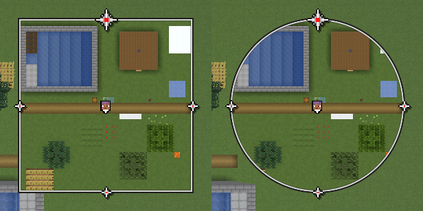
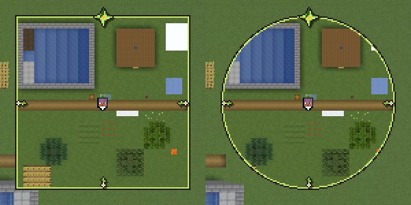
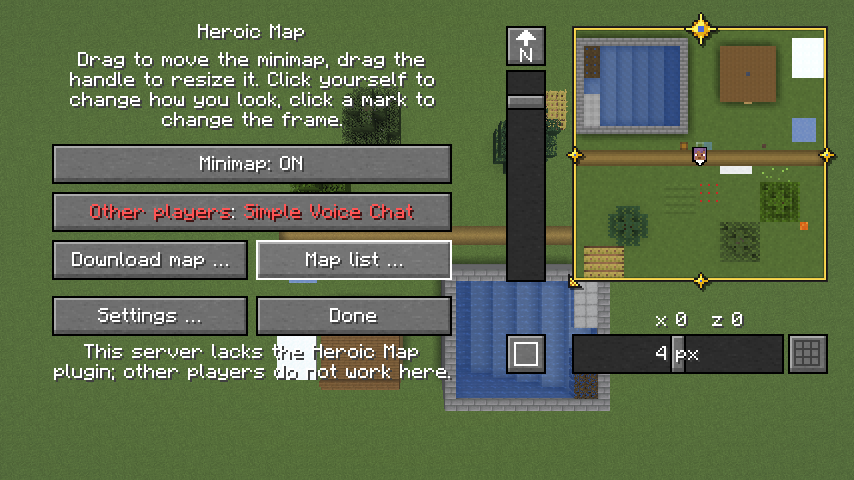
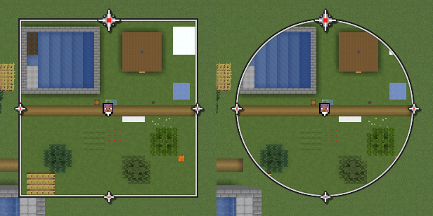
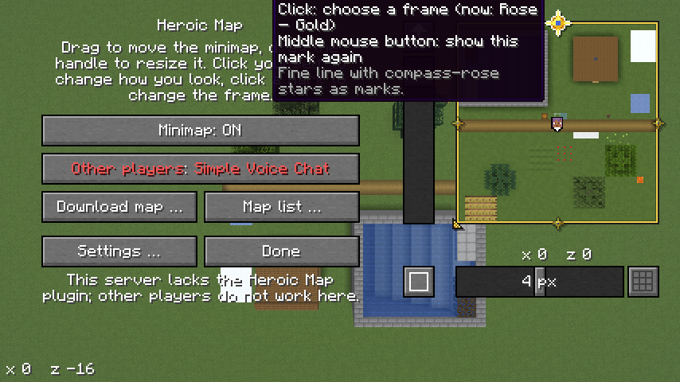
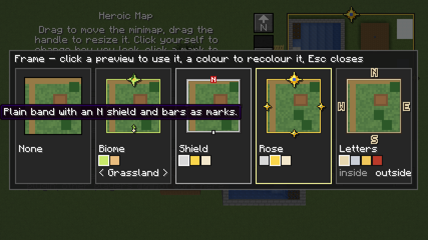
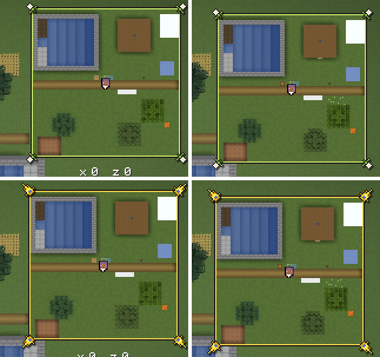
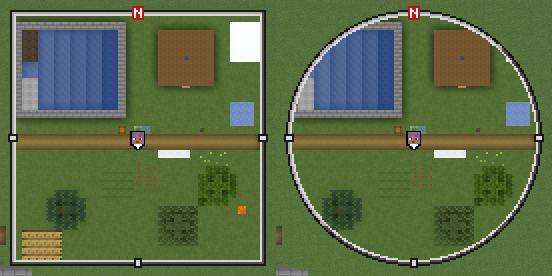
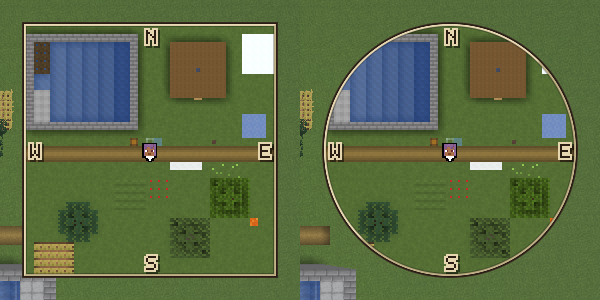
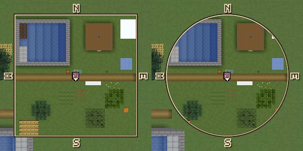

# Rahmen

Um die Minimap kann ein Rahmen liegen, aus dem Satz des Designers: Bänder
in festen Farben und Marken für N, O, S und W. Rahmen gibt es in Familien
mit Varianten, meist andere Farben desselben Rahmens. Gewählt wird im
Wähler, den ein Klick auf eine Marke der Minimap im Menü öffnet; die
Vorgabe ist „biom“, ein Rahmen, der mit dem Biom unter dem Spieler
wechselt. „Ohne“ ist der dünne Umriss wie bisher. Die Vollbildkarte
bekommt keinen Rahmen. Warum so:
[0005](entscheidungen/0005-rahmen-als-skins.md),
[0008](entscheidungen/0008-biom-rahmen-als-vorgabe.md) und
[0032](entscheidungen/0032-rahmen-familien-und-waehler.md).

## Wahl

- **Wo:** ein Klick mit der linken oder rechten Taste auf eine Marke N, O,
  S, W der Minimap im Menü von `/hmap` oder im Untermenü „Einstellungen …“
  öffnet den Wähler, siehe „Wähler“ und [Minimap](minimap.md), „Aussehen an
  der Minimap“. Der Tooltip nennt Familie und Variante. Bis 0.2.68 schaltete
  ein Linksklick zum nächsten Skin, bis 0.2.27 war es der Knopf „Rahmen“ im
  Untermenü.
- **Vorgabe `biom`.** Gespeichert als `rahmen_wahl` in
  `heroicmap.properties`, nur wenn der Spieler den Rahmen selbst gewählt
  hat, auch „ohne“; sonst gilt die Vorgabe, auch wenn sie sich wieder
  ändert. Ein unbekannter Name gilt als nicht gewählt.
- **Die Variante** je Familie als `rahmen_variante.<familie>`, bei „biom“
  je Kategorie `rahmen_variante.biom/<kategorie>`; ohne Eintrag gilt die
  erste aus `varianten.txt` (`Minimap.variante`).
- **„biom“ automatisch oder fest** als `rahmen_biom`, `auto` oder eine
  Kategorie; ohne Eintrag oder mit einem unbekannten Wert automatisch
  (`Minimap.biomFest`), siehe „Biom“.
- **Umzug aus 0.2.68 und älter** (`Skin.ALT`): `rahmen_wahl` oder ein
  altes `rahmen` mit einem Skin von vorher wird Familie und Variante:

  | vorher | Familie | Variante |
  |---|---|---|
  | `grau` | `schild` | `grau` |
  | `holz` | `schild` | `gold` |
  | `papier` | `schild` | `papier` |
  | `kompass` | `rose` | `silber` |
  | `uhr` | `rose` | `gold` |
  | `kartograph` | `rose` | `pergament` |

  Beim nächsten Speichern steht es neu in der Datei.
- **Aus einer älteren Version** stand `rahmen` immer in der Datei. Ein
  Rahmen ausser `ohne` gilt als gewählt, denn die Vorgabe war `ohne`. Ein
  `rahmen=ohne` lässt sich nicht von der alten Vorgabe unterscheiden; dort
  gilt die neue Vorgabe. Wie bei Drehen, siehe [Minimap](minimap.md),
  „Drehen“.
- **Die Gametests** `Bilder` und `Messung` stellen „ohne“ ein, denn ihre
  Bilder und Messreihen zeigen die Minimap ohne Rahmen.

## Familien

Je Familie die Varianten aus `varianten.txt`, die erste ist die Vorgabe
(`Skin.FAMILIEN`, `Skin.MIT_VARIANTEN`, `Skin.varianten`).

| Familie | Varianten | Bänder | Schatten | Stellung, Lage | `norden` | Abstand zum Rand |
|---|---|---|---|---|---|---|
| `biom` | je Kategorie `standard` und 1–2 Recolors, siehe „Biom“ | 2 | ja | aussen, O/S/W `kante`, N `mitte` | 15 × 15 | 11 |
| `schild` | `grau`, `gold`, `papier` | 3, 4, 5 | nein | karte, `mitte` | 6 × 7 | 5 |
| `rose` | `silber`, `gold`, `pergament` | 2 | ja | `silber` aussen, sonst karte; `mitte` | 17 × 17 | 13 |
| `lettern` | `tinte`, `nacht`, `gold`, `rubrik`, je `_innen` und `_aussen` | 2 | ja | aufrecht, `innen` oder `aussen` | 7 × 9 | 11 |

Die Pixelbilder von `schild`, `rose` und `biom/<kategorie>/standard` sind
die der alten Skins, unverändert; die Recolors und `lettern` sind neu.

## Biom

Der Rahmen `biom` zeigt eine von acht Familien, je nach dem Biom unter dem
Spieler (`Biom`, `Minimap.skinJetzt`), in der Variante, die für diese
Kategorie gewählt ist. So hat es der User gewünscht, als Vorgabe. Fest auf
eine Kategorie geht auch, siehe unten.

- **Kategorien:** `waelder`, `grasland`, `gebirge`, `schnee`, `wueste`,
  `tropen`, `feuchtgebiete`, `gewaesser`; je eine Familie
  `rahmen/biom/<kategorie>/` mit `varianten.txt`:

  | Kategorie | Varianten |
  |---|---|
  | `feuchtgebiete` | `standard`, `mangrove` |
  | `gebirge` | `standard`, `sandstein` |
  | `gewaesser` | `standard`, `lagune` |
  | `grasland` | `standard`, `trocken` |
  | `schnee` | `standard`, `polarnacht` |
  | `tropen` | `standard`, `regenwald` |
  | `waelder` | `standard`, `herbst`, `kirschhain` |
  | `wueste` | `standard`, `rotfels` |
- **Automatisch oder fest** (`Minimap.biomFest`,
  [0048](entscheidungen/0048-biom-automatisch-oder-fest.md)): Im Wähler
  wählt „&lt; Automatisch &gt;“ unter der Vorschau, der erste Eintrag und
  die Vorgabe, den Rahmen nach dem Biom; die Pfeile führen weiter durch die
  acht Kategorien. Eine Kategorie dort, mit dem Klick auf die Vorschau
  übernommen, bleibt fest, wo der Spieler auch steht; dann blendet der
  Rahmen nicht über. Der Wähler öffnet mit der Wahl von jetzt.
- **Je Kategorie gewählt:** Die Farbfelder meinen die Kategorie in der
  Reihe darunter, bei „Automatisch“ die unter dem Spieler, die ein Tooltip
  nennt; so lässt sich jede einstellen, ohne hinzulaufen.
- **Zuordnung** in fester Rangfolge, die erste passende Zeile gewinnt
  (`Biom.kategorie`). Je Zeile Tags der Biome und Biome des Spiels mit
  Namen:

  | Kategorie | Tags | Biome |
  |---|---|---|
  | `schnee` | `c:is_snowy`, `c:is_icy`, `c:is_aquatic_icy` | `snowy_plains`, `ice_spikes`, `snowy_taiga`, `snowy_beach`, `snowy_slopes`, `grove`, `frozen_peaks`, `jagged_peaks`, `frozen_river`, `frozen_ocean`, `deep_frozen_ocean` |
  | `feuchtgebiete` | `c:is_swamp` | `swamp`, `mangrove_swamp` |
  | `tropen` | `minecraft:is_jungle` | |
  | `wueste` | `c:is_desert`, `minecraft:is_badlands` | `desert` |
  | `gewaesser` | `minecraft:is_ocean`, `minecraft:is_river`, `minecraft:is_beach` | `mushroom_fields`, `stony_shore` |
  | `waelder` | `minecraft:is_forest`, `minecraft:is_taiga` | `cherry_grove` |
  | `grasland` | `c:is_plains`, `minecraft:is_savanna` | `plains`, `sunflower_plains`, `meadow` |
  | `gebirge` | `minecraft:is_mountain`, `minecraft:is_hill` | |

  Vor allen Zeilen: Nether und End nehmen Grasland, Höhlen behalten die
  letzte Kategorie, siehe unten.
- **Warum Namen neben Tags:** Der Server schickt dem Client die Tags der
  Biome, denn `Registries.BIOME` steht in
  `RegistryDataLoader.SYNCHRONIZED_REGISTRIES` (26.3, per javap): die des
  Spiels und die seiner Datapacks. `c:` gibt es nur mit Fabric API oder
  mit einem Datapack, der sie mitbringt. Für Schnee, Sumpf, Wüste, Ebene
  und Pilze hat das Spiel keinen Tag, darum stehen seine Biome mit Namen
  da.
- **Rangfolge:** Schnee vor Wald, so ist die verschneite Taiga Schnee,
  obwohl sie in `minecraft:is_taiga` liegt. Grasland vor Gebirge, denn
  `minecraft:is_mountain` enthält `meadow` und `cherry_grove`; Wiese ist
  Grasland, der Kirschhain Wald, so schlägt es der Designer vor.
- **Rückfall über den Namen:** Passt keine Zeile, etwa bei Biomen aus
  Datapacks, entscheidet ein Wort im Namen, in derselben Rangfolge: etwa
  `snowy`, `frozen` oder `winter` Schnee, `shrubland` oder `canyon` Wüste,
  `forest` oder `taiga` Wald, `peak` oder `hills` Gebirge (`Biom.WOERTER`).
  Ein Wort ist ein ganzes Stück zwischen `_` oder `/`. Sonst Grasland.
- **Nether und End** (`minecraft:is_nether`, `minecraft:is_end`) nehmen
  Grasland, auch der Wald im Nether.
- **Höhlen** (`c:is_cave`, dazu `dripstone_caves`, `lush_caves`,
  `deep_dark` und `sulfur_caves` mit Namen, `Biom.HOEHLEN`): Der Rahmen
  bleibt bei der letzten Kategorie. „Biom unter dem Spieler“ heisst die
  Landschaft, nicht die Höhle; so hat es der Reviewer entschieden.
- **Noch nicht geladen:** Steht der Spieler in einem Chunk, den der Client
  noch nicht hat, fragt die Minimap nicht (`hasChunkAt`); sonst läse sich
  das Biom als Ebene, und nach einem weiten Teleport spränge der Rahmen
  hin und zurück.
- **Wechsel:** erst, wenn der Spieler 2 s in der neuen Kategorie ist
  (`Biom.WARTEN_MS`); jeder Schritt zurück setzt die Zeit neu, so flackert
  der Rahmen an Grenzen nicht. Die erste Kategorie nach dem Start und nach
  einem Wechsel der Welt oder Dimension gilt sofort (`Minimap.leeren`).
  Dann blendet der Rahmen in 0,3 s über (`Biom.BLENDE_MS`): Die Bänder sind
  in allen acht gleich gebaut, darum liegen die alten zu 1 und die neuen zu
  t darüber; nur die alten Marken blenden zu 1 − t aus. So sinkt die
  Deckung der Bänder nie.
- **Abstand zum Rand:** der grösste aller Kategorien und ihrer Varianten,
  11 Einheiten, denn `norden` ist in allen 15 × 15 Pixel gross
  (`Minimap.rand`). So springt die Minimap beim
  Wechsel nicht; ebenso die Koordinaten darunter.
- **Kosten:** Das Biom unter dem Spieler liest die Minimap je Frame; die
  Kategorie rechnet sie nur neu, wenn sich das Biom ändert. Während der
  Überblendung zeichnet sie zwei Rahmen, siehe „Kosten“.

## Dateien

Je Familie ein Ordner `assets/heroicmap/textures/gui/sprites/rahmen/<familie>/`
mit `varianten.txt` und je Variante einem Unterordner, im Atlas des GUI;
F3+T und Ressourcenpakete laden ihn neu. Bei „biom“ je Kategorie
`rahmen/biom/<kategorie>/`.

- **`varianten.txt`:** eine Variante je Zeile, die erste die Vorgabe, `//`
  beginnt einen Kommentar: `<name> [ordner=<unterordner>] [schalter=wert …]`.
  Ohne `ordner` heisst der Unterordner wie die Variante; die Schalter
  überschreiben `info.txt` des Ordners, so teilen sich `tinte_innen` und
  `tinte_aussen` einen Ordner. Namen nur aus a–z, 0–9 und _, sonst lädt die
  Familie nicht (`Skin.liesVarianten`).
- **`griff.png`, `griff_aktiv.png`:** der Griff, 7 × 7, gezeichnet für
  unten rechts.
- **`norden.png`, `marke.png`, `marke_quer.png`,** je mit `_aktiv`: die
  Marken, siehe „Marken“. **`osten.png`, `sueden.png`, `westen.png`,** je
  mit `_aktiv`: eigene Bilder je Richtung, etwa die Buchstaben von
  „lettern“; gibt es sie, nimmt der Mod sie bei `drehung=aufrecht` statt
  `marke` und `marke_quer`.
- **`tafel.png`** bei `schild` und `rose`: der Grund der Infotafel auf der
  Vollbildkarte in dieser Variante (`Karte.tafelSkin`), sonst der von
  `rahmen/ohne/`.
- **`palette.txt`:** eine Zeile je Band, von aussen nach innen, eine Farbe
  `#RRGGBB` oder zwei, Licht und Schatten; `//` beginnt einen Kommentar
  (`Skin.lies`). Der Atlas nimmt nur PNG, die Textdatei liegt daneben.
  Mindestens zwei Bänder, siehe [Minimap](minimap.md), „Form“.
- **`info.txt`:** je Zeile ein Schlüssel; die letzte Zeile je Schlüssel
  gilt, so überschreibt eine Zeile aus `varianten.txt` (`Skin.lies`):

  | Schlüssel | Werte | Vorgabe |
  |---|---|---|
  | `schatten` | `ja`, `nein`: Marken und Griff mit Schatten | `nein` |
  | `drehung` | `karte`, `aussen`, `aufrecht`, siehe „Drehen“ und „Nach aussen“; ein altes `aussen=ja` heisst `aussen` | `karte` |
  | `lage` | `mitte`, `kante`, `innen`, `aussen`, siehe „Lage“ | `mitte` |
  | `lage_norden` | wie `lage`, nur für N | wie `lage` |

  `kante` nur mit `drehung=aussen`, `innen` und `aussen` nur mit
  `drehung=aufrecht`; ein anderer Wert lässt die Variante nicht laden.
- **Namen und Beschreibungen** stehen in `de_de.json` und `en_us.json`
  unter `heroicmap.rahmen.<familie>` und `.beschreibung`, je Variante
  `heroicmap.rahmen.<familie>.<variante>`, bei „biom“
  `heroicmap.rahmen.biom.<kategorie>` und `.<variante>`.
- **Ein neuer Rahmen** ist ein Ordner mit `varianten.txt`, ein Eintrag in
  `Skin.FAMILIEN` und `Skin.MIT_VARIANTEN` und die Namen je Sprache; eine
  neue Variante nur ein Unterordner, eine Zeile und ihr Name.
- **Geladen** einmal je Variante, auch ein Fehlschlag bleibt gemerkt, bis
  der Atlas neu lädt (`Skin.von`); sonst stünde je Frame eine Warnung im
  Log. Ebenso `varianten.txt` je Familie.
- **HD-Bilder** `<bild>_hd.png` und `<bild>_hd_aktiv.png` je Bild der
  Marken und des Griffs, 4 Texel je Einheit, ausserhalb des Atlas unter
  `assets/heroicmap/textures/rahmen/<familie>/<ordner>/`, siehe „HD“.
- **Quellen** unter `docs/bilder/quellen/rahmen/<familie>/<variante>.aseprite`,
  die HD-Bilder in `<variante>_hd.aseprite`, eine Ebene je Bild, vom
  Designer; dazu `tafel.aseprite`.

## Bänder

Die Bänder rechnet der Mod aus `palette.txt` nach der Formel des
Designers, mit weichem Übergang, Fase und Schatten; Bilder gibt es dafür
nicht. Warum so:
[0034](entscheidungen/0034-band-nach-der-formel.md).

- **Masse:** Die Formel rechnet in Texeln, 4 je Einheit des GUI
  (`Skin.D`). Ein Band ist 4 Texel breit, n Bänder sind B = 4n. Gezeichnet
  wird in Pixeln des Schirms, k je Einheit, k der GUI-Massstab: Ein Pixel
  ist p = 4/k Texel, es zählt seine Mitte. So bleibt das Band auch bei
  GUI-Massstab 3 gleichmässig.
- **Abstand v** der Pixelmitte vom Aussenrand, S die Seite in Texeln:
  eckig `min(x, y, S − x, S − y)`, rund `S/2 − √(dx² + dy²)` mit dx, dy ab
  der Mitte.
- **Licht L** von 0 (Schatten) bis 1, mit `glatt(t) = t² · (3 − 2t)` und t
  auf [0, 1] begrenzt:
  - eckig `glatt(0,5 + (min(S − x, S − y) − min(x, y)) / 3)`: oben und
    links Licht, die Grenze auf der Diagonale der Ecke, weich über etwa 3
    Texel;
  - rund `glatt(0,5 − (dx + dy) / 12)`: oben links Licht, die Grenze bei
    45°, weich über etwa 12 Texel.
- **Farbe** (`Skin.bandFarbe`), je Band i mit `lo = 4i` und
  `hi = 4(i + 1)`; das äusserste hat kein lo, das innerste kein hi:
  - Gewicht `glatt((v − lo) / 1,6 + 0,5) · glatt((hi − v) / 1,6 + 0,5)`,
    der Übergang zwischen zwei Bändern über 1,6 Texel;
  - Grundfarbe `Schatten + (Licht − Schatten) · L`, bei einer Farbe je
    Zeile dieselbe;
  - Fase `f = 0,10 · (1 − 2t)` mit `t = (v − lo) / 4` auf [0, 1]: aussen
    bis 10 % heller, `c + (255 − c) · f`, innen bis 10 % dunkler,
    `c · (1 + f)`;
  - gemischt nach den Gewichten.
- **Deckung** `clamp(v/p + 0,5) · clamp((B − v)/p + 0,5)`
  (`Skin.deckung`): Die Aussenkante ist über einen Pixel weich, rund also
  geglättet; eckig liegt sie auf ganzen Pixeln.
- **Schatten auf die Karte:** Schwarz zu `0,38 · clamp(1 − (v − B) / 3)`
  für v > B − p/2: 38 % am inneren Rand, nach 3 Texeln, einer
  Dreiviertel-Einheit, nichts. Die Bänder liegen darüber.
- **Gezeichnet** nach Karte und Linien (`Skin.baender`):
  - rund als Ring, eine Textur mit (s · k)² Pixeln für die Seite s
    (`Skin.ringFarbe`);
  - eckig aus der Textur der Ecken, einem Quadrat der Seite 2c + 1
    Einheiten mit c = n + 2: die vier Ecken c × c, dazwischen die
    mittlere Einheit gestreckt (`Skin.stuecke`, `Skin.eckigFarbe`). Bis c
    Einheiten vom Rand hängt die Farbe nur vom Abstand zur nächsten Kante
    ab; darum ist das genau so, wie die Formel für die ganze Seite rechnet
    (`SkinTest.eckigAusStueckenGenau`).
- **Die Karte rund** reicht als Vieleck unter den Ring, siehe
  [Minimap](minimap.md), „Form“. Sichtbar endet sie so genau am Ring, auch
  die Chunklinien.
- **Breite** n Einheiten, sie wächst mit dem GUI-Massstab; dazu der
  Schatten eine Dreiviertel-Einheit auf der Karte.
- **Bis 0.2.68** war jedes Band eine Einheit in einer Farbe, eckig vier
  Rechtecke je Band, rund ein Ring mit einem Texel je Einheit.

## Griff

- **Im Menü** (`/hmap`) steht an der Ecke zur Mitte des Schirms
  (`Minimap.griffEcke`) der Griff, auf der Mitte der Bänder, eckig in der
  Ecke, rund bei 45° (`Skin.ecken`), unter der Maus oder beim Ziehen als
  `griff_aktiv`; greifen lässt er sich 9 × 9 Einheiten um seine Mitte
  (`Minimap.imGriff`). Er steht immer fest, auch mit dem Schalter
  „Verzierungen“ aus, und liegt zuoberst. Der weisse Umriss
  entfällt mit Rahmen; ohne Rahmen bleiben Umriss und weisser Griff wie
  bisher.
- **Gespiegelt** für die anderen Ecken, gezeichnet ist er für unten rechts
  (`Skin.spiegeltX`, `Skin.spiegeltY`): über vertauschte Koordinaten im
  Atlas, u0 > u1 oder v0 > v1. Die Ecken des Quads bleiben in derselben
  Reihenfolge, das GUI verwirft es nicht; über die Pose gespiegelt verwürfe
  es die Rückseite. Beides belegt per javap: `BlitRenderState.buildVertices`
  setzt die Ecken nur aus x und y, `RenderPipeline.Builder.build` gibt
  `cull` mit `true` vor. Gezeichnet über `GuiGraphicsExtractor.innerBlit`,
  per Access Widener offen, denn nur dort gehen Koordinaten im Atlas und
  eine Farbe zusammen.
- **Schatten** bei `schatten=ja`, für Griff und Marken: erst das Bild in
  Schwarz zu 50 % um (+1, +1) versetzt, dann das Bild. Die PNG haben nur
  Alpha 0 oder 255.

## Marken

Der Rahmen zeigt die Himmelsrichtungen als Marken, genordet wie gedreht;
Ornamente in den Ecken gibt es nicht. So hat es der User am 10.10.
entschieden, siehe [0012](entscheidungen/0012-marken-statt-verzierungen.md).
Ohne Rahmen gibt es keine, die Bilder gehören zur Variante; nur im Menü
stehen dann die von `schild/grau`, siehe „Im Menü“.

- **Wo:** von der Mitte der Minimap in die Himmelsrichtung, nach ihrer Lage,
  siehe „Lage“: auf der Mitte der Bänder, an ihrer Kante, in der Karte oder
  ausserhalb; rund am Kreis, eckig am Quadrat (`Skin.marke`,
  `Minimap.ornamente`). Genordet stehen sie fest oben, rechts, unten und
  links, die linke obere Ecke bei `⌊p − w / 2 + 0,5⌋` (`Skin.lage`);
  gedreht wandern sie am Rahmen entlang, siehe „Drehen“.
- **Bild:** fest je Richtung, N `norden`, S `marke`, O und W `marke_quer`
  (`Skin.MARKE_JE_RICHTUNG`); mit `drehung=aussen` O, S und W `marke`, siehe
  „Nach aussen“; mit `drehung=aufrecht` und eigenen Bildern `osten`,
  `sueden`, `westen` (`Skin.EIGENE_JE_RICHTUNG`). Im Menü unter der Maus
  `_aktiv`.
- **Reihenfolge:** Bänder, die Marken, `norden` zuletzt, im Menü darüber
  der Griff.

## Drehen

Dreht die Minimap, siehe [Minimap](minimap.md), „Drehen“, wandern die
Marken mit der Karte; nichts steht fest ausser dem Griff im Menü. So hat es
der User gewünscht, siehe
[0012](entscheidungen/0012-marken-statt-verzierungen.md). Wie ihr Bild
steht, sagt `drehung` (`Skin.Stellung`): `karte` starr mit der Karte,
`aussen` von der Mitte weg, siehe „Nach aussen“, `aufrecht` immer
aufrecht, nur der Platz wandert, so bleiben die Buchstaben von „lettern“
lesbar.

- **Lage:** in ihrer Himmelsrichtung im Kartenbild, gedreht wie die Karte,
  nach ihrer Lage; rund am Kreis, eckig am Quadrat, das selbst achsparallel
  bleibt (`Minimap.verzierung`, `Skin.marke`).
- **Bild:** um seine Mitte um denselben Winkel gedreht, über die Pose
  (`Skin.ornament`), bei `aufrecht` nicht. Der Schatten bleibt auf dem
  Schirm um (+1, +1).
- **Pixel:** Die Mitte liegt auf ganzen Pixeln des Schirms, sonst zitterte
  sie beim Laufen. Gedreht ist die Pixelkunst nicht pixelgenau: Das Spiel
  rastert sie mit Nearest, die Kanten werden treppig, und beim Drehen
  flimmern Texel am Rand, wie bei der gedrehten Karte. Ungedreht liegt
  alles auf ganzen Einheiten wie bisher.

## Nach aussen

Bei `drehung=aussen`, „rose“ in „silber“ und allen Kategorien von „biom“,
zeigt das Bild jeder Marke von der Mitte der Minimap weg, genordet wie
gedreht; sonst zeigten alle gleich nach Norden, mit Blick nach Süden etwa
alle nach unten. So hat es der User am 15.10. gewünscht, siehe
[0022](entscheidungen/0022-marken-nach-aussen.md).

- **Bild:** N `norden` wie bisher; O, S und W nehmen `marke`, gezeichnet
  für oben, und drehen es um 90°, 180° und 270° weiter
  (`Minimap.ornamente`). `marke_quer` bleibt bei diesen Varianten
  ungenutzt.
- **Pixel:** Um ganze Vierteldrehungen gedreht liegt der Kasten des Bildes
  mit vertauschten Seiten auf ganzen Einheiten wie ungedreht
  (`Skin.blit`); genordet bleibt die Pixelkunst so scharf.
- **Starr** mit der Karte bleiben `schild` und „rose“ in „gold“ und
  „pergament“: ihr `norden` ist ein Buchstabe oder Stern für oben, `marke`
  und `marke_quer` sind für ihre Seite gezeichnet.

## Lage

Wo eine Marke liegt, sagt `lage`, für N `lage_norden` (`Skin.Lage`,
`Skin.Platz`); die Rechnung ist `Skin.marke`.

| Lage | wo | bei |
|---|---|---|
| `mitte` | die Mitte des Bilds auf der Mitte der Bänder | `schild`, `rose`, N von `biom` |
| `kante` | auf den Bändern, Bild und Schatten innen an der äusseren Kante | O, S, W von `biom` |
| `innen` | ganz in der Karte, eine Einheit innerhalb der Bänder | `lettern` `_innen` |
| `aussen` | ganz ausserhalb, eine Einheit ausserhalb der Minimap | `lettern` `_aussen` |

- **`kante`** (`Skin.anliegend`), so hat es der User am 23.10. für „biom“
  gewählt, aus zwei Entwürfen: aussen bündig statt kleiner im Band, denn
  ganz im Band von 2 Einheiten wäre eine Marke ein Punkt (mod#189).
  Ungedreht schliessen O und S mit ihrem Schatten an der Kante ab, eine
  Einheit weiter innen als das Bild allein, W mit dem Bild; rund berühren
  die äussersten Ecken den Kreis. Gedreht zählt der Kasten des gedrehten
  Bilds: eckig an beiden Seiten, die es erreichen kann, rund jede Ecke. Nach
  innen reicht die Marke über die Bänder in die Karte. Die Lage hiess beim
  Designer zuerst `innen`; so hat es der Reviewer am 24.10. getrennt, siehe
  [0032](entscheidungen/0032-rahmen-familien-und-waehler.md).
- **`innen`** (`Skin.innen`): Das aufrechte Bild berührt von innen die Linie
  eine Einheit innerhalb der Bänder, eckig das Quadrat, rund mit seiner
  weitesten Ecke den Kreis; genordet die Formel des Designers, Mitte bei
  K/2 − n − 1 − a/2.
- **`aussen`** (`Skin.aussen`): Das aufrechte Bild berührt von aussen die
  Linie eine Einheit ausserhalb der Minimap, eckig mit einer Seite, rund mit
  seinem nächsten Punkt; genordet die Mitte bei K/2 + 1 + a/2.
- **Pixel:** Gedreht liegt die Mitte auf ganzen Pixeln des Schirms; das
  kann sie um einen halben Pixel verschieben.
- **Der Klick im Menü** trifft die Marke dort, wo sie liegt, siehe „Im
  Menü“.

## Verzierungen

Jede Marke N, O, S, W steht für sich in Pixeln, in HD oder durchsichtig.
Für sich an oder durchsichtig hat es der User am 20.10. gewählt (mod#175),
HD kam mit dem Satz des Designers dazu, siehe „HD“. Einen Schalter im
Untermenü gibt es dafür nicht mehr.

- **Die mittlere Maustaste** im Menü auf eine Marke, ohne zu ziehen,
  schaltet nur sie reihum: Pixel, HD, durchsichtig, wieder Pixel
  (`Minimap.schalteVerzierung`). Der Tooltip nennt, was gerade gilt. Bis
  0.2.68 machte der Rechtsklick sie durchsichtig und zurück; den braucht
  jetzt der Wähler, siehe
  [0032](entscheidungen/0032-rahmen-familien-und-waehler.md). Ziehen heisst
  wie beim Linksklick: Die Maus wandert mehr als 3 Einheiten
  (`MinimapKlick.WEG`).
- **Links- und Rechtsklick** auf eine Marke öffnen den Wähler, siehe
  „Wähler“. Der Tooltip nennt beides.
- **Durchsichtig** heisst: im Spiel nicht gezeichnet, im Menü halb, siehe
  „Im Menü“. Der Rahmen zeigt dort nur seine Bänder oder den Ring, gedreht
  wie ungedreht. Griff und Abstand zum Rand bleiben.
- **Gespeichert** als `verzierungen_aus` in `heroicmap.properties`, die
  Buchstaben der durchsichtigen Marken, etwa `N,S`; leer heisst alle an,
  die Vorgabe. Eine Datei von vorher hat `verzierungen=false`; das heisst
  alle vier durchsichtig, so springt nichts (`Minimap.marken`). Die
  Marken in HD stehen ebenso in `verzierungen_hd`; eine durchsichtige ist
  nie zugleich HD.
- Nur die vier Marken, nicht die Ecken, so hat es der Reviewer entschieden;
  in den Ecken zeichnet der Rahmen ohnehin nichts ausser dem Griff.

## HD

Jede Marke kann statt der Pixelfassung eine feinere zeigen, mit 4 Texeln je
Einheit (`Skin.D`), vom Designer gezeichnet. Warum so:
[0036](entscheidungen/0036-hd-marken-ausserhalb-des-atlas.md).

- **Wahl** je Marke mit der mittleren Taste, siehe „Verzierungen“. Der
  Griff im Menü steht in HD, sobald eine Marke HD zeigt; eine eigene Wahl
  hat er nicht.
- **Gezeichnet** ab GUI-Massstab 2 aus einer eigenen kleinen Textur mit k
  Pixeln je Einheit: das HD-Bild nach Fläche gemittelt, mit
  vormultipliziertem Alpha, so bleibt am Rand kein dunkler Saum
  (`Skin.verkleinere`). Bei 2 sind es je 2 × 2 Texel, bei 3 nach Fläche
  4 : 3, bei 4 das Bild unverändert, darüber vergrössert. Bei
  GUI-Massstab 1 zeichnet der Mod die Pixelfassung; HD wäre dort Brei.
- **Geladen** beim ersten Zeichnen, nur für die gezeigte Variante und den
  Massstab, in der Liste der Texturen der Bänder: Was 2 s nicht gezeichnet
  wurde, fällt mit der nächsten neuen (`Skin.hd`, `Skin.textur`). Fehlt ein
  HD-Bild oder hat es nicht genau die 4-fache Grösse der Pixelfassung,
  zeichnet der Teil seine Pixelfassung, bis der Atlas neu lädt.
- **Nicht im Atlas des GUI:** Die HD-Bilder liegen unter
  `textures/rahmen/`, nicht unter `textures/gui/sprites/`, siehe „Dateien“.
  Im Atlas brauchten sie dauerhaft 1,35 MiB.
- **Schatten** wie bei der Pixelfassung: das Bild schwarz zu 50 % um
  (+1, +1) Einheiten.
- **Im Wähler** zeigen die Vorschauen die Marken so, wie sie je Marke
  gestellt sind: durchsichtige fehlen, die in HD stehen in HD.

## Im Menü

Ein Klick auf eine Marke öffnet den Wähler, siehe „Wähler“ und
[Minimap](minimap.md), „Aussehen an der Minimap“. Damit es immer eine gibt:

- **Halbe Marken:** Durchsichtige Marken, siehe „Verzierungen“, und bei
  „ohne“ alle vier zeichnet das Menü zu 50 % deckend, nur dort, nicht im
  HUD sonst (`Minimap.geister`). So trifft die mittlere Taste sie zum
  Zurückholen. Mit Rahmen dessen Marken an ihrem Ort, bei „ohne“ die von
  `schild/grau` auf der Mitte des Umrisses, 1,5 Einheiten ausserhalb der
  Karte.
- **Genordet:** Im Menü dreht die Minimap nicht, auch mit Drehen an, siehe
  [Minimap](minimap.md), „Drehen“; sonst wanderten die Marken über den
  Griff.
- **Über dem Umriss:** Das Menü zeichnet die halben Marken zuletzt, nach dem
  weissen Umriss, der sonst durch sie liefe.
- **Unter der Maus** nimmt die Marke ihr Bild `_aktiv`, die halbe dazu ganz
  deckend.
- **Am Rand des Schirms** kann bei „ohne“ eine halbe Marke um bis zu eine
  Einheit angeschnitten sein: Der Abstand zum Rand ist dort 4 Einheiten,
  siehe „Abstand zum Rand“, und gilt nur für das HUD.

## Wähler

Ein Klick mit der linken oder rechten Taste auf eine Marke öffnet über dem
Menü oder Untermenü eine Tafel mit einer Vorschau je Familie (`Waehler`).
So hat es der User am 23.10. gewünscht, statt durch die Rahmen zu
schalten, siehe [0032](entscheidungen/0032-rahmen-familien-und-waehler.md).

- **Vorschau:** je Familie eine Minimap von 56 Einheiten mit ihrem Rahmen,
  gezeichnet mit denselben Routinen wie die Minimap, Bänder oder Ring und
  die Marken genordet, eckig oder rund wie die Minimap; auf einer festen
  Beispielkarte aus der Testwelt (`waehler_karte.png`, rund
  `waehler_karte_rund.png`, je 56 × 56). „Ohne“ zeigt nur die Karte.
- **Farbfelder** unter dem Namen, eines je Ordner der Varianten, in der
  Farbe des innersten Bands; das der Vorschau weiss umrandet, der Tooltip
  nennt die Variante. Ein Klick färbt nur die Vorschau um.
- **`lettern`** dazu „innen | aussen“: wählt in derselben Farbe die
  Variante mit dieser Lage.
- **`biom`** dazu „&lt; Automatisch &gt;“ und „&lt; Kategorie &gt;“: wählt
  automatisch oder eine feste Kategorie, siehe „Biom“; die Vorschau zeigt
  deren Rahmen, die Felder stellen deren Variante.
- **Übernehmen:** Ein Klick auf eine Vorschau setzt Familie und Variante
  und schliesst; gespeichert wird beim Schliessen des Menüs wie sonst.
- **Schliessen ohne Änderung:** Esc oder ein Klick neben die Tafel. Esc
  schliesst nur den Wähler, nicht das Menü.
- **Offen** nimmt er alle Klicks, Tasten und das Mausrad; das Menü darunter
  zeigt dann keinen Hover und keinen Tooltip. Die gewählte Familie ist gelb
  umrandet.
- **Grösse:** 5 Karten zu 76 Einheiten, die Tafel rund 408 × 140; sie passt
  bei GUI-Massstab 4 auf 427 × 240.

## Abstand zum Rand

Die Minimap hält 4 Einheiten Abstand zum Rand des Schirms, mit Rahmen
mindestens die halbe Diagonale der grössten Marke, aufgerundet
(`Minimap.rand`, `Skin.einrueckung`), siehe die Tabelle unter „Familien“:
bei `rose` 13, bei `biom` 11. So bleibt jede Marke in jeder Drehung ganz
auf dem Schirm, auch ihr Schatten, denn ihre Mitte liegt auf der Mitte der
Bänder oder weiter innen. Liegen Marken aussen, wie bei `lettern`, so weit,
wie sie samt Schatten in irgendeiner Drehung über die Minimap reichen,
eckig wie rund: bei `lettern` 11, wie beim Designer. Je Familie gilt der
grösste über alle Varianten, bei `biom` über alle Kategorien. Das gilt
immer, auch ungedreht und mit dem Schalter
„Verzierungen“ aus; so springt die Minimap beim Umschalten nicht, siehe
[0012](entscheidungen/0012-marken-statt-verzierungen.md). Vorher war es die
halbe zier, bei `uhr` 8, bei `biom` 6.

Der schwarze Umriss entfällt mit Rahmen.

## Kosten

Gemessen am 10.10. mit „kompass“, heute `rose` in `silber`, 4 px und Zoom 4, siehe
[Minimap, Verzierungen drehen mit](messungen/2026-10-10-minimap-verzierungen.md):
das HUD-Element im Median eckig 0,016 bis 0,021 ms, rund 0,025 bis
0,033 ms, gedreht wie ungedreht. Gemessen ist das noch mit zier, je Frame
8 Bilder gedreht und 4 ungedreht; ohne zier sind es 4 und 4, die Zahlen
sind also eine obere Schranke. Ohne Rahmen sind es eckig 0,002 bis 0,003 ms, siehe
[Minimap](minimap.md), „Kosten“. Gemessen ist das mit den Bändern bis 0.2.68, eckig als Rechtecke.

Geschätzt, nicht gemessen:

- **Eckig** je Frame 8 Stücke aus einer Textur. Die Textur der Ecken
  rechnet der Mod einmal je GUI-Massstab: bei 5 Bändern und GUI-Massstab
  4 sind es 60 × 60 Pixel, 14 KiB.
- **Marken** je Frame 4 Bilder, mit Schatten 8, gedreht je eines mit einer
  gedrehten Pose; die Minimap rechnet ihre 4 Punkte je Frame
  (`Minimap.ornamente`), im Menü dazu den Griff.
- **Rund** je Frame ein Bild für den Ring. Den Ring rechnet der Mod
  einmal je Seite und GUI-Massstab, eine Wurzel und die Formel je Pixel:
  bei 256 Einheiten und GUI-Massstab 4 sind es 1024 × 1024 Pixel, 4 MiB im
  Arbeitsspeicher und so viel auf der Grafikkarte, bis 0.2.68 waren es
  256 KiB. Für die Vorschau im Wähler 56 Einheiten, bei GUI-Massstab 4
  196 KiB.
- **Im Speicher** bleibt nur, was zu sehen ist: Alle Texturen der Bänder
  liegen in einer Liste, und eine neue gibt alle frei, die 2 s nicht
  gezeichnet wurden (`Skin.textur`). Im Spiel ist es meist ein Ring, beim
  Überblenden zwei, mit dem Wähler dazu die Vorschauen. Bis 0.2.68 behielt
  jede Variante zwei Ringe, mit `biom` bis 8 Kategorien.
- **Überblendung:** 0,3 s lang zwei Rahmen je Frame.
- **Abstand zum Rand:** je Frame das Grösste über die Varianten der
  Familie, bei `biom` über alle Kategorien und ihre Varianten, rund 20
  Nachschlagen in Tabellen; den Abstand je Variante rechnet der Mod einmal
  beim Laden, bei `lage=aussen` über 360 Drehungen eckig und rund.
- **HD:** je Teil und GUI-Massstab eine Textur, nur für die gezeigte
  Variante, bei GUI-Massstab 4 für den Griff 28 × 28 Pixel, 3 KiB; die
  Mittelung einmal beim Laden. Im Jar 224 HD-Bilder, 569 KiB.
- **Wähler:** offen je Frame 4 Vorschauen mit Bändern oder Ring und je 4
  Marken, dazu die Farbfelder; geschlossen nichts.

## Bilder

Der Gametest `Bilder` nimmt jede Familie in ihrer ersten Variante eckig und
rund bei 4 px auf, `rahmen-<familie>.png`, dazu `lettern` aussen
(`rahmen-lettern-aussen.png`), `rose` mit allen Marken in HD
(`rahmen-rose-hd.png`), das Menü mit `rose` in `gold`, mit
Verzierungen aus und der Maus auf N (`rahmen-menue-halb.png`) und mit dem
offenen Wähler (`rahmen-waehler.png`), siehe [Minimap](minimap.md),
„Bilder“. Diese Bilder stammen aus einem Lauf des Gametests in der CI mit
`-Pbilder`. `rahmen-abstand.png` setzt die Bildschirmfotos `rahmen-biom-0`
und `rahmen-uhr-0` dieses Gametests zusammen, aus einem Lauf auf main
`49e4f3c` und einem mit 0012, je die rechte obere Ecke; es zeigt noch die
alten Namen.

