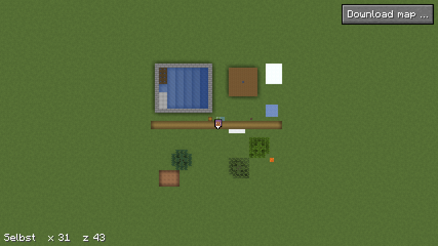

# Selbst gezeichnete Karte

Mit der Wahl „Selbst“ zeichnet der Mod die Karte einer Dimension selbst:
jeden Chunk, den der Spieler lädt, mit dem Maler der [Minimap](minimap.md),
1, 2 oder 4 Pixel je Block, in Kacheln auf der Platte, auf einem Server wie
im Einzelspieler. Die
[Vollbildkarte](vollbildkarte.md) zeigt dann auf diesem Server diese Karte,
nie gemischt mit der des Servers. Warum: [0004](entscheidungen/0004-karte-selbst-zeichnen.md),
[0014](entscheidungen/0014-eigene-karte-mit-massstab.md),
[0015](entscheidungen/0015-ordner-fuer-einzelspielerwelten.md) und, je
Server, [0029](entscheidungen/0029-was-ein-server-zeigt-gilt-je-server.md).

## Wahl

- **Wo:** im Fenster „Karten dieses Servers“ (Knopf „Karte laden …“)
  steht oben „Selbst zeichnen: `<dimension>`“ mit dem Umschalter
  „Massstab“ und dem Knopf „Selbst“, darunter die Massstäbe des Servers.
  Ein Klick fragt erst im Dialog nach, der den Massstab nennt. Danach
  heisst der Knopf „Selbst · an · `<n>` px“ und ist aus. Kam das Fenster von
  der Vollbildkarte, öffnet „Zurück“ sie neu, mit der eigenen Karte.
- **Wann:** auf einem Server, auch ohne Plugin, und im Einzelspieler, mit
  dem Ordner der Welt aus [Download](download.md), „Ablage“; nicht unter
  einer Decke (`DimensionType.hasCeiling`), sonst fehlt die Zeile
  (`Selbst.moeglich`).
- **Was:** Die Wahl legt `heroicmap/<welt>/selbst-<dimension>-<crc>/` an,
  siehe [Download](download.md), „Ablage“, für den Server, auf dem der
  Spieler ist, mit `satz.json` (Name „Selbst“, Massstab wie gewählt, mit
  Namen des Servers `server`), `<massstab>/map.json` (`tileSize` 256, `minZoom` 0,
  `maxZoom` 8, `scale` 4, `downscale` `"nearest"`, für jeden Massstab
  gleich, siehe „Pyramide“) und der Marke
  `selbst.txt` (`Selbst.anlegen`), und `zeigt.txt` merkt, dass dieser
  Server sie zeigt. Danach zeichnet der Mod gleich alle geladenen Chunks.
- **Name:** Andere Zeichen der Kennung als `a`–`z`, `0`–`9`, `_` und `-`
  werden `_`, gekürzt auf 47 Zeichen; dazu 8 Stellen hex aus CRC32 der
  Kennung, auf einem Server mit Namen über Namen und Kennung
  (`Selbst.baum`). So ergeben `mod:a/b` und `mod:a_b` zwei Bäume, main und
  build ebenso. Ohne Namen, also im Einzelspieler, auf einem Server ohne
  Plugin und für jeden Baum von vor 0.2.69, nur aus der Kennung.
  „An“ ist eine Dimension nur, wenn auch `satz.json` ihre Kennung nennt
  (`Selbst.an`).
- **Kein Baum vom Server:** Einen Baum, dessen Name mit `selbst-` beginnt,
  lädt der Mod nie vom Server (`Freigabe.baum`); sonst mischten sich beide
  in einem Ordner. Selbst gezeichnet ist ein Baum nur mit Präfix und Marke
  (`Selbst.selbst`).
- **Welcher Server:** sein Name aus `backend` an der Antwort auf `show`,
  ab Plugin 0.17.2 (`Downloads.wer`), sonst einer ohne Namen, Schlüssel `-`
  (`Zeigt.OHNE`); im Einzelspieler immer ohne. Bis die erste Antwort der
  Sitzung da ist, oder 3 s nach dem Login ohne den Kanal von Heroic Map
  (`Downloads.OHNE_KANAL_MS`), zeichnet „Selbst“ nicht
  (`Downloads.serverFest`); sonst landete der erste Chunk vielleicht in der
  Karte eines anderen Servers.
- **Was ein Server zeigt,** je Dimension (`Satz.fuer`):
  1. seine Wahl in `zeigt.txt` im Ordner der Welt, siehe
     [Download](download.md), „Ablage“;
  2. ohne Wahl, mit Namen: der erste Download nach dem Namen, dann einer im
     Ziel seines Zeigers, siehe [Download](download.md), „Ablage“, dann
     seine eigene Karte; ohne Namen wie bis 0.2.68 die eigene vor dem
     Download, dann der im Ziel.

  Die eigene Karte eines anderen Servers zeigt er nie, auch nicht mit einer
  Wahl. Gezeichnet wird nur in die eigene Karte dieses Servers, und nur,
  solange er sie zeigt. Downloads vom Server gehen weiter in ihre eigenen
  Bäume; einer kann auf main an sein und auf build ruhen.
- **Die Frage** (`AlteKarte`): Zeigt dieser Server für die Dimension einen
  Download, fragt der Mod bei „Selbst“ statt des einfachen Dialogs:
  - er nennt Name, Herkunft, Massstab und Grösse der alten Karte, bei
    geteiltem Ordner auch, wem der Download noch gehört, etwa main, wenn
    build mit `karte.von` die Karte von main zeigt;
  - „Löschen“, bei geteiltem Ordner „Löschen, auch für main“: erst, wenn
    kein Download in den Baum wartet oder läuft (`Downloads.halte`), wie in
    der Kartenliste; danach legt der Mod die eigene Karte an;
  - „Behalten, ruht auf build“: Der Download ruht auf diesem Server und
    bleibt auf der Platte;
  - „Abbrechen“ und Esc ändern nichts, auch keine Datei.

  Drei Knöpfe wie beim Öffnen einer alten Welt in Vanilla. Ebenso fragt der
  Mod vor dem ersten vollen Download, wenn dieser Server seine eigene Karte
  zeigt, siehe [Download](download.md), „Ablage“.
- **Die Zeile „Server“** im Fenster „Karten dieses Servers“ unter dem Titel:
  grün „Server: build · erkannt“ mit Namen, gelb „wartet auf Antwort“, grau
  „Server ohne Namen“ bei einem Plugin ohne `backend` oder „Server ohne
  Heroic Map“; im Einzelspieler keine (`Auswahl.server`). Der Tooltip bei
  „Server ohne Namen“ sagt, was das heisst und was hilft: „Ort …“ in der
  Kartenliste, siehe [Download](download.md), „Ort ändern“, und für
  Admins `karte.name` im Plugin.
- **Ruht die eigene Karte,** heisst der Knopf „Selbst · ruht · `<n>` px“;
  ein Klick zeigt sie wieder, der Download ruht dann (`Selbst.wiederAn`).
- **Alte eigene Karten** ohne `server` gehören einem Server ohne Namen. Ein
  Server mit Namen übernimmt eine in der Kartenliste mit „übernehmen“: Der
  Baum bekommt den Namen für diesen Server, `satz.json` nennt ihn, und er
  zeigt ihn. Gibt es dort schon eine eigene Karte der Dimension, geht es
  nicht.
- **Beenden:** die Karte in der Kartenliste löschen, siehe
  [Download](download.md), „Kartenliste“; die Rückfrage sagt, dass die
  eigene Karte mit „Selbst“ von vorn beginnt. Das Löschen läuft im Worker
  der eigenen Karte, nach allem, was er noch schreibt (`Selbst.loesche`);
  gezeichnet wird dann nicht mehr. Scheitert es, nennt die Liste den
  Fehler. Danach zeigt die Vollbildkarte wieder die Karte des Servers.

## Massstab

Der Umschalter „Massstab“ in der Zeile „Selbst“ wählt 1, 2 oder 4 Pixel je
Block, Vorgabe 4, wie bei den Karten des Servers (`Selbst.MASSSTAEBE`). So
hat es der User gewünscht, siehe
[0014](entscheidungen/0014-eigene-karte-mit-massstab.md).

- **Fest bis zum Löschen:** Der Massstab gilt für den Baum, bis der Spieler
  ihn in der Kartenliste löscht; einen anderen gibt es nur mit einer neuen
  Karte. Ist sie an, zeigt der Knopf den Massstab.
- **Tooltip:** Der Umschalter nennt den Platz, 1, 2 und 4 px etwa wie
  1 : 4 : 16, gerundet aus der Messung unter „Kosten“.
- **Wie ein Download:** `satz.json` nennt den Massstab, `map.json` ist für
  jeden gleich, die feinste Stufe ist 8, 7 oder 6 (`Satz.stufe`), siehe
  [Vollbildkarte](vollbildkarte.md). Stufe 0 deckt immer 16 384 Blöcke.
- **Gezeichnet** mit dem Maler der Minimap in diesem Massstab
  (`ChunkMaler.abziehen`), je Chunk 16 · Massstab Pixel Seite.

## Wann gezeichnet wird

- **Auslöser:** die Mixins an `LevelExtractor.setSectionDirty` und an
  `ClientLevel`, dieselben wie für die Minimap, siehe [Minimap](minimap.md), „Neu zeichnen“: ein Chunk,
  dessen Licht der Client einschaltet, und jede Änderung eines Blocks. Bei
  der Wahl kommen alle geladenen Chunks in Sichtweite dazu.
- **Bereit:** der Chunk und alle 8 Nachbarn geladen und mit Licht
  (`LevelLightEngine.lightOnInColumn`, `Selbst.bereit`). Sonst rechneten
  Schatten und Biomübergang am Rand mit fehlenden Blöcken, und das Licht
  eines neuen Chunks setzt der Client erst später. Chunks am Rand der
  Sichtweite warten, bis der Spieler näher kommt.
- **Je Chunk höchstens alle 5 s** (`Selbst.PAUSE_MS`): Wasser fliesst,
  Getreide wächst.
- **Die Minimap geht vor:** Hat sie zu zeichnen und in der letzten Sekunde
  gearbeitet (`Minimap.beschaeftigt`), gibt die eigene Karte höchstens
  einen Chunk je Tick an ihren Worker, sonst bis zu 4. Ganz warten muss sie
  nie: Ändert sich im Bereich der Minimap jeden Tick etwas, etwa an einer
  Farm, fielen die Chunks sonst beim Entladen ungezeichnet weg. Ohne HUD,
  etwa mit F1, arbeitet die Minimap nicht; dann gilt sie nicht als
  beschäftigt.
- **Last:** je Tick höchstens 1 ms für Abzüge auf dem Render-Thread,
  höchstens 4 Chunks beim Worker, einem eigenen Thread mit niedriger
  Priorität.
- **Wie gezeichnet:** wie die Minimap (`ChunkMaler`), mit den Texturen der
  Packs des Spielers, seinem Biomübergang und dem Licht des Tages, siehe
  [Minimap](minimap.md), „Licht“ und „Was anders ist als top-north“.

## Kacheln

- **Raster:** je Kachel 256 × 256 Pixel auf der feinsten Stufe des
  Massstabs. Die Projektion ist die des Renderers, siehe
  [Projektion](projektion.md): Chunk (cx, cz) liegt in Kachel
  (⌊cx / n⌋, ⌊cz / n⌋), n die Chunks je Seite einer Kachel. Ein Chunk
  ersetzt seinen Ausschnitt ganz (`Kachelwerk.lege`); ein Bild in anderem
  Massstab lehnt `lege` ab, statt die Kachel zu verdrehen.

  | Massstab | feinste Stufe | Chunks je Kachel | Blöcke je Kachel |
  |---|---|---|---|
  | 4 px | 8 | 4 × 4 | 64 × 64 |
  | 2 px | 7 | 8 × 8 | 128 × 128 |
  | 1 px | 6 | 16 × 16 | 256 × 256 |
- **PNG** unter `<massstab>/<z>/<x>/<y>.png`, denn Java hat keinen Encoder für WebP.
  `Kacheln` liest `<y>.png`, wenn es keine `<y>.webp` gibt, und prüft wie
  bei WebP die Grösse aus dem Kopf, bevor es dekodiert (`Kacheln.png`).
- **Schreiben:** die zwei feinsten Stufen alle 5 s (`Selbst.SCHREIBEN_MS`),
  die gröberen alle 60 s (`Selbst.GROB_MS`), alle beim Wechsel der Welt
  und beim Trennen; über `<y>.png.tmp`, nie liegt eine halbe Kachel da,
  und eine gescheiterte Zwischendatei geht wieder weg. Scheitert das
  Schreiben, bleibt jede Kachel, die noch nicht geschrieben ist, geändert
  und kommt beim nächsten Mal. Scheitert es 3-mal in Folge
  (`Kachelwerk.VERSUCHE`), etwa bei voller Platte, gibt der Mod auf: Er
  vergisst, was ungeschrieben ist, zeichnet bis zum nächsten Wechsel der
  Welt nicht weiter und sagt es dem Spieler im Chat; sonst wüchse der
  Speicher mit jeder neuen Kachel. Was schon geschrieben ist, meldet der Mod
  der Vollbildkarte trotzdem. Was beim Beenden des Spiels noch nicht
  geschrieben ist, fehlt; der Chunk kommt wieder, sobald der Spieler ihn
  lädt.
- **Im Speicher** bleiben höchstens 64 ungeänderte Kacheln, rund 16 MiB;
  geänderte liegen getrennt davon, bis sie geschrieben sind, grobe also bis
  60 s. Eine unlesbare Kachel auf der Platte, auch eine kaputte PNG, gilt
  als fehlend und entsteht aus dem neu, was jetzt kommt.
- **Die offene Vollbildkarte** lädt jede geschriebene Kachel neu
  (`Kacheln.geaendert`); die alte bleibt sichtbar, bis die neue da ist.

## Pyramide

- **Jede geschriebene Kachel** verkleinert der Mod auf die halbe Kante in
  ihr Viertel des Vorfahren; die anderen drei Viertel bleiben, wie sie im
  Speicher oder auf der Platte sind (`Kachelwerk.viertel`). Der Vorfahr ist
  damit geändert und wird mit seiner Stufe geschrieben, so bis Stufe 0.
  Eine Kachel der Stufe 0 deckt 16 384 × 16 384 Blöcke.
- **Verkleinern** wie die Pyramide des Renderers bei `top-north`
  (`Pyramide.halbiere`): je 2 × 2 genau ein Pixel, in ungerader Tiefe über
  der gezeichneten Stufe, der feinsten des Massstabs, der rechts unten, in
  gerader der links oben; ein durchsichtiger Pixel ohne Farbe. Das
  Verfahren steht in
  [`zoomstufen.md` des Renderers](https://github.com/VonNekyia/heroic-map-renderer/blob/master/docs/benutzung/zoomstufen.md),
  „Verkleinern“; `PyramideTest` prüft denselben Fall wie dessen Test.
- **Warum nicht mitteln:** Bis 0.2.66 mittelte der Mod je 2 × 2 in
  linearem Licht. Mit jeder Stufe wurde die Karte weicher, beim User
  „mega unscharfe Zwischenstufen“ (mod#132). Gemessen in der Testszene des
  Gametests `SelbstZoom`, 4 px, als Anteil waagrechter Nachbarpixel mit
  mehr als 10 Unterschied:

  | Stufe | gemittelt | ein Pixel |
  |---|---|---|
  | 7 | 0,099 | 0,146 |
  | 6 | 0,126 | 0,159 |
  | 5 | 0,092 | 0,182 |
  | 4 | 0,104 | 0,223 |

  
- **`map.json`** nennt `"downscale": "nearest"`, wie ein Baum des
  Renderers, siehe dessen
  [`map-json.md`](https://github.com/VonNekyia/heroic-map-renderer/blob/master/docs/benutzung/map-json.md),
  „Verkleinern“.
- **Alte Sätze** ohne das Feld, gemittelt bis 0.2.66, baut der Worker der
  eigenen Karte einmal neu (`Kachelwerk.baueNeu`, `Selbst.baueNeu`):
  - Er beginnt, sobald das Werk des Satzes zeichnet, also beim Betreten
    der Welt mit „Selbst“ in dieser Dimension.
  - Je Schritt 16 Kacheln der feinsten Stufe, 4 × 4 beieinander, in ihre
    Vorfahren, dann alle Stufen schreiben; alle 250 ms ein Schritt
    (`Selbst.NEUBAU_MS`), nur wenn kein Chunk im Worker wartet. Das
    Zeichnen geht vor, und der Worker läuft mit niedriger Priorität.
  - Erst wenn alles neu ist, kommt `"downscale": "nearest"` in
    `map.json`. Bricht der Neubau ab, etwa beim Verlassen der Welt oder
    beim Beenden des Spiels, fehlt das Feld noch, und der nächste Start
    baut wieder alles.

## Kosten

- **Zeichnen:** je Chunk so viel wie bei der Minimap im selben Massstab,
  siehe [Minimap](minimap.md), „Kosten“: im Median rund 1,9 ms bei 1 px,
  2,1 ms bei 2 px und 2,6 ms bei 4 px im Worker, dazu 0,08 ms für den Abzug
  auf dem Render-Thread.
- **Schreiben** im Worker, gemessen am 09.10., siehe
  [Selbst gezeichnete Karte, Schreiben der Kacheln](messungen/2026-10-09-selbst-schreiben.md):

  | Fall | feine Stufen alle 5 s, Median | alle Stufen alle 60 s, Median | PNG je Stunde |
  |---|---|---|---|
  | Farm, ein Chunk ändert sich dauernd | 8,2 ms | 36 ms | 1 860 |
  | Flug mit 20 Blöcken/s, Sichtweite 12 | 105 ms | 324 ms | 16 306 |

  Bei der Farm schriebe jede Stufe je Änderung alle 5 s 6 480 PNG je
  Stunde.
- **Platz je Massstab,** eine Stunde Flug, gemessen am 10.10., siehe
  [Selbst gezeichnete Karte, Platz je Massstab](messungen/2026-10-10-selbst-platz-je-massstab.md):

  | Massstab | PNG je Stunde | Platz danach |
  |---|---|---|
  | 1 px | 4 276 | 118 MiB |
  | 2 px | 7 366 | 477 MiB |
  | 4 px | 16 306 | 1 877 MiB |

- **Schreiben je Massstab,** im Flug, gemessen am 11.10. in Ruhe, siehe
  [Selbst gezeichnete Karte, Schreiben je Massstab](messungen/2026-10-11-selbst-schreiben-je-massstab.md):

  | Massstab | feine Stufen alle 5 s, Median | alle Stufen alle 60 s, Median |
  |---|---|---|
  | 1 px | 40 ms | 104 ms |
  | 2 px | 100 ms | 210 ms |
  | 4 px | 276 ms | 517 ms |

  Der Chunk dieser Messung ist je Pixel verrauscht und packt in PNG
  schwerer als der vom 09.10. unter „Schreiben“; bei 4 px sind es dort
  105 ms, hier 276 ms. Echtes Gelände liegt dazwischen. Beide Messungen
  laufen ohne Minecraft mit
  `./gradlew test --tests '*KachelwerkMessung*' -Pkachelwerk=<datei>`.

## Bild

Der Gametest `Bilder` wählt in der Szene „Selbst“ wie ein Spieler, in einer
Einzelspielerwelt mit ihrem Ordner, ohne Haken für den Test: Karte ohne
Satz, „Karte laden …“, mit der Maus den Massstab auf 2 px, „Selbst“, Ja,
Zurück; die Karte zeigt dann die eigene mit 2 px und öffnet auf Stufe 7,
nicht auf der Stufe des Testsatzes davor, siehe
[Vollbildkarte](vollbildkarte.md), „Lage merken“. Zu Beginn
leert er den Ordner der Welt (`Bilder.leereWelt`), sonst brächte ein
früherer Lauf Wegpunkte und Karte mit. Schon vor der Wahl gilt die Minimap als beschäftigt, über einen
Haken nur für den Test (`Minimap.fuerTestBeschaeftigt`): Die eigene Karte
bekommt höchstens einen Chunk je Tick und muss um den Spieler trotzdem in
1200 Ticks fertig werden. So hängt der Test nicht an der Geschwindigkeit
der Maschine. Dann schreibt er und nimmt die Vollbildkarte auf der feinsten
Stufe auf, siehe [Minimap](minimap.md), „Bilder“.

## Was fehlt

- **Nicht 8 oder 16 Pixel je Block,** siehe „Massstab“.
- **Nicht unter einer Decke,** siehe „Wahl“.
- **Nur Geladenes:** Was der Spieler nie in Sichtweite hatte, fehlt; einen
  Abgleich mit dem Server gibt es dafür nicht.
