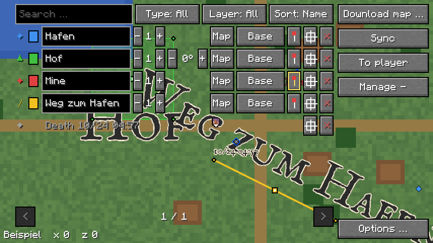

# Schnellverwaltung

Auf der Vollbildkarte listet ein Panel alle eigenen Objekte in der
Dimension des Spielers, eins je Zeile, mit allen Einstellungen
nebeneinander. Gewünscht hat es der User am 24.10.; den Plan schrieb Mod
Code Map, der Reviewer hat ihn freigegeben. Warum so:
[0037](entscheidungen/0037-schnellverwaltung.md).

## Öffnen

- **Knopf „Verwalten +“** in der Spalte rechts, unter „Ebenen“ und dessen
  Liste; ohne „Ebenen“ unter „Zum Spieler“. „Verwalten −“ schliesst. Die
  Liste der Ebenen lässt ihm eine Zeile, siehe
  [Vollbildkarte](vollbildkarte.md), „Ebenen“.
- **Taste „Schnellverwaltung“** unter „Heroic Map“ in den Steuerungen, ohne
  Belegung. Im Spiel öffnet sie die Vollbildkarte mit offenem Panel, auf der
  Karte schaltet sie es (`HeroicMap.verwaltung`).
- **Nicht im Rechtsklick-Menü:** Das gehört zum Ort unter der Maus. So hat
  es der Reviewer entschieden.
- **Nicht gemerkt:** Die Taste der Karte öffnet sie ohne Panel.

## Panel

- **Links neben der Spalte** der Knöpfe, ab oben, ohne Hintergrund: Jede
  Änderung ist gleich auf der Karte zu sehen. Die Spalte bleibt stehen.
  Steht oben links der Hinweis auf eine neue Version, beginnt das Panel
  darunter, siehe [Vollbildkarte](vollbildkarte.md), „Neue Version“.
- **Klicks und Mausrad** im Panel wirken nicht auf die Karte, und unter dem
  Panel hebt die Karte nichts hervor.
- **Oben:** Suche, Art (Alle, Wegpunkte, Regionen, Linien), Ebene (Alle
  oder eine eigene), Sortierung (Name, Nähe, Neu).
- **Unten:** `<` und `>` mit „Seite / Seiten“; das Mausrad über dem Panel
  blättert.
- **Neu gebaut** im nächsten Tick der Karte, wenn sich am Panel oder an den
  Wegpunkten etwas ändert (`Karte.tick`). Nie mitten in einem Klick, und
  nicht, solange ein Name getippt wird.

## Zeilen

Nur eigene Objekte in der Dimension des Spielers (`Verwaltung.zeilen`);
Objekte aus Ebenen vom Server nicht.

| Art | Zeichen | Spalten |
|---|---|---|
| Wegpunkt | ◆ in seiner Farbe | alle ausser Biegung |
| Region | ▲ | alle |
| Linie | ╱ | alle ausser Biegung |
| altes Rechteck | ▲ | Farbe, Ebene, Anheften, Hinspringen, Löschen; statt des Namens grau sein Ort |
| Todespunkt | ◆ grau | grau „Tod“ mit der Zeit im Stil der Karte, nur Hinspringen und Löschen |

## Spalten

| Spalte | Breite | tut |
|---|---|---|
| Farbe | 12 | Wegpunkt und Rechteck: reihum die 8 Farben (`Wegpunkte.faerbe`). Form: öffnet das Feld „Farbe…“ mit „Gewicht“ darunter, wie im Menü der Form, siehe [Wegpunkte](wegpunkte.md), „Farbe“ |
| Name | 92 | direkt bearbeitbar; ohne Namen grau der Ort „x …, z …“. Enter, ein Klick daneben oder in eine andere Zeile speichert, `Esc` verwirft, was getippt ist; leer nimmt den Namen weg |
| Schrift | 32 | `−` und `+` durch die Stufen ¼ bis 4; grau ohne Namen |
| Biegung | 40 | `−` und `+` in 15° bis ±180°, nur Regionen; grau ohne Namen |
| Schriftart | 20 | K für die Karte, MC für Minecraft; grau ohne Namen |
| Ebene | 48 | der Name der Ebene; ein Klick legt das Objekt in die nächste eigene Ebene, nach der letzten in die erste |
| Anheften | 14 | eine Nadel; heftet an die Minimap oder löst, gelb umrandet, solange angeheftet. Für Regionen gilt die Grenze wie sonst, siehe [Wegpunkte](wegpunkte.md), „Anheften“ |
| Hinspringen | 14 | ein Fadenkreuz; legt die Mitte des Objekts in die Mitte der Karte, das Panel bleibt offen |
| Löschen | 14 | `×`. Der erste Klick färbt es rot mit „?“, erst der zweite Klick in Folge löscht; jeder andere Klick vergisst den ersten |

- **Jeder Klick speichert** gleich (`Wegpunkte.speichere`).
- **Eine Zeile** ist 314 Einheiten breit. Passt das links der Spalte nicht,
  stehen je Objekt zwei Zeilen, 170 breit: oben Art, Farbe, Name,
  Anheften, Hinspringen, Löschen, darunter rechtsbündig Schrift, Biegung, Schriftart,
  Ebene (`Verwaltung.spalten`). Oben steht dann die Suche allein, darunter
  die drei Filter. So passt es auch bei 1280 × 720 und GUI-Massstab 4.

## Suche, Filter, Sortierung

`Verwaltung.auswahl`:

- **Suche:** ein Teil des Namens, gross oder klein gleich; sie findet nur
  Namen, also keine Todespunkte und keine Rechtecke.
- **Art:** Todespunkte zählen zu den Wegpunkten, alte Rechtecke zu den
  Regionen.
- **Name:** alphabetisch, Objekte ohne Namen dahinter.
- **Nähe:** zum Spieler, gemessen an der Mitte des Objekts: beim Wegpunkt
  die Mitte seines Blocks, bei einer Form die Mitte des Kastens um ihre
  Ecken, beim Rechteck seine Mitte.
- **Neu:** Wegpunkte nach ihrer id, dann Formen von hinten in der Datei,
  dann Rechtecke. Formen haben weder Zeit noch id.
- **Todespunkte** stehen immer am Ende, der neueste zuerst.

## Tasten

- **Im Feld** gehört jede Taste dem Feld, auch die der Karte und `Entf`;
  Enter speichert, `Esc` verwirft. Die Karte bleibt offen.
- **Das Feld „Farbe…“** einer Form nimmt jeden Klick zuerst: Ein Klick
  daneben, auch ins Panel, schliesst es. So sind Feld und Panel nie
  zugleich in Bearbeitung, und `Esc` im Feld nimmt nichts zurück, was das
  Panel gespeichert hat.

## Bild

`verwaltung.png` nimmt der Gametest `Bilder` mit `-Pbilder` auf (`Bilder.vollbildkarte`): zwei
benannte Wegpunkte, eine Region, eine Linie und ein Todespunkt.

## Kosten

Geschätzt, nicht gemessen:

- **Neu bauen:** alle eigenen Objekte der Dimension filtern und sortieren,
  höchstens 256 Formen, 256 Rechtecke und die Wegpunkte; Knöpfe nur für die
  Zeilen einer Seite, je Zeile bis 12.
- **Zu** kostet das Panel nichts.
