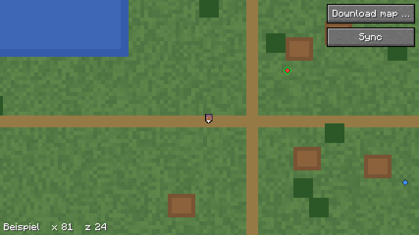

# Vollbildkarte

Die Vollbildkarte zeigt den Satz Kacheln, den der Mod vom Plugin geladen
hat ([Download](download.md)), über den ganzen Schirm. Sie liest nur von der
Platte und braucht keine Verbindung; ohne geladenen Satz für die Dimension
sagt sie das und zeigt nichts.

## Bedienung

| Eingabe | tut |
|---|---|
| Taste `.` | öffnet die Karte, schliesst sie wieder; frei belegbar unter „Heroic Map“, die einzige vorbelegte Taste des Mods |
| Ziehen mit links | verschiebt die Karte, der Inhalt folgt der Maus |
| Mausrad | zoomt, siehe „Stufen und Lupe“; über einer Tafel, die höher ist als ihr Platz, scrollt es sie |
| Zeigen auf eine Nadel, ein Banner, eine Fläche oder einen Kreis | öffnet nach 50 ms dessen Tafel, siehe [Ebenen](ebenen.md), „Infotafel“ |
| Doppelklick auf eine Nadel, ein Banner, eine Fläche oder einen Kreis | heftet es an die Minimap oder löst es, siehe [Wegpunkte](wegpunkte.md), „Anheften“; ein Klick hält keine Tafel, sie kommt nur beim Zeigen |
| Rechtsklick | öffnet ein kleines Menü für den Block unter der Maus, wie die Anzeige unten links: „Hierher teleportieren (x, z)“, siehe unten, darunter „Wegpunkt setzen“, auf einem Wegpunkt „Wegpunkt löschen“, dazu „Linie/Region von hier“ und auf Ecken eigener Formen „Eckpunkt hinzufügen“ und „Eckpunkt löschen“, siehe [Wegpunkte](wegpunkte.md); erst ein Klick auf einen Eintrag tut etwas, mit der linken oder rechten Taste, jeder Klick daneben schliesst es, ein Rechtsklick öffnet es dort neu |
| Klick, Doppelklick auf eine Marke | legt einen Wegpunkt, Mitspieler oder den eigenen Spieler in die Mitte, 250 ms nach dem Loslassen, wenn kein zweiter Klick kam; ein Doppelklick bewegt die Karte nicht und heftet einen Wegpunkt oder Mitspieler an die Minimap, ebenso eine eigene Form, die Raute eines alten Rechtecks und eine Fläche oder einen Kreis vom Server; wer auf einer Marke zieht, zieht nur die Karte; siehe [Wegpunkte](wegpunkte.md) |
| Knopf „Karte laden …“ | zeigt die Karten des Servers, je Baum der Name und darunter ein Knopf je Massstab mit seiner Grösse (`Auswahl`), darüber die Wahl „Selbst“, siehe [Selbst gezeichnete Karte](selbst.md); die Knöpfe teilen sich die Breite des Schirms, höchstens 90 Einheiten je Knopf, so passen sie auch bei grossem GUI-Massstab; den Massstab, den der Spieler schon ganz hat (`Downloads.vollstaendig`: ein vollständiger Satz, und das Plugin misst den Abgleich an demselben Massstab), zeigt der Knopf als „Abgleich“ und gleicht ab wie der Knopf „Abgleich“, nach einer Ablehnung mit `wieder` bis dahin aus; ein Klick fragt wie `/hmap laden` erst im Dialog nach |
| Knopf „Abgleich“ | fragt einen Abgleich des gezeigten Satzes an, wie `/hmap abgleich`; nur mit einem Satz vom Server, nicht auf der selbst gezeichneten Karte. Lehnt der Server mit `wieder` ab, ist der Knopf bis dahin aus und nennt die Uhrzeit |
| Knopf „Zum Spieler“ | legt den eigenen Spieler in die Mitte, für den Fall, dass man sich verirrt hat, wie auf der Webkarte; Stufe und Lupe bleiben (mod#75) |
| Knopf „Ebenen +“ unter „Zum Spieler“ | klappt die Liste der Ebenen auf, „Ebenen -“ wieder zu; nur, wenn der Server Ebenen schickt, siehe „Ebenen“ (mod#76) |
| Klick auf „An“/„Aus“ in der Liste | schaltet die Ebene an oder aus, sonst nichts, siehe „Ebenen“ |
| Doppelklick auf den Namen einer Ebene in der Liste | heftet alles von ihr an die Minimap oder löst es, siehe „Ebenen“ |
| Knopf „Im Browser öffnen“ über „Optionen …“ | öffnet die Webkarte des Servers im Browser, angemeldet, wie `/hmap web`; nur mit dem Plugin auf dem Server, siehe „Im Browser öffnen“ |
| Hinweis „Neue Version …“ oben links | öffnet nach der Rückfrage des Spiels die Versionen des Mods auf Modrinth; nur, wenn es dort eine neuere gibt, siehe „Neue Version“ |
| Knopf „Optionen …“ unten rechts | öffnet das Menü von `/hmap`, siehe [Minimap](minimap.md), „Bedienung“; „Fertig“ und `Esc` führen von dort zurück auf die Karte, an dieselbe Stelle (mod#75) |
| `Esc` | bricht zuerst eine Form ab, die der Spieler aus Wegpunkten baut, sonst schliesst es die Karte |

- **Das Spiel läuft weiter,** die Karte hält es nicht an (`isPauseScreen`).
- **Unten links** stehen der Name des Satzes und `x`, `z` des Blocks unter
  der Maus, so wie die Kacheln ihn zeichnen (`Kartenblick.basisRasterX`),
  fest wie auf der Karte im Browser; so will es der User.
- **Beim Öffnen** steht die Karte wie beim letzten Schliessen, siehe „Lage
  merken“; beim ersten Mal je Satz liegt der Spieler in der Mitte.
- **Geht ein Knopf nicht,** etwa weil der Server den Baum nicht anbietet oder
  schon ein Download läuft, steht der Grund über den Koordinaten, ebenso,
  was beim Anheften oder Speichern einer Form nicht ging. So ein Hinweis
  ist nach 5 s weg (`Karte.HINWEIS_MS`), oder beim nächsten Klick oder
  Tastendruck auf der Karte, was eher kommt (`Karte.zeige`); Mausrad und
  Zeigen nehmen ihn nicht weg. Meldet der Klick selbst etwas, steht danach
  das Neue. Bis 0.2.46 blieb er, bis die Karte zuging; so entschied es der
  Reviewer am 18.10. Die Hilfe beim Bauen einer Form und beim Eingabefeld
  steht darüber, solange beides offen ist.
- **Ohne Satz** zeigt die Karte nur den Hinweis und den Knopf zum Laden.

### Lage merken

Beim Öffnen stehen Mitte, Stufe und Lupe wie beim letzten Schliessen, je
Server, Welt und Satz, so will es der User (mod#75); vorher begann die
Karte jedes Mal beim Spieler, und man musste wieder herauszoomen.

- **Gemerkt** beim Schliessen und vor jedem Untermenü (`Karte.removed`): die
  Mitte in Blöcken, die Stufe und die Lupe (`Kartenlage`). Ob die Liste der
  Ebenen offen ist, merkt sie gleich beim Klick, für alle Dimensionen, siehe
  „Ebenen“.
- **Je Welt** in `karte.properties` im Ordner der Welt, neben
  `wegpunkte.json`, siehe [Download](download.md), „Ablage“; die Schlüssel
  beginnen mit Baum und Massstab des Satzes, mit `/` auf jedem System,
  etwa `<baum>/4.zoom` (`Kartenlage.schluessel`).
  Im Einzelspieler im Ordner nach dem Speicherordner der Welt, siehe
  [Download](download.md), „Ablage“.
- **Je Satz, nicht je Dimension:** Sonst öffnete ein anderer Satz derselben
  Dimension mit der Stufe des vorigen, etwa die eigene Karte nach einem
  groben Blick auf die des Servers. Dort ist sie grob oft noch leer, siehe
  [Selbst gezeichnete Karte](selbst.md), „Kacheln“. Ein neuer Satz beginnt beim
  Spieler auf der feinsten Stufe. Einträge je Dimension aus 0.2.21 und
  früher liest die Karte nicht mehr; sie beginnt dann einmal beim Spieler.
- **Gelesen** beim Öffnen, einmal, nicht bei jeder neuen Grösse des
  Fensters (`Karte.gestellt`). Die Stufe kommt auf die Stufen des Satzes,
  die Lupe auf 1, 2 oder 4 und nur auf der feinsten Stufe
  (`Kartenblick.stelle`). Fehlt die Datei oder ist sie unlesbar, liegt der
  Spieler in der Mitte.
- **Getestet** im Gametest `Bedienung`: eine Stufe gröber, schliessen und
  wieder öffnen, Mitte, Stufe und Lupe wie vorher; dazu `KartenblickTest`
  mit `lageJeSatzUeberstehtDenNeustart` und `listeDerEbenenBleibtOffen`.

### Ebenen

Auf der Vollbildkarte je Ebene ihr Name und ein Knopf „An“/„Aus“, wie
„Ebenen“ auf der Webkarte, so will es der User (mod#76). Ein Doppelklick
auf den Namen heftet die ganze Ebene an (mod#103).

- **Knopf „Ebenen +“** unter „Zum Spieler“, nur, wenn der Server Ebenen
  schickt, es neben Base eine eigene Ebene gibt oder Base aus ist (`Karte.ebenen`). Er klappt die Liste auf, „Ebenen -“ klappt sie
  zu. Beim ersten Öffnen ist sie zu; offen oder zu merkt sich die Karte in
  `karte.properties` unter `ebenen`, siehe „Lage merken“
  (`Kartenlage.ebenenOffen`).
- **Liste:** je Ebene eine Zeile, in der Reihe, wie gezeichnet wird, die
  oberste zuerst, siehe „Reihe der Ebenen“. Ohne Umstellen zuerst die
  eigenen Ebenen, Base vorn, wenn es neben Base eine gibt oder Base aus ist,
  siehe [Wegpunkte](wegpunkte.md), „Eigene Ebenen“; dann die vom Server,
  wie im Untermenü „Ebenen …“, siehe [Ebenen](ebenen.md), „Umschalten“;
  dieselbe Wahl. Rechts der Knopf „An“ oder „Aus“, 30 Einheiten breit
  (`Karte.AN_AUS`), davor „▲“ und „▼“, links davor der Name in der Sprache des Spiels als Überschrift, weiss
  mit Schatten, rechtsbündig. Ein langer Name ragt nach links über die
  Karte, statt abgeschnitten zu werden. Die Liste
  reicht bis über „Optionen …“; passen nicht alle, führt der letzte Knopf
  „Weitere …“ zum Untermenü. Kommen andere Ebenen, während die Karte offen
  ist, baut sie die Liste neu (`Karte.tick`).
- **Klick** auf „An“/„Aus“ schaltet die Ebene an oder aus, sonst nichts;
  ein Doppelklick darauf schaltet zweimal.
- **Doppelklick auf den Namen** einer Ebene vom Server heftet alles von ihr an, was sich
  anheften lässt, Flächen, Kreise, Nadeln und Banner mit `id`, siehe
  [Wegpunkte](wegpunkte.md), „Anheften“; ist schon alles angeheftet, löst
  er alles (`Wegpunkte.alleUmschalten`). Ein Klick auf den Namen tut
  nichts und zieht die Karte nicht. Bis 0.2.26 lag das Anheften auf dem
  Doppelklick auf den Schalter, der dabei aus- und wieder anschaltete und
  flackerte; so wollte es der User nicht mehr (mod#103).
- **Grenzen:** Die 64 Flächen und Kreise und die 64 Nadeln und Banner
  gelten weiter. Was nicht mehr passt, bleibt los, und unten links steht
  „3 nicht angeheftet: höchstens 64 Regionen und 64 Nadeln und Banner“.
  Dann ist die Ebene nicht ganz angeheftet, und ein weiterer Doppelklick
  löst nichts, sondern heftet wieder an, was passt. Lösen geht dann je
  Objekt.
- **Bunter Punkt** vor dem Namen, wenn alles Anheftbare der Ebene
  angeheftet ist, in der Farbe des Rings angehefteter Marken
  (`Karte.BUNT_MS`); eine Ebene ohne etwas mit `id` bekommt keinen
  (`Wegpunkte.ganzAngeheftet`). Neu gerechnet nur, wenn sich Ebenen oder
  Wegpunkte ändern (`Ebenen.stand`, `Wegpunkte.stand`).
- **Über einem Knopf** geht keine Tafel auf; die Knöpfe gehen der Karte
  darunter vor.

### Reihe der Ebenen

Jeder Spieler kann die Reihe der Ebenen für sich umstellen: welche oben
gezeichnet wird. Gewünscht vom User am 20.10. (renderer#317, Teil 4); Plan
vom Reviewer freigegeben. Das Gewicht vom Server ist `order`, siehe
[Ebenen](ebenen.md); am Format ändert sich nichts.

- **Ohne Umstellen** wie vorher: die vom Server aufsteigend nach `order`,
  bei Gleichstand nach `id` absteigend, darüber alle eigenen Formen, in
  ihnen nach Gewicht, siehe [Wegpunkte](wegpunkte.md), „Gewicht“. Wer
  nichts umstellt, sieht nichts anders; so hat es der Reviewer entschieden.
- **Umstellen:** In der Liste der Ebenen je Zeile „▲“ und „▼“, 12 Einheiten
  breit (`Karte.PFEIL`), vor „An“/„Aus“. Ein Klick rückt die Zeile eine
  gezeigte Stelle hoch oder runter; oben heisst darüber gezeichnet.
  „▲“ der obersten und „▼“ der untersten Zeile sind aus. Knöpfe statt
  Ziehen: Auf dem Namen liegt schon der Doppelklick zum Anheften.
- **Beim ersten Umstellen** gilt die sichtbare Reihe als Start, die eigenen
  oben; nur die eine Zeile wandert. Base allein und an steht nicht in der
  Liste; über sie springt eine Zeile hinweg, und sie bleibt, wo sie ist
  (`Ebenenreihe.verschoben`).
- **Umgestellt** ist jede eigene Ebene eine eigene Schicht, darin ihre
  Formen nach Gewicht: Zuerst entscheidet die Ebene, dann das Gewicht der
  Form. Gilt auf Vollbildkarte, Minimap und für den Schleier, ebenso für
  die Nadeln der Ebenen vom Server (`Wegpunkte.baue`).
- **Neue Ebenen** in einer umgestellten Reihe: Eine neue kommt direkt über
  die oberste bekannte, deren `order` nicht höher ist; gibt es keine, ganz
  unten. Eine eigene zählt dabei als `order` 0. Mehrere neue nacheinander,
  erst die eigenen, dann die vom Server von oben nach unten; jede zählt die
  vor ihr eingereihten mit (`Ebenenreihe.wirksam`).
- **Verschwundene** überspringt der Mod; beim nächsten Speichern fallen sie
  weg.
- **„Reihe des Servers“:** Ist umgestellt, steht unter der letzten Zeile
  dieser Knopf. Er löscht die eigene Reihe; dann gilt wieder `order`, die
  eigenen oben.
- **Gespeichert** gleich beim Umstellen in `ebenen-reihe.json` im Ordner der
  Welt neben `ebenen.properties`, also je Welt eines Servers, wie An und
  Aus: `{"reihe":[{"server":"<id>"},{"eigen":3},…]}`, von oben nach unten.
  Kennungen vom Server sind freier Text; so verwechselt sich keine mit einer
  eigenen. Ohne Datei oder unlesbar gilt `order`.
- **Das Untermenü „Ebenen …“** zeigt die Ebenen vom Server in derselben
  Reihe; die eigenen bleiben dort oben, wo ihre Knöpfe zum Verwalten
  stehen, siehe [Ebenen](ebenen.md), „Umschalten“.

### Teleportieren

- **Der Eintrag** „Hierher teleportieren“ steht in jedem Menü der Karte,
  sobald es eine Verbindung gibt, in jeder Dimension. Fehlen dem Spieler
  die Rechte für `execute` und `tp`, lehnt der Server ab und sagt es im
  Chat; der Mod umgeht nichts. So hat es der User gewünscht (mod#131),
  siehe [0023](entscheidungen/0023-teleport-mit-korrektur.md). Bis 0.2.48
  fehlte der Eintrag ohne beide Befehle im Befehlsbaum und unter einer
  Decke.
- **Befehl** (`Teleport.befehl`): `execute in <dimension> run tp @s
  <x+0,5> <y> <z+0,5>`, mit fester Höhe, so geht er auch in Chunks, die
  weder Client noch Server geladen haben. So hat es der User gewünscht
  (mod#111), siehe [0019](entscheidungen/0019-teleport-mit-fester-hoehe.md).
  Der Mod schickt ihn mit `sendCommand`; darin stehen nur die Dimension des
  Spielers und die drei Zahlen, kein Text vom Server.
- **Die Höhe,** in dieser Reihenfolge (`Teleport.los`):
  1. **Beim Client:** Hat er den Chunk, der freie Platz darin
     (`Teleport.frei`). Ob der Client den Chunk hat, fragt der Mod den
     Cache (`Teleport.chunk`), denn `ClientLevel.hasChunk` sagt immer ja
     (per javap).
     - **Ohne Decke** aus der Heightmap `MOTION_BLOCKING_NO_LEAVES`: der
       erste freie Block über dem obersten, der Bewegung oder Flüssigkeit
       hält, ohne Laub; über Wasser also die Oberfläche. Belegt per javap
       in 26.3: das Prädikat
       `is(BLOCKS_MOTION_IN_HEIGHTMAP_NO_LEAVES) || !getFluidState().isEmpty()`,
       und der Server schickt diese Heightmap mit jedem Chunk
       (`Heightmap.Usage.CLIENT`).
     - **Mit Decke** (`dimensionType().hasCeiling()`), etwa im Nether: der
       Platz unter der Decke, der der Höhe des Spielers am nächsten liegt,
       bei gleichem Abstand der untere. Frei heisst: darunter ein Block mit
       Kollision und ohne Flüssigkeit, Füsse und Kopf ohne beides. Die
       Decke ist die logische Höhe der Dimension (`logicalHeight`), im
       Nether 128. Der oberste Block wäre dort das Dach aus Grundgestein.
     - **Ohne freien Platz,** etwa in einer leeren Säule oder über einem
       Lavasee unter der Decke, gilt 2.
  2. **Aus der Karte:** sonst der Boden ohne Laub (`ground`, je Block), sonst
     die Höhen (`heights`, je 4 × 4) aus `map.json` des Satzes, wie der
     Renderer sie ab 0.9.0 schreibt, der oberste Block plus 1 (`Teleport.quelle`,
     `Teleport.stehen`).
     - **Nur in der Ablage einer Wurzel,** `../ground/{x}.{z}.bin`; dann
       liegt die Datei auf dem Server unter `/tiles/ground/<rx>.<rz>.bin`,
       neben den Ebenen und mit derselben Basis wie sie, aus der letzten
       gültigen Liste. Ein anderes Muster nimmt der Mod nicht.
     - **Je Klick höchstens eine Region,** per HTTP, mit denselben Grenzen
       wie die Bilder der Ebenen, siehe [Ebenen](ebenen.md), „Symbole“:
       Adresse geprüft, ohne Weiterleitung, höchstens 1 MiB gepackt
       (`Teleport.MAX_GEPACKT`) in 10 s, entpackt genau 512 KiB beim Boden
       und 32 KiB bei den Höhen (`Teleport.hole`, `Teleport.entpacke`). Der
       Download legt die Dateien nicht ab.
     - **Keine Höhe** sind −32768, ein Wert ausserhalb von `minY` bis `maxY`
       und jeder Fehler beim Holen.
     - **Über einem Stamm** von 1 × 1 nennt der Boden durch seinen Median
       die Erde darunter; dort landet der Spieler im Stamm. Selten, darum
       so gelassen.
  3. **Ohne Höhe,** etwa auf der selbst gezeichneten Karte, ohne
     Webserver oder in einer anderen Dimension als der des Satzes:
     - **Zuerst der Server,** mit dem alten Befehl `execute in <dimension>
       positioned <x+0,5> 0 <z+0,5> positioned over
       motion_blocking_no_leaves run tp @s ~ ~ ~`. Hat er den Chunk
       geladen, landet der Spieler auf dem Boden, ohne Schaden; im Nether
       auf dem Dach, dann folgt die Korrektur. Hat er ihn nicht, weist er
       den Befehl ab, „That position is not loaded“, und der Chat zeigt
       es. Bis 0.2.35 galt dieser Befehl immer.
     - **Dann die feste Höhe:** Steht der Spieler 5 Ticks danach
       (`Teleport.SERVER_TICKS`) nicht am Ziel, geht der Befehl mit fester
       Höhe ab: die Höhe des Spielers beim Klick, mindestens der
       Meeresspiegel der Dimension, in der Welt (`Teleport.hoehe`). Danach
       folgt die Korrektur. Bis 0.2.48 sagte der Chat nur „Höhe unbekannt
       …“, und wo der Server ablehnte, geschah nichts.
- **Korrektur nach dem Landen** (`Teleport.tick`, je Tick des Clients):
  für jeden Teleport aus dem Menü, auch mit Höhe aus der Karte, denn die
  kann veraltet sein.
  - **Geprüft wird einmal,** sobald der Spieler höchstens 1,5 Blöcke
    waagrecht vom Ziel steht (`Teleport.DA`) und der Client den Chunk hat
    (`FULL`).
  - **Korrigiert wird,** wenn er in einem Block mit Kollision steckt, über
    der Decke steht, mehr als 3 Blöcke über dem freien Platz aus 1 ist,
    dann kostete der Fall Schaden, oder mehr als 1 Block darunter, etwa in
    einer Höhle unter dem Ziel (`Teleport.korrigieren`). Dann geht ein
    zweiter Befehl mit fester Höhe auf den freien Platz.
  - **Grenzen gegen Schleifen:** höchstens eine Korrektur je Teleport.
    Nach 10 s (`Teleport.FRIST_TICKS`) gibt der Mod auf, ebenso, wenn der
    Spieler nach der Ankunft mehr als 4 Blöcke weggeht (`Teleport.WEG`),
    die Dimension wechselt oder die Verbindung endet. Ein neuer Teleport
    ersetzt den offenen. Andere Teleports, etwa ein Befehl im Chat, prüft
    der Mod nicht.
  - **Schaden:** Hat der Server den Chunk, landet man ohne Schaden. Muss
    er ihn erst laden oder erzeugen, liegt die feste Höhe vielleicht im
    Block oder in der Luft, bis der Chunk beim Client ist. Im schlimmen
    Fall kostet das ½ bis wenige Herzen. Belegt per javap in 26.3:
    - **Ersticken:** Steckt der Kopf im Block, schadet das Spiel mit
      `damageSources().inWall()`. Wegen der Unverwundbarkeit nach einem
      Treffer ist das ½ Herz beim Landen und dann ½ je 10 Ticks bis zur
      Korrektur.
    - **Fallen:** Der Client lässt den Spieler auch über einem Chunk
      fallen, den er noch nicht hat. `tp` setzt die Fallstrecke nicht
      zurück, der Server nur, wenn der Spieler steigt
      (`ServerGamePacketListenerImpl.handleMovePlayer`). Fällt man vor der
      Korrektur mehr als 3 Blöcke, kostet die Landung danach Schaden.
    - **Im Gametest `Bedienung`,** in der flachen Welt, die der Server
      schnell erzeugt, kostet der Teleport ohne Daten in einen Chunk, den
      er nicht hat, ½ Herz: Der Spieler landet in der Erde und erstickt
      einmal, bis die Korrektur kommt (Stand 18.10.).
- **Das Menü** bleibt ganz auf dem Schirm, auch bei grossem GUI-Massstab.
- **Nach dem Klick** schliesst sich die Karte. Holt der Mod die Höhe, geht
  der Befehl ab, sobald sie da ist, höchstens 10 s später.

### Im Browser öffnen

Der Knopf öffnet die Webkarte des Servers im Browser und meldet den Spieler
dort an, so erkennt sie ihn genau und lässt auch Klicks zu. Gewünscht vom
User am 20.10.; Plan vom Reviewer freigegeben, mit dem Plugin abgestimmt.
Ohne Mod erkennt die Webkarte den Spieler über die IP oder mit
`/karte anmelden`.

- **Knopf** „Im Browser öffnen“ über „Optionen …“ unten rechts, gleich
  breit; die Liste der Ebenen hört dann darüber auf. Dasselbe tut
  `/hmap web`, siehe [Download](download.md), „Befehle“. Den Knopf gibt es
  nur, wenn das Plugin den Kanal angemeldet hat, also nicht im
  Einzelspieler.
- **Aus, mit dem Grund als Tooltip** (`Webkarte.grund`), in dieser Reihe:
  - **Das Plugin ist alt:** Seine Antwort auf `show` hat kein Feld `web`.
    Der Mod fragt dann nie, so bekommt ein altes Plugin die Nachricht `web`
    nicht.
  - **`web: false`:** Der Spieler bekäme jetzt keinen Link, ohne
    `heroicmap.web` oder ohne Anmeldung auf dem Server.
  - **Die Basis ist unbekannt:** Es kam keine Liste `ebenen` mit `url` oder
    `port`, oder die Basis endet nicht auf `/tiles`.
  - **Eine Frage ist offen,** höchstens 10 s (`Webkarte.FRIST_MS`).
- **Ablauf:**
  1. Der Mod schickt `{"v":1,"typ":"web"}`, siehe [Download](download.md),
     „Kanal“.
  2. Das Plugin antwortet mit einem Token, demselben wie bei
     `/karte anmelden`: 5 min gültig, einmal, höchstens einer je 15 s und
     Spieler. Sonst mit einem Grund; er steht unten links, bei `rate` mit
     den Sekunden bis zum nächsten.
  3. Der Mod prüft das Token: zwei Teile aus `A–Z`, `a–z`, `0–9`, `_` und
     `-`, durch einen Punkt getrennt, höchstens 256 Zeichen
     (`Webkarte.token`).
  4. Den Link baut der Mod selbst, nie aus einer Adresse in der Nachricht:
     die Basis der Kacheln aus der Liste `ebenen` ohne das letzte `/tiles`
     (`Webkarte.wurzel`), dahinter `#anmelden=<token>` (`Webkarte.link`).
     Das Token steht nur im Fragment; das schickt der Browser keinem
     Server, so steht es in keinem Log eines Servers.
  5. Die Wurzel prüft der Mod wie die Bilder der Ebenen
     (`Adresse.pruefe`), siehe [Ebenen](ebenen.md), „Symbole“; abseits des
     Render-Threads, denn sie löst den Namen auf.
  6. Dann öffnet er den Browser.
- **Ohne Bestätigungsschirm,** direkt nach dem Klick, siehe
  [0024](entscheidungen/0024-browser-ohne-bestaetigung.md). Der Mod ruft
  `SDLMisc.SDL_OpenURL` selbst auf, wie das Spiel, auf
  `Util.nonCriticalIoPool`, aber nicht über `Blaze3D.openUri`: Das schriebe
  bei einem Fehler den ganzen Link ins Log (per javap am Client 26.3).
  Schlägt es fehl, steht im Log nur der Fehler von SDL, ein Fragment darin
  ersetzt, und unten links „Der Browser liess sich nicht öffnen“.
- **Das Token** steht nie im Log, auch nicht im Debug: Der Kanal loggt
  keine Inhalte, kein Text zeigt den Link, und der Gametest `Bedienung`
  sucht es nach dem Klick in `latest.log`.
- **Ob Windows das Fragment** an den Browser weitergibt, prüft der User bei
  der Abnahme; ein Test öffnet keinen Browser.

### Neue Version

Gibt es auf Modrinth eine neuere Version des Mods für dieses Spiel und
Fabric, steht oben links auf der Karte ein Hinweis. Vorgeschlagen vom
Reviewer in mod#155, Plan freigegeben am 19.10.; siehe
[0025](entscheidungen/0025-neue-version-von-modrinth.md).

- **Frage:** einmal je Start, im Hintergrund, sobald der Client läuft
  (`NeueVersion.frage`):
  `GET https://api.modrinth.com/v2/project/heroic-map/version` mit
  `loaders=["fabric"]`, `game_versions=["<Version des Spiels>"]` und
  `include_changelog=false` (`NeueVersion.adresse`). Die Version des
  Spiels liest der Mod aus dem laufenden Spiel, so stimmt sie nach einem
  Update von selbst.
- **User-Agent:**
  `VonNekyia/heroic-map-renderer-mod/<Version> (+https://github.com/VonNekyia/heroic-map-renderer-mod)`
  (`NeueVersion.agent`). Sonst schickt der Mod nichts mit, keinen Namen und
  keine UUID; Modrinth sieht die IP.
- **Grenzen:** derselbe Client wie für die Symbole, HTTP/1.1, ohne
  Weiterleitung und Proxy; Header und Körper in 10 s, höchstens 256 KiB
  (`NeueVersion.MAX`). Ohne Changelogs ist die Antwort heute rund 0,8 KiB
  je Version, gemessen an einem öffentlichen Projekt.
- **Welche Version zählt:** die höchste nach Semver, wie Fabric sie
  vergleicht (`SemanticVersion`), wenn sie höher ist als die eigene
  (`NeueVersion.neuere`). Vorabversionen mit `-…`, etwa `0.3.0-rc.1`,
  zählen nicht, ebenso Einträge ohne lesbare Version und Versionen über 32
  Zeichen. Den Kanal auf Modrinth liest der Mod nicht: Jede Version liegt
  dort als `beta` (`.github/workflows/modrinth.yml`).
- **Fehler** geben keinen Hinweis und keine Meldung im Spiel, nur eine
  Zeile im Log, ohne die Antwort. Gefragt wird auch nach einem Fehler erst
  beim nächsten Start wieder.
- **Hinweis:** ein Knopf oben links, „Neue Version 0.2.x“, mit einem Rand,
  der alle 2 s von Gold nach Weiss und zurück pulsiert (`Karte.PULS_MS`).
  Der Tooltip nennt beide Versionen. Ein Klick öffnet den Bestätigungsschirm
  des Spiels mit der festen Adresse
  `https://modrinth.com/mod/heroic-map/versions` (`NeueVersion.SEITE`);
  nichts aus der Antwort kommt in den Link. Kommt die Antwort, während die
  Karte offen ist, steht der Hinweis beim nächsten Öffnen da.
- **Schalter** „Neue Version melden“ im Untermenü „Einstellungen …“, Gruppe „Technik“,
  Vorgabe an, siehe [Minimap](minimap.md), „Bedienung“. Aus fragt der Mod
  nicht und zeigt keinen Hinweis. Wird er angeschaltet und hat der Mod in
  diesem Start noch nicht gefragt, fragt er gleich.
- **Stand 19.10.:** Ohne Token antwortet Modrinth zum Projekt mit 404; es
  ist noch nicht öffentlich. Bis dahin zeigt der Mod keinen Hinweis.
- **Tests ohne Netz:** Die Gametests fragen Modrinth nie
  (`heroicmap.ohne_modrinth` in `build.gradle.kts`), sondern einen Server
  auf loopback; siehe [Entwicklung](entwicklung.md), „Tests“.

## Welcher Satz

- **Je Baum** schreibt der Mod nach einem vollständigen Download
  `satz.json` neben die Massstäbe: Name und Dimension aus dem `angebot`,
  dazu der Massstab. Ein gekappter Download schreibt sie nicht. Beim Strom
  steht sie schon, sobald die gröbste Stufe daliegt, wenn noch kein Satz
  dasteht; die Karte zeigt ihn dann, bevor er vollständig ist. Siehe
  [Download](download.md), „Strom“.
- **Die Karte** nimmt unter dem Ordner der Welt den Baum, dessen
  Dimension die des Spielers ist (`Satz.fuer`), siehe
  [Download](download.md), „Ablage“; einen selbst gezeichneten vor jedem
  anderen, siehe [Selbst gezeichnete Karte](selbst.md), „Wahl“. Kachelgrösse, Stufen und
  `scale` liest sie aus `map.json` des Satzes.
- **`map.json` kommt vom Server** und hat deshalb Grenzen (`Satz.lies`):

  | Feld | erlaubt |
  |---|---|
  | `tileSize` | Zweierpotenz von 64 bis 1024 |
  | `minZoom`, `maxZoom` | `0 ≤ minZoom ≤ maxZoom ≤ 30`, und die Stufe des Massstabs nicht unter `minZoom` |
  | `scale` | ab 1 |
  | Massstab aus `satz.json` | 1, 2 oder 4 |

  Eine selbst gezeichnete Karte hat dieselben Dateien, die Kacheln als PNG.

- **Ein Baum ohne `satz.json`, `map.json` oder mit unlesbarer Datei oder
  verletzter Grenze** zählt nicht und verdeckt keinen anderen.
- **Bietet ein Server zwei Bäume derselben Dimension an,** nimmt die Karte
  den ersten nach dem Namen, Zeichen für Zeichen (`welt_alt` vor `weltneu`).

## Fortschritt

Solange ein Strom oder ein Abgleich läuft, siehe [Download](download.md),
„Strom“, steht links neben „Karte laden …“ ein Kasten (`Karte.fortschritt`).
So hat es der Reviewer nach einem Entwurf entschieden; den Kasten beim
Abgleich wünschte der User am 20.10., siehe [0027](entscheidungen/0027-abgleich-bis-zur-haelfte.md).

- **Lage:** 200 × 38 Einheiten, oben bündig mit dem Knopf, 4 Einheiten
  links davon, dunkel durchscheinend.
- **Zeile 1:** „Karte wird geladen“, beim Abgleich „Karte wird
  abgeglichen“ (`Laden.Fortschritt.abgleich`), rechts die Prozent,
  abgerundet.
- **Balken:** wie der Ladebalken des Spiels, weisser Rand, weiss gefüllt.
- **Zeile 2, grau:** links die Bytes, empfangen von gesamt in der Einheit
  des Gesamten, etwa „2.0 von 4.8 GB“; rechts Tempo und Restzeit, etwa
  „38.0 MB/s, noch 1:16“, ab einer Stunde h:mm:ss.
- **Nur aus Bytes** (`Laden.Fortschritt`): Empfangen zählt jedes Byte des
  Körpers, gesamt ist `X-Heroic-Bytes`, ohne den Header die `bytes` der
  `freigabe`, höchstens die Grenze des Stroms. Über 100 % geht der Anteil
  nicht. Dateien zählen nicht. Beim Abgleich steht gesamt erst fest, wenn
  das Manifest verglichen ist (`Laden.Fortschritt.UNBEKANNT`); bis dahin
  stehen statt Prozent und Bytes „…“. Dann ist es die Summe der Kacheln,
  die laut Manifest fehlen, höchstens die `bytes` der `freigabe`, und
  empfangen zählt jedes Byte einer geholten Kachel (`Laden.lade`). Fehlt
  nichts, steht kein Kasten (`Laden.Fortschritt.zeigen`).
- **Tempo** über die letzten 5 s (`Laden.Fortschritt.FENSTER_MS`), die
  Restzeit ist der Rest durch das Tempo. Vor der ersten Sekunde und
  solange nichts kommt, steht „…“.
- **Ohne Satz** steht während des Downloads kein Hinweis mitten auf der
  Karte; der Kasten sagt, was los ist.
- **Sobald eine Stufe ganz daliegt,** öffnet sich eine Karte ohne Satz
  neu mit dem Satz (`Karte.tick`, `Downloads.stufen`), und die offene
  Karte fragt fehlende Kacheln neu an (`Kacheln.satzGeladen`). Bis eine
  Stufe da ist, zeigt sie den Ausschnitt der gröberen.
- **Sonst:** Der Chat meldet Beginn und Ende wie bisher, die Minimap
  zeigt nichts. Der einzelne Download, wenn der Renderer den Strom nicht
  kennt, zeigt keinen Kasten.

## Stufen und Lupe

- **Die feinste Stufe** des Satzes hängt am Massstab: 4 px ist `maxZoom`,
  2 px eine gröber, 1 px zwei (`Satz.stufe`). Dort öffnet die Karte, ein
  Pixel der Kachel auf eine Einheit des GUI.
- **Mausrad zurück** geht eine Stufe gröber, bis `minZoom`.
- **Mausrad vor** geht eine Stufe feiner, auf der feinsten vergrössert die
  Lupe auf 2 und 4 Einheiten je Pixel.
- **Die Mitte** rechnet `Kartenblick` in Pixeln der Basis, der Stufe
  `maxZoom`; so bleibt sie beim Zoomen stehen. Die Kacheln einer Stufe
  liegen auf ganzen Einheiten nebeneinander, ohne Naht.

## Kacheln

- **WebP lesen:** Das Spiel liest Texturen nur als PNG. Die Kacheln
  dekodiert TwelveMonkeys `imageio-webp`, im Jar des Mods mitgeliefert;
  der Hinweis seiner Lizenz steht in [`NOTICE`](../NOTICE). Einfache
  verlustfreie WebP, wie der Renderer sie schreibt, liest eine geänderte
  Kopie seines Dekoders, siehe „Farbindex hinter der Palette“.
- **Grösse vor dem Dekodieren:** Der Kopf der WebP nennt Breite und Höhe.
  Sind sie nicht genau `tileSize`, gilt die Kachel als leer, bevor
  ein Dekoder Speicher anlegt; sonst könnte eine kleine Datei mit einem
  Kopf von 16384 × 16384 rund 1 GiB verlangen.
- **Im Hintergrund:** Ein Thread dekodiert und füllt das `NativeImage`; auf
  dem Render-Thread bleibt nur das Hochladen als `DynamicTexture`. Die
  Rückgabe an den Render-Thread steht im `finally`, auch nach einem `Error`.
- **Platzhalter:** Bis eine Kachel da ist, zeigt die Karte an ihrem Platz,
  was schon geladen ist (`Karte.platzhalter`). Zuerst eine feinere Stufe,
  verkleinert, wenn alle ihre 4 oder 16 Kacheln geladen sind
  (`Karte.fein`): Sie ist schärfer, und beim Herauszoomen liegt die Stufe,
  die gerade noch zu sehen war, schon da. Sonst den Ausschnitt aus der
  nächsten gröberen, vergrössert (`Karte.grob`, `Kartenblick.grob`), und
  darüber, was von der nächsten feineren schon geladen ist. Angefragt wird
  für den Platzhalter nichts; beim Hineinzoomen liegt die gröbere Kachel
  meist schon da. Sonst bleibt der Platz dunkel. Vorher nahm die Karte
  nur gröbere Stufen: Beim Herauszoomen war sie, bis die neue Stufe
  dekodiert war, dunkel oder grob, „mega unscharf“ beim User (mod#132).
  Vorgeladen wird die nächste feinere Stufe nicht, Entscheid des
  Reviewers; erst sehen, ob es dem User so reicht. Fehlt die Kachel aber auf der Platte (`Kacheln.fehlt`),
  etwa weil ein Strom erst die gröberen Stufen brachte, fragt die Karte die
  gröberen an, bis eine da ist; jede kostet einmal Dekodieren. Ohne das
  bliebe die Karte während des Stroms bis zur feinsten Stufe dunkel, denn
  sie öffnet auf der feinsten.
- **Kosten** ([Messung](messungen/2026-10-06-vollbildkarte-uebernahme.md)):
  Eine Kachel 256² dekodiert in rund 2,8 ms, der Thread liefert also rund
  350 je Sekunde, etwa 6 je Frame bei 60 fps. Das Hochladen kostet den
  Render-Thread rund 0,05 ms je Kachel, also rund 0,3 ms je Frame beim
  Öffnen. 160 Kacheln, ein Schirm in 4K bei GUI-Massstab 1, kosten ihn
  zusammen rund 8 ms, verteilt über eine knappe halbe Sekunde.
- **Behalten:** die 192 zuletzt gezeigten Texturen, bei 256² Pixeln rund
  48 MiB auf der Grafikkarte (`Kacheln.MAX`). Die älteste gibt der Mod frei.
  Weit herausgezoomt hat die Minimap eigene Kacheln, höchstens 64, siehe
  [Minimap](minimap.md), „Weit heraus“; einen fertigen Download und neue
  Kacheln der eigenen Karte erfahren alle offenen.
- **Fehlt eine Kachel** oder lässt sie sich nicht lesen, merkt sich die
  Karte das und fragt nicht wieder, bis sie neu öffnet oder ein Download
  fertig ist.
- **Nach einem vollständigen Download** lädt die offene Karte jede Kachel
  neu (`Kacheln.satzGeladen`). Die alte Textur bleibt sichtbar, bis die
  neue da ist; ein Ergebnis, das während des Downloads entstand, lädt sie
  gleich noch einmal.
- **Beim Schliessen** gibt die Karte alle Texturen frei.
- **Nur Kacheln vom Server:** Was sich seit dem letzten Lauf des Renderers
  ändert, bringt der Abgleich; über die Kacheln des Servers zeichnet der
  Mod nichts, siehe [0002](entscheidungen/0002-vollbildkarte-nur-vom-server.md).
  Eine eigene Karte statt der des Servers gibt es mit der Wahl „Selbst“,
  siehe [Selbst gezeichnete Karte](selbst.md).

### Farbindex hinter der Palette

Verlustfreies WebP kann die Farben eines Bildes als Palette ablegen, die
Farbindex-Transformation. Ein Index hinter dem Ende der Palette ergibt
`0x00000000`, durchsichtiges Schwarz (RFC 9649, 3.5.4). libwebp nutzt das
und lässt durchsichtiges Schwarz als letzten Eintrag weg. TwelveMonkeys
3.15.2 und 3.15.3 lesen solche Pixel als die letzte Farbe der Palette,
deckend; gemeldet als
[haraldk/TwelveMonkeys#1361](https://github.com/haraldk/TwelveMonkeys/issues/1361).
Warum eine Kopie: [0003](entscheidungen/0003-kopie-des-vp8l-dekoders.md).

- **Die Kopie:** Das Paket `com.nekyia.heroicmap.webp` ist das Paket
  `com.twelvemonkeys.imageio.plugins.webp.lossless` aus TwelveMonkeys
  ImageIO 3.15.2, alle 12 Dateien, unter BSD-3-Clause; jede Datei behält
  ihren Lizenzkopf, der Hinweis steht in [`NOTICE`](../NOTICE). Geändert
  sind nur das Paket und in `VP8LDecoder.readTransform` die Schleife, die
  die Farbtabelle auflöst: Sie läuft bis `colorTableSize * 4` statt über
  den ganzen aufgefüllten Puffer.
- **Welche Kacheln:** `Kacheln.dekodiere` liest eine einfache verlustfreie
  WebP, `RIFF` mit nur dem Chunk `VP8L`, mit der Kopie, in dasselbe
  Bildformat wie TwelveMonkeys: `TYPE_4BYTE_ABGR`, ohne Alpha im Kopf
  `TYPE_3BYTE_BGR`. Alles andere, etwa verlustbehaftet oder mit `VP8X`,
  liest TwelveMonkeys selbst.
- **Geprüft** an `src/test/resources/farbindex.webp`, 8 × 8 Pixel,
  erzeugt mit `python -I src/test/resources/farbindex.py` aus der Wurzel
  des Repositorys, mit Pillow und damit libwebp wie der Renderer (method 0,
  quality 0, `exact`). Das Skript prüft am Kopf, dass die erste
  Transformation der Farbindex ist und die Palette 31 Einträge hat, das
  Bild aber 32 Farben, und dass libwebp die Datei verlustfrei liest. Eine
  Farbe kommt also aus Indizes hinter der Palette. `KachelnTest` prüft,
  dass die Kopie diese Pixel durchsichtig liest, und dass sie `kachel.webp`
  und die 24 Kacheln des Testsatzes Pixel für Pixel wie TwelveMonkeys
  liest, ausser hinter der Palette. Das gibt es auch im Testsatz: In den 4
  Kacheln der Stufe 0 liest libwebp je 49152 Pixel durchsichtig,
  TwelveMonkeys liest sie deckend, die Kopie wie libwebp.
- **Wann sie wegfällt:** sobald eine Version von TwelveMonkeys den Fehler
  behebt. Hebt man die Version in `gradle/libs.versions.toml` auf eine
  solche, schlägt `KachelnTest.indexHinterDerPaletteIstDurchsichtig` fehl,
  weil TwelveMonkeys `farbindex.webp` dann selbst richtig liest. Dann gehen
  das Paket `webp`, der Weg über die Kopie in `Kacheln.dekodiere`, der
  Absatz in `NOTICE` und dieser Abschnitt.

## Spieler und Koordinaten

Der eigene Kopf und die Koordinaten rechnen mit derselben Projektion wie der
Renderer und mit `scale` aus `map.json`, siehe [Projektion](projektion.md).
Chunklinien zeichnet die Karte auf Wunsch über den Kacheln, siehe
[Minimap](minimap.md), „Chunklinien“. Kopf und Pfeil sind dieselben wie auf der Minimap, 6 Einheiten des GUI, in derselben Darstellung, siehe [Minimap](minimap.md), „Spieler“. Mitspieler stehen als Kopf mit Namen darüber,
siehe [Minimap](minimap.md), „Mitspieler“. Was ausserhalb des Schirms liegt, steht am Rand, siehe
[Wegpunkte](wegpunkte.md), „Am Rand“.

## Bild

`docs/bilder/vollbildkarte.png` nimmt der Gametest `Bilder` auf, siehe
[Bauen und testen](entwicklung.md), „Gametests“, mit einem angehefteten
Wegpunkt und einem am Rand. Er legt einen gemalten
Testsatz an, `scale` 4, Stufen 0 bis 2, 24 Kacheln, aus
`src/gametest/resources/satz/`. Der Satz ist keine gerenderte Welt; er
prüft, dass TwelveMonkeys im Spiel lädt und die Kacheln richtig liegen.

## Was fehlt

- **Mehrere Bäume einer Dimension** zeigt die Karte nicht zur Wahl, siehe
  „Welcher Satz“.
