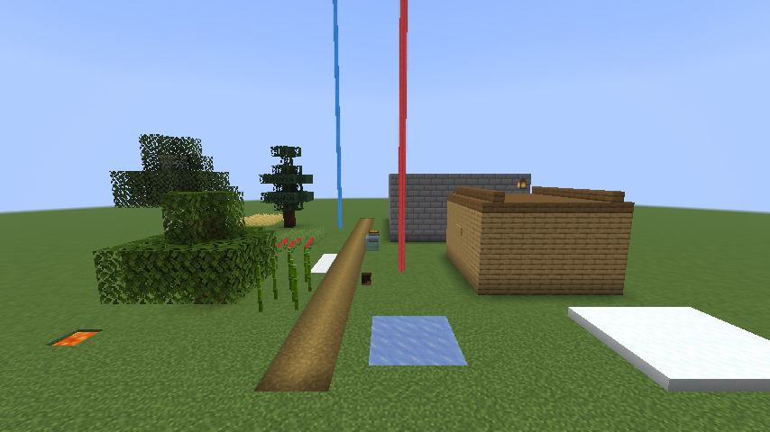

# Wegpunkte

Wegpunkte setzt der Spieler auf der [Vollbildkarte](vollbildkarte.md). Dort
stehen sie als Raute in ihrer Farbe, wie Mitspieler und der eigene Spieler;
was ausserhalb des Schirms liegt, steht am Rand in seiner Richtung. Ein
Klick legt eine Marke in die Mitte, ein Doppelklick heftet einen Wegpunkt
oder Mitspieler an die [Minimap](minimap.md). So hat es der User am 08.10.
gewünscht. Ebenso heftet ein Doppelklick eine eigene Form oder eine
Fläche oder einen Kreis vom Server an, siehe „Anheften“ (mod#36). Aus
Wegpunkten baut der Spieler eigene Linien und Regionen, siehe „Eigene
Formen“ (mod#79, mod#112).

## Bedienung

| Eingabe auf der Vollbildkarte | tut |
|---|---|
| Rechtsklick, „Wegpunkt setzen“ | der Eintrag unter „Hierher teleportieren“; setzt einen Wegpunkt auf den Block unter der Maus, in der ersten der 8 Farben (`Wegpunkte.FARBEN`), die in der Dimension noch frei ist, sind alle vergeben, reihum. Steht dort schon einer, bleibt es einer |
| Rechtsklick auf einen Wegpunkt, eine Ecke oder die Raute eines alten Rechtecks | nur das Menü dieses Objekts, siehe „Menü je Objekt“ |
| Rechtsklick, „Koordinaten setzen…“ | an einem Wegpunkt oder einer Ecke ein Feld mit ihrem `x z` wie bei „Wegpunkt bei …“; Enter legt sie dorthin und in die Mitte, siehe „Menü je Objekt“ |
| `Entf` oder `⌫` | löscht, was unter der Maus hervorgehoben steht, wie „… löschen“ im Menü: einen Wegpunkt, auch den Todespunkt, eine Ecke, am Griff die ganze Form, die Raute eines alten Rechtecks. `⌫`, weil die Taste auf dem Mac so heisst (Reviewer). Nichts auf freier Karte, im offenen Feld (dort löscht sie Zeichen), bei offenem Menü, bei gedrückter Taste und solange eine Form im Bau ist. Nichts vom Server. Wie im Menü ohne Rückgängig (mod#149) |
| Rechtsklick auf einen Wegpunkt, den Griff einer Form oder die Raute eines alten Rechtecks, „Ebene …“ | legt es in eine eigene Ebene, auch in eine neue, siehe „Eigene Ebenen“ |
| Rechtsklick, „Wegpunkt bei …“ | öffnet an der Stelle des Menüs ein Eingabefeld mit `x z` des Blocks unter der Maus, wie bei „Name…“, siehe „Namen“. Enter nimmt `x z`, `x, z` oder `x y z`, ganze Zahlen aus Ziffern in ASCII, x und z höchstens 30 000 000 weit (`Wegpunkte.koordinaten`); y zählt nicht, ein Wegpunkt hat nur x und z, so sagt es auch der Hinweis unten links. Dann setzt es dort einen Wegpunkt in der jetzigen Dimension wie „Wegpunkt setzen“ und legt ihn in die Mitte. Was keine Koordinaten sind, nimmt Enter nicht; der Text wird rot. Gewünscht vom User am 18.10. (mod#129) |
| Klick auf eine Marke | legt sie in die Mitte, sobald kein zweiter Klick mehr folgen kann, 250 ms nach dem Loslassen: einen Wegpunkt, einen Mitspieler oder den eigenen Spieler. So kommt man vom Wegpunkt zum eigenen Spieler zurück. Wer auf einer Marke zu ziehen beginnt und sich weiter als 3 Einheiten vom Druckpunkt entfernt (`Karte.ZUG`), zieht nur die Karte |
| Doppelklick auf einen Wegpunkt oder Mitspieler | heftet ihn an die Minimap oder löst ihn wieder; die Karte bewegt sich dabei nicht, siehe „Doppelklick“ unten |
| Linke Taste 0,5 s still auf einem Wegpunkt halten | er hängt an der Maus, die Karte zieht nicht mit; beim Loslassen liegt er auf dem Block darunter, mit Farbe und Anheften (`Wegpunkte.verschiebe`). Liegt dort schon einer, bleibt er, wo er war; `Esc` bricht ab. Still heisst: nie weiter als 3 Einheiten vom Druckpunkt weg (`Karte.ZUG`); das Zittern der Hand hin und her zählt nicht, nur der Abstand. Bis 0.2.32 zählte der ganze Weg der Maus: Mit 1 bis 2 Pixeln Zittern fügte ein Linksklick in einer Form im Bau oft nichts an, und Halten ging kaum (mod#112). Unter 0,5 s ist es ein Klick oder ein Zug wie sonst (`Karte.HALTEN_MS`, mod#75). Bis 0.2.36 waren es 2 s, dem User zu lang; 0,5 s hat der Reviewer entschieden (mod#112). Ein Klick dauert kürzer. Nur Wegpunkte, nicht die Rauten eigener Regionen |
| Doppelklick in eine eigene Region, auf eine eigene Linie, auf die Raute eines alten Rechtecks, auf eine Fläche, einen Kreis, eine Nadel oder ein Banner vom Server | heftet sie an die Minimap oder löst sie wieder, siehe „Anheften“ |
| Rechtsklick, „Linie/Region von hier“ | beginnt eine eigene Form mit einer Ecke auf dem Block unter der Maus, auf einem Wegpunkt auf dessen Block, siehe „Eigene Formen“ |
| Linksklick auf die Karte, solange eine Form im Bau ist | setzt eine Ecke, auf einem Wegpunkt auf dessen Block, statt ihn in die Mitte zu legen, sonst auf den Block darunter; auf die erste Ecke schliesst er bei drei und mehr die Region. Ziehen verschiebt die Karte wie sonst |
| Rechtsklick auf eine Ecke, „Eckpunkt hinzufügen“ | neue Ecken zwischen ihr und der nächsten, siehe „Eigene Formen“ |
| Rechtsklick auf eine Ecke, „Eckpunkt löschen“ | nimmt sie aus der Form; aus einer Region mit drei Ecken wird eine Linie, eine Linie mit zwei fällt weg |
| Beim Ziehen einer Ecke oder eines Wegpunkts `Strg` halten | er rastet auf die nächste Ecke einer anderen Form oder, eine Ecke, auf den nächsten Wegpunkt ein, höchstens 8 Einheiten weg, siehe „Einrasten“ |
| Linke Taste 0,5 s still auf einer Ecke halten | sie hängt an der Maus, die Form folgt ihr, und sie liegt beim Loslassen auf dem Block darunter; `Esc` bricht ab |
| Linke Taste 0,5 s still auf dem Griff in der Mitte einer Form halten | die ganze Form hängt an der Maus; beim Loslassen liegt sie um ganze Blöcke verschoben; `Esc` bricht ab, siehe „Eigene Formen“ |
| Rechtsklick, solange eine Form im Bau ist | schliesst sie ab: mit zwei Ecken eine Linie, mit mehr eine Region; mit einer nur ein Hinweis. Am Griff einer Form statt dessen ihr Menü mit „Form fertig“ ab zwei Ecken und „Form abbrechen“ |
| `Esc`, oder am Griff „Form abbrechen“ | verwirft die Form im Bau; eine geänderte bleibt, wie sie war |
| Rechtsklick auf den Griff einer eigenen Form | ihr Menü: „An die Minimap heften“ oder „Von der Minimap lösen“, „Name…“, „Farbe…“, „Eckpunkt hinzufügen“, „Form löschen“; siehe „Eigene Formen“, „Namen“ und „Farbe“ |

- **Unter der Maus** steht hervorgehoben, was ein Klick dort träfe: ein
  Wegpunkt oder die Raute eines alten Rechtecks mit hellem statt bunten oder
  ohne Ring, eine Ecke oder ein Griff mit hellem statt dunklem Rand
  (`Karte.schwebe`). Eine Marke geht einer Ecke vor, eine Ecke einem Griff,
  wie beim Klick. Nichts, solange ein Menü offen ist, etwas gezogen wird
  oder die Maus über einem Knopf oder der Tafel steht. In Einheiten des GUI,
  im selben Zug wie die Marke gezeichnet; so flackert nichts. Gewünscht vom
  User am 18.10., „dass man sieht, dass man damit interagieren kann“
  (mod#128).
- **Doppelklick:** Das Spiel meldet einen Klick als doppelt, wenn derselbe
  Knopf im selben Schirm weniger als 250 ms nach dem letzten kommt, gleich
  wo, und nur, wenn der Schirm den letzten Klick angenommen hat
  (`mouseClicked` gab `true`; `MouseHandler.onButton`, belegt per javap am
  Client 26.3). Die Karte zählt ihn nur, wenn der zweite Druck höchstens
  3 Einheiten vom ersten weg ist (`Karte.ZUG`), für jedes Ziel, auch
  Flächen und Überschriften der Ebenen. Bis 0.2.36 heftete ein schneller
  Klick auf B kurz nach einem auf A den Wegpunkt A an, statt B in die
  Mitte zu legen (mod#112). Die Karte nimmt jeden Linksklick an, auch
  einen auf freie Karte, sonst zählte ein Doppelklick auf eine Fläche nie. Der erste
  Klick auf eine Marke legt sie erst in die Mitte, wenn 250 ms lang kein
  zweiter kam (`MouseHandler.DOUBLE_CLICK_THRESHOLD_MS`, `Karte.wartend`);
  so bewegt ein Doppelklick die Karte nicht, wie der User es will (mod#75).
  Der zweite zählt für die Marke des ersten (`Karte.letzte`), nicht für die
  unter der Maus, und hebt das Zentrieren auf. Jeder andere Klick vergisst
  sie; ein schneller Klick nach „Wegpunkt setzen“ heftet so nichts an.
- **Doppelklick auf ein Objekt vom Server:** Der erste Klick merkt sich
  beim Loslassen ohne Zug das Ziel unter der Maus (`Karte.letztesZiel`),
  eine Nadel, ein Banner, eine Fläche oder einen Kreis mit `id`; eine Nadel
  geht vor, wie bei der Tafel. Liegt dort eine eigene Form, merkt er sich
  sie statt der Fläche oder des Kreises vom Server darunter
  (`Karte.letzteEigene`), so wie sie über ihnen gezeichnet ist. Bis 0.2.17
  ging die Fläche vom Server vor, und eine eigene Region in einem Land vom
  Server liess sich nicht anheften. Der zweite heftet es an, wenn unter ihm
  dasselbe Ziel liegt; ein Knopf geht vor. Eine Tafel hält dabei keiner
  der Klicks, siehe [Ebenen](ebenen.md), „Infotafel“.
- **Treffer:** eine halbe Kopfseite und eine Einheit um die Mitte der
  Marke. Ein Wegpunkt oder Mitspieler geht dem eigenen Kopf vor, sonst
  liesse sich ein Wegpunkt am eigenen Standort nicht greifen; sonst die
  zuletzt gezeichnete zuerst. Die Knöpfe oben rechts gehen vor.
- **Ohne Namen:** Die Farbe unterscheidet die Wegpunkte; unten links stehen
  die Koordinaten unter der Maus, siehe [Vollbildkarte](vollbildkarte.md),
  „Bedienung“.

## Am Rand

- **Vollbildkarte:** Eine Marke, die nicht mindestens 14 Einheiten
  (`Karte.RAND`) vom Rand des Schirms liegt, rückt auf der Linie von der
  Mitte des Schirms zu ihr bis dorthin (`Kartenblick.marke`). Die Seite
  sagt so die Richtung, nicht die Entfernung. Die 14 Einheiten lassen Platz
  für den Namen über einem Kopf. Den Knöpfen rechts oben weicht eine Marke
  am Rand aus, oben nach links, rechts nach unten.
- **Auf der Karte:** Eine Marke steht auf dem Pixel, auf dem die Karte
  ihren Ort zeichnet, und wackelt beim Ziehen und Laufen nicht gegen sie.
  Auf der Vollbildkarte rechnen Kacheln, Marken und Klicks von derselben
  ganzzahligen Kante aus, der Kante des Pixels 0 der Basis
  (`Kartenblick.kanteX`): Kachel `tx` liegt bei `kante + tx · kachel ·
  lupe`, eine Marke bei `kante + B / teiler · lupe` (`Kartenblick.rasterX`).
  Umgekehrt nehmen „Wegpunkt setzen“, „Hierher teleportieren“ und die
  Koordinaten unten links den Block, den die Karte unter der Maus zeichnet
  (`Kartenblick.basisRasterX`). So stimmen sie auch in Doubles überein. Auf der
  Minimap rechnet die Marke von der Kante des Bildes aus `Minimap.ecke`
  (`Minimap.pixel`, `Minimap.marke`).
- **Namen** über Köpfen stehen ganz auf dem Schirm. Träfe der Name über
  dem Kopf die Knöpfe rechts oben, steht er unter dem Kopf; erst wenn auch
  das sie träfe, links neben ihnen (`Kartenblick.name`). Die
  Knöpfe misst die Karte an ihren eigenen Grenzen.
- **Minimap:** Angeheftete Wegpunkte und Mitspieler, die ausserhalb der
  Form liegen, stehen an ihrem Rand in ihrer Richtung, rund am Kreis, eckig
  am Quadrat, eine halbe Kopfseite und eine Einheit nach innen geklemmt. Mitspieler, die nicht angeheftet
  sind, stehen wie bisher nur in der Form; Wegpunkte, die nicht angeheftet
  sind, gar nicht.
- **Mitspieler** gibt es nur, solange der Server sie nennt, siehe
  [Minimap](minimap.md), „Mitspieler“. Ein angehefteter Mitspieler, den er
  nicht nennt, fehlt auch am Rand.
- **Angeheftet** zeigt die Vollbildkarte mit einem Ring, dessen Farbe
  einmal in 2 s durch alle Töne läuft (`Karte.BUNT_MS`); die Minimap zeigt
  keinen Ring. Gewünscht hat der User den Ring für Mitspieler; Wegpunkte
  haben ihn ebenso, sonst sähe man nicht, welche angeheftet sind.

## Strahl

Über jedem angehefteten Wegpunkt steht in der Welt der Strahl eines
Leuchtfeuers in seiner Farbe, so wünscht es der Maintainer (mod#36).



- **Gezeichnet** mit dem Strahl des Spiels, `BeaconRenderer.submitBeaconBeam`,
  aus `LevelRenderEvents.COLLECT_SUBMITS` von Fabric (`Strahlen.zeichne`).
  Er sieht aus wie der eines Leuchtfeuers: dieselbe Textur, derselbe Lauf
  in 40 Ticks, innen 0,2 und aussen 0,25 Blöcke Radius. Ab 96 Blöcken
  waagrechtem Abstand wird er mit dem Abstand breiter, durchs Fernrohr
  nicht, wie beim Leuchtfeuer (`BeaconRenderer.extract`, belegt per javap am
  Client 26.3).
- **Unten** steht er auf dem Boden unter dem Laub, auf Wasser auf seiner
  Oberfläche: der Heightmap `MOTION_BLOCKING_NO_LEAVES` des Clients
  (`Level.getHeight`). Der Client bekommt `WORLD_SURFACE`, `MOTION_BLOCKING`
  und `MOTION_BLOCKING_NO_LEAVES` vom Server (`Heightmap.Types.sendToClient`,
  per javap). Ist der Chunk nicht geladen, beginnt der Strahl am Boden der
  Welt.
- **Oben** reicht er 2048 Blöcke hoch (`BeaconRenderer.MAX_RENDER_Y`), wie
  der Strahl eines Leuchtfeuers. Der Plan nannte die Bauhöhe; über ihr
  sähe man aber das Ende, wenn man höher fliegt.
- **Welche:** angeheftete Wegpunkte dieser Dimension, deren Block waagrecht
  höchstens die Sichtweite entfernt liegt, also Sichtweite × 16 Blöcke wie
  beim Leuchtfeuer (`Strahlen.waehle`). Höchstens 64 je Frame
  (`Strahlen.MAX_STRAHLEN`), die ersten in der Reihe der Wegpunkte.
- **Schalter** „Effekte in der Welt“ im Untermenü „Einstellungen …“, Vorgabe
  an, siehe [Minimap](minimap.md), „Bedienung“. Aus zeichnet der Mod
  keinen Strahl und keinen Schleier.
- **Kosten:** 64 Strahlen, die Grenze, kosten je Frame im Median 0,05 bis
  0,06 ms und im p95 0,07 bis 0,12 ms, gemessen am 11.10., siehe
  [Strahl, Kosten je Frame](messungen/2026-10-11-strahl.md).
- **Ohne Allokation im Mod je Frame:** Die Indizes der Gewählten liegen in
  einem festen Feld, die Liste der Wegpunkte ist eine feste Sicht, und den
  Namen der Dimension rechnet `Strahlen` nur beim Wechsel. Der Strahl des
  Spiels selbst legt je Aufruf zwei kleine Objekte an, wie bei jedem
  Leuchtfeuer.

## Schleier

Am Rand angehefteter Regionen und Kreise steht in der Welt ein Schleier in
ihrer Farbe, so wünscht es der Maintainer (mod#36): unten auf dem Gelände,
nach oben immer durchsichtiger.


- **Welche:** dieselben Formen wie auf der Minimap, siehe „Anheften“:
  angeheftete Flächen und Kreise der sichtbaren Ebenen, angeheftete eigene
  Regionen aus Wegpunkten und alte Rechtecke, in der Dimension des Spielers
  (`Wegpunkte.minimap`). Linien bekommen keinen Schleier, auch eigene
  nicht, entschieden vom Reviewer (mod#79).
- **Farbe:** der Rand der Form, ohne sichtbaren Rand ihre Füllung ohne
  Alpha; eine eigene Region in ihrer Farbe (`Schleier.farbe`).
- **Form:** je Stück der Kante ein senkrechtes Viereck. Die Kanten teilt
  der Mod, wo sie eine ganze Zahl in x oder z kreuzen, so liegt jedes Stück
  in einem Block (`Schleier.teile`). Ein Kreis wird ein Vieleck mit Sehnen
  von höchstens einem Block, nur über den Bogen beim Spieler
  (`Schleier.bogen`); so kostet ein Kreis von 100 000 Blöcken nur sein
  Stück in Sichtweite.
- **Höhe:** 4 Blöcke (`Schleier.HOEHE`). Unten ist der Schleier zur Hälfte
  so deckend wie seine Farbe (`Schleier.DECKUNG`), oben ganz durchsichtig,
  dazwischen linear.
- **Regler** „Schleier“ im Untermenü „Einstellungen …“, neben „Effekte in
  der Welt“ (`Anzeige.SchleierRegler`): für eigene Regionen und alte
  Rechtecke 4 bis 16 Blöcke hoch, in ganzen Blöcken, Vorgabe 4
  (`Minimap.schleier`, gespeichert als `schleier`, gekappt auch beim
  Lesen). Höhe und Deckung steigen zusammen: unten von 50 % bei 4 Blöcken
  linear bis 90 % bei 16 (`Schleier.deckung`, `Schleier.MAX_DECKUNG`).
  Flächen und Kreise vom Server bleiben bei 4 Blöcken und 50 %; welche
  Form eigen ist, sagt `Wegpunkte.eigen`. Es sind gleich viele Vierecke,
  nur höher; die Grenze von 5 000 bleibt, und je Frame kommt keine Arbeit
  dazu. Eine andere Höhe baut neu, wie eine andere Sichtweite. Gewünscht
  vom User am 18.10.: „ein Regler, der Höhe und Deckkraft zusammen
  hebt“.

  
- **Gelände:** Die Ecken unten stehen auf der Heightmap
  `MOTION_BLOCKING_NO_LEAVES` des Clients, also unter dem Laub und auf der
  Oberfläche von Wasser, wie der Strahl. Der Client hat `WORLD_SURFACE`,
  `MOTION_BLOCKING` und `MOTION_BLOCKING_NO_LEAVES`, die drei Heightmaps
  mit `Heightmap.Usage.CLIENT` (`Heightmap.Types.sendToClient`, belegt per
  javap am Client 26.3). Liegt eine Ecke auf der Grenze mehrerer Blöcke,
  nimmt der Mod den höchsten, so taucht der Schleier an keiner Stufe ein
  (`Schleier.hoehe`). So folgt er dem Hang.
- **Gezeichnet** mit `RenderTypes.debugQuads` aus
  `LevelRenderEvents.COLLECT_SUBMITS`: Ecken mit Farbe, gemischt wie
  Durchsichtiges, mit Tiefentest, aber ohne in die Tiefe zu schreiben, und
  ohne Culling, also von beiden Seiten zu sehen
  (`RenderPipelines.DEBUG_FILLED_SNIPPET`: `DepthStencilState` mit
  `GREATER_THAN_OR_EQUAL` und ohne Schreiben, `withCull(false)`; belegt per
  javap).
- **Gebaut** nur bei einer Änderung (`Schleier.baue`): andere Ebenen oder
  Wegpunkte (`Ebenen.stand`, `Wegpunkte.stand`), andere Dimension oder
  Sichtweite, der Spieler mehr als 16 Blöcke vom Ursprung des letzten Baus
  (`Schleier.NEU_AB`), oder ein Chunk unter dem Schleier ändert sich, über
  denselben Haken `setSectionDirty` wie die Minimap. Neu gebaut wird
  höchstens alle 500 ms (`Schleier.NEU_FRUEHESTENS_MS`); nur der erste Bau
  und eine andere Dimension warten nicht. Gebaut wird bis zur Sichtweite
  und 16 Blöcke darüber, so reicht der Schleier, bis der Spieler so weit
  gegangen ist. Über einem Chunk, der nicht geladen ist, fehlt er, bis der
  Chunk kommt.
- **Je Frame** reicht der Mod nur die fertigen Ecken weiter, relativ zum
  Ursprung des Baus; das Objekt, das sie schreibt, legt er einmal an.
- **Grenze:** höchstens 5 000 Vierecke (`Schleier.MAX_VIERECKE`), die
  nächsten zuerst, gemessen an der Mitte des Stücks. Darüber warnt das Log
  einmal, bis ein Bau wieder darunter liegt.
- **Kosten,** gemessen am 11.10., siehe
  [Schleier, Kosten je Frame](messungen/2026-10-11-schleier.md):

  | Fall | je Frame, Median | ein Bau, Median |
  |---|---|---|
  | 3 Regionen, 2 220 Vierecke | +0,16 bis +0,24 ms | 1,3 bis 1,4 ms |
  | 47 Regionen, an der Grenze von 5 000 | +0,32 bis +0,47 ms | 4,4 bis 4,7 ms |

  Je Frame mit 64 Strahlen. Ein Bau liest vor allem Höhen aus der Welt,
  70 bis 80 % seiner Zeit. Darum hat der Reviewer nach dem Profil die
  Grenze von 20 000 auf 5 000 gesenkt und den Bau auf höchstens alle
  500 ms gesetzt; bei 20 000 waren es 0,8 bis 2,1 ms je Frame und 5,2 ms je
  Bau. Sammeln und Sortieren gingen dabei über alle Stücke in Reichweite,
  nicht nur die nächsten 5 000; bei 47 Regionen waren das rund 2 ms des
  Baus.
- **Auswahl statt Sortieren:** Von allen Stücken in Reichweite wählt der
  Bau die 5 000 nächsten aus, ohne alle zu sortieren (`Schleier.waehle`),
  und sortiert nur diese (`Schleier.naechste`). Das ergibt dieselben in
  derselben Reihe wie volles Sortieren, denn jeder Schlüssel trägt seinen
  Index.
- **Nur im Kreis geteilt:** Eine Kante teilt der Bau nur, soweit sie im
  Kreis um den Spieler liegt, einen Block weiter als die Reichweite
  (`Schleier.imKreis`). Ein Stück mit der Mitte in der Reichweite liegt ganz
  darin, so fehlt keins; was ausserhalb liegt, entsteht gar nicht erst.
- **Gemessen am 19.10.,** siehe
  [Schleier, Auswahl statt Sortieren](messungen/2026-10-19-schleier-auswahl.md):
  Ein Bau mit 47 Regionen dauert im Median 3,44 statt 4,31 ms, rund 20 %
  weniger. Das Sortieren sinkt von 1,34 auf 0,49 ms, das Sammeln steigt
  von 0,57 auf 0,70 ms; die Höhen bleiben bei rund 2,6 ms und sind jetzt
  drei Viertel des Baus. Je Frame ändert sich nichts.
- **Schalter** „Effekte in der Welt“, siehe „Strahl“.

## Grösse

- **Köpfe und Wegpunkte** sind 6 Einheiten des GUI gross (`Minimap.KOPF`),
  vorher waren es 8. Auf der Minimap wachsen sie mit deren Seite:
  6 × Seite / 128, mindestens 4, also 4 bei 64 Einheiten und 12 bei 256
  (`Minimap.kopf`). Mit dem GUI-Massstab wachsen sie wie alles im GUI.
- **Rand und Pfeil** wachsen mit: Kopf, Pfeil und Raute sind in Achteln
  oder Sechzehnteln gezeichnet und mit der Grösse skaliert
  (`Minimap.avatar`, `Mitspieler.kopf`, `Minimap.wegpunkt`).
- **Auf ganze Pixel** des Schirms gelegt, wie die Karte darunter.
- **Texel:** Gleich breit sind die 8 Texel eines Gesichts nur, wenn seine
  Seite in Pixeln ein Vielfaches von 8 ist. Bei 6 Einheiten und
  GUI-Massstab 2 sind es 12 Pixel, die Texel also abwechselnd 1 und 2
  Pixel breit. Ob 6 Einheiten gut aussehen, sieht der User im Spiel.

## Todespunkt

Stirbt der Spieler, setzt der Mod einen Wegpunkt dort, wo er gestorben
ist, so findet er zurück. Gewünscht vom User am 18.10. (mod#129); Plan vom
Reviewer freigegeben.

- **Wann:** im Client-Tick, wenn `isDeadOrDying` von falsch auf wahr
  wechselt, einmal je Tod (`HeroicMap.gestorben`), auf dem Block des
  Spielers in seiner Dimension.
- **Mehrere,** so viele, wie der Regler „Todespunkte“ sagt, 1 bis 16,
  gewünscht vom User am 19.10. (mod#151). Jeder Tod setzt einen neuen
  (`Wegpunkte.setzeTod`); sind es mehr, fallen die ältesten weg. Ihre
  Folge ist die der Tode, der letzte der neueste; eine Zeit merkt sich der
  Mod nicht, die Folge in der Liste reicht.
- **Derselbe Block:** Stirbt der Spieler auf dem Block eines früheren
  Todespunkts, wird der der neueste. Liegt auf dem Block ein Wegpunkt, gibt
  es keinen; der Block ist schon markiert, und die übrigen bleiben.
- **Angeheftet** wird der neue beim Setzen, und der vorige neueste wird
  gelöst, auch wenn der Spieler ihn selbst angeheftet hatte; so führt ein
  Strahl zum letzten Tod, siehe „Strahl“. So hat es der Reviewer
  entschieden. Sonst wie ein Wegpunkt: Doppelklick löst oder heftet an, ein
  Klick legt ihn in die Mitte, am Rand steht er wie die anderen Marken.
- **Nicht verschiebbar,** so hat es der User entschieden: Gehalten hängt
  ein Todespunkt nicht an der Maus, und „Koordinaten setzen…“ gibt es an
  ihm nicht. Ein Rechtsklick bietet „Todespunkt löschen“, ebenso `Entf`.
- **Gezeichnet** als dunkle Raute mit hellem ✕ (`Minimap.TOD`,
  `Minimap.TOD_KREUZ`), auf Vollbildkarte und Minimap; sein Strahl ist
  dunkel. Die Arme des ✕ sind 5 Sechzehntel der Marke lang und 0,75 dick;
  mit 1 lief es bei GUI-Massstab 2 zu einem hellen Fleck zusammen, wie
  ein Nachstellen der Pixel zeigte (ein Pixel gilt, wenn seine Mitte im
  Viereck liegt). Eine Farbe aus der Liste nimmt er nicht; der nächste Wegpunkt
  bekommt sie, als gäbe es ihn nicht.
- **Im Chat** steht „Todespunkt gesetzt bei x z“, unterstrichen. Ein Klick
  darauf ruft `/hmap karte x z`, siehe [Download](download.md), „Befehle“;
  das Spiel schickt einen Klick im Chat über `sendUnattendedCommand`, und
  dort fängt Fabric die Befehle des Clients ab (per javap an 26.3 und am
  Fabric API). Die Karte öffnet sich in der jetzigen Dimension; wer in
  einer anderen gestorben ist, sieht den Todespunkt erst dort.
- **Regler** „Todespunkte: aus, 1 … 16“ im Untermenü „Einstellungen …“,
  neben „Auflösung“, Vorgabe 1 (`Anzeige.TodRegler`, `Minimap.todespunkte`,
  gespeichert als `todespunkte`). Weniger nimmt gleich die ältesten weg
  (`Wegpunkte.kappeTode`), aus alle; dann setzt ein Tod keinen. Bis 0.2.57
  war es ein Schalter `todespunkt`: aus wird 0, an oder ohne Eintrag 1.
- **Datei:** eigens als Liste `tode`, der älteste zuerst, nicht in der
  Liste `wegpunkte`, siehe „Ablage“. Dazu steht der neueste noch einmal als
  `tod`; so behält eine ältere Version, die nur `tod` kennt, ihren einen.
  Ohne `tode` liest der Mod `tod`, also eine alte Datei mit einem. Eine id
  bekommt jeder beim Lesen wie ein Wegpunkt ohne.

## Menü je Objekt

Ein Rechtsklick zeigt nur, was das Objekt unter der Maus betrifft
(`Karte.menue`), gewünscht vom User am 19.10. (mod#149). Was unter der
Maus liegt, zählt wie beim Zeigen und beim Klick: ein Wegpunkt oder die
Raute eines alten Rechtecks vor einer Ecke vor dem Griff einer Form.

| Objekt | Einträge |
|---|---|
| Wegpunkt | „Hierher teleportieren“, „Koordinaten setzen…“, „Linie/Region von hier“ auf seinem Block, „Ebene …“, „Wegpunkt löschen“ |
| Todespunkt | „Hierher teleportieren“, „Todespunkt löschen“; er bleibt, wo er ist, und in Base |
| Ecke einer eigenen Form | „Koordinaten setzen…“, „Eckpunkt hinzufügen“, „Eckpunkt löschen“ |
| Raute eines alten Rechtecks | „Ebene …“, „Region löschen“ |
| Griff einer eigenen Form | ihr Menü, siehe „Eigene Formen“, „Menü am Griff“ |
| freie Karte, auch in einer Fläche | „Hierher teleportieren“, „Wegpunkt setzen“, „Wegpunkt bei …“, „Linie/Region von hier“ |

- **Teleport** bleibt am Wegpunkt und am Todespunkt, entschieden vom
  Reviewer: Er betrifft den Ort, und nach einem Tod ist er der Weg zurück.
- **Im Bau** gibt es kein Menü ausser am Griff; ein Rechtsklick schliesst
  die Form ab, siehe „Eigene Formen“.
- **„Koordinaten setzen…“** öffnet an der Stelle des Menüs ein Feld mit
  `x z` des Objekts (`Karte.koordinaten`). Enter nimmt dieselben Formen
  wie „Wegpunkt bei …“, `x z`, `x, z` oder `x y z` (`Wegpunkte.koordinaten`),
  legt das Objekt dorthin und es in die Mitte. Was keine Koordinaten sind,
  steht rot.
  - Eine Ecke liegt danach auf diesem Block, wie nach dem Loslassen; auf
    dem Block ihrer Nachbarin werden beide eine.
  - Ein Wegpunkt auf einen Block, auf dem schon einer liegt: Enter nimmt
    es nicht, der Text steht rot, und unten links steht „Dort liegt schon
    ein Wegpunkt“.
  - Den Todespunkt gibt es dort nicht; er lässt sich nicht verschieben,
    so hat es der User entschieden (mod#151).

## Einrasten

Hält der Spieler beim Ziehen einer Ecke oder eines Wegpunkts `Strg`
(auf dem Mac `⌘`, `Minecraft.hasControlDown`), rastet er auf ein nahes
Ziel ein (`Karte.einrasten`), gewünscht vom User am 19.10. (mod#149): So
schliessen Regionen sauber aneinander.

- **Ziele:** die Ecken anderer eigener Formen und, für eine Ecke, die
  Wegpunkte, alle in Ebenen, die an sind, und in dieser Dimension.
  Gemessen wird an der Lage des Blocks, nicht an der Marke: Die Marke
  eines fernen Wegpunkts steht am Rand, siehe „Am Rand“, und zählt nicht. Die
  Ecken der eigenen Form zählen nicht; liegt eine Ecke beim Loslassen auf
  dem Block ihrer Nachbarin, werden beide eine, wie ohne `Strg`. Ein
  Wegpunkt rastet nur auf Ecken ein, denn zwei Wegpunkte liegen nie auf
  einem Block.
- **Nah** heisst höchstens 8 Einheiten des GUI von der Maus, gemessen an
  den Lagen des letzten Frames; das nächste Ziel gewinnt. Entschieden vom
  Reviewer.
- **Beim Ziehen** steht, was an der Maus hängt, schon genau auf dem Ziel,
  und das Ziel ist hell wie unter der Maus. Ohne `Strg` folgt es der Maus
  wie bisher.
- **Beim Loslassen** zählt, ob `Strg` dann gedrückt ist: mit dem Ziel auf
  dessen Block (`Karte.ablage`), sonst auf dem Block unter der Maus.
- **Nicht** am Griff, wo die ganze Form hängt, und nicht auf Objekte vom
  Server.

## Eigene Formen

Eigene Linien und Regionen baut der Spieler aus eigenen Ecken, je ein
Marker wie ein Wegpunkt (mod#79, mod#112). Zwei Ecken sind eine Linie,
drei und mehr eine Region, ein Vieleck in der Folge der Ecken. Eine Ecke
ist ein Block (x, z), kein Wegpunkt; so will es der User: „eine Linie
sollte dann ein Punkte sein genau wie eine Region mit Eckpunkten“.

- **Beginnen:** Rechtsklick, „Linie/Region von hier“ beginnt eine Form mit
  einer Ecke auf dem Block unter der Maus, auf einem Wegpunkt auf dessen
  Block (`Karte.beginne`). Den Eintrag gibt es nur, solange keine Form im
  Bau ist.
- **Bauen:** Solange eine Form im Bau ist, setzt ein Linksklick ohne Zug
  auf die Karte eine Ecke (`Karte.hinzu`): auf einem Wegpunkt auf dessen
  Block, statt ihn in die Mitte zu legen, sonst auf den Block darunter, und
  höchstens 3 Einheiten neben einer Ecke im Bau auf deren Block
  (`Karte.eckBlock`). Ziehen über `Karte.ZUG` verschiebt die Karte wie
  sonst. Ein Wegpunkt entsteht dabei nicht. Ein Linksklick auf die erste
  Ecke schliesst eine neue Form ab drei Ecken zur Region.
- **Abschliessen:** Ein Rechtsklick speichert die Form, wie sie ist, wie
  „Form fertig“ (`Karte.fertig`, `Wegpunkte.setzeForm`): mit zwei Ecken eine
  Linie, ab drei eine Region. Das gilt auch auf einem Wegpunkt, einer
  Ecke oder der Raute eines alten Rechtecks. Mit einer Ecke sagt er unten
  links „Mindestens zwei Eckpunkte; Esc bricht ab“ und tut sonst nichts.
  Am Griff einer Form, wo nichts darüber liegt, kommt statt dessen ihr
  Menü, siehe „Griff“. Gewünscht vom User am 19.10. (mod#149); bis dahin
  öffnete der Rechtsklick ein Menü zum Bauen.
- **Im Bau** verbindet eine gepunktete weisse Vorschau die Ecken, mit
  einer weissen Raute auf jeder, und die Stelle der nächsten Ecke mit der
  Maus. Unten links steht „Linksklick: Eckpunkt hier oder auf einem
  Wegpunkt, auf den ersten: Region; Rechtsklick: fertig; Esc bricht ab“.
  Ein Menü gibt es im Bau nur am Griff einer Form: ihr Menü, siehe
  „Griff“, mit „Form fertig“ und „Form abbrechen“ für die Form im Bau.
- **Keine Tafel,** solange die Form im Bau ist (`Karte.tafel`). Sonst ging
  die Tafel einer Region vom Server dort auf, wo das Menü war, lag über den
  Stellen, die der Spieler anklickt, und nahm deren Klick; so fügte ein
  Linksklick bis 0.2.17 auf einem Server mit Ländern oft nichts an (Test
  des Users am 10.10.).
- **Nicht dazu** kommt eine Ecke, die schon dabei ist, ausser der ersten
  zum Schliessen, und keine über 64 (`Wegpunkte.MAX_PUNKTE_FORM`). Wer die
  Dimension wechselt, verliert die Form im Bau.
- **Ecken** stehen auf der Vollbildkarte als kleine Rauten in der Farbe
  ihrer Form, mit dunklem Rand, immer, unter den Marken (`Karte.ecken`).
  Ein Klick trifft die Ecke, deren Mitte am nächsten liegt, höchstens 3
  Einheiten weg (`Karte.eckeUnter`); liegen zwei eng, die nähere, nicht die
  zuletzt gezeichnete. Ein Wegpunkt auf derselben Stelle geht vor, beim
  Linksklick wie beim Rechtsklick, siehe „Menü je Objekt“.
- **Eckpunkt hinzufügen** auf einer Ecke einer fertigen Form: Die Form kommt
  in den Bau (`Karte.bearbeite`), neue Ecken kommen zwischen diese und die
  nächste, jede weitere hinter die vorige neue. Nach der letzten Ecke einer
  Region ist die erste die nächste; an der letzten einer Linie hängt sie
  hinten an. Abschliessen speichert an derselben Stelle, mit Farbe und
  Anheften (`Wegpunkte.ersetze`); „Form abbrechen“ oder `Esc` lässt die Form,
  wie sie war. Gibt es sie beim Speichern so nicht mehr, etwa weil sie im
  Bau über „Form löschen“ ging, speichert das Abschliessen nichts und sagt
  unten links „Die Form gibt es so nicht mehr; die neuen Ecken sind nicht
  gespeichert“, statt sie still zu verwerfen (Review von #122).
- **Eckpunkt löschen** auf einer Ecke nimmt sie heraus, die Form bleibt.
  Aus einer Region mit drei Ecken wird eine Linie; eine Linie mit zwei Ecken
  fällt weg, eine Ecke allein ist keine Form.
- **Verschieben:** Linke Taste 0,5 s still auf einer Ecke halten, wie bei
  einem Wegpunkt: Sie hängt an der Maus und folgt ihr genau, nicht auf
  ganze Blöcke, und die Form folgt mit (`Karte.punkte`); an ihrem alten Ort
  fällt die Form solange weg (`Wegpunkte.ziehe`). Beim Loslassen liegt die
  Ecke auf dem Block darunter; `Esc` bricht ab. Liegt sie dann auf dem
  Block ihrer Nachbarin, werden beide eine. Bis 0.2.41 hing nur die Ecke an
  der Maus, und die Form sprang erst beim Loslassen nach; so hat es der User
  am 18.10. gewünscht (mod#128). Ein Wegpunkt folgt der Maus ebenso; an ihm
  hängt keine Form.
- **Griff:** In der Mitte jeder Form steht ein Griff, ein Quadrat in ihrer
  Farbe mit dunklem Rand und hellem Kern, grösser als eine Ecke
  (`Karte.griff`): bei einer Linie auf halber Länge, bei einer Region im
  Schwerpunkt ihrer Fläche, ohne Fläche in der Mitte ihres Kastens
  (`Wegpunkte.griff`). Linke Taste 0,5 s still darauf halten: Die ganze
  Form hängt an der Maus und folgt ihr; beim Loslassen liegen alle Ecken um
  den Weg der Maus verschoben, auf ganze Blöcke gerundet; `Esc` bricht ab.
  Eine Ecke geht dem Griff vor, eine Marke beiden. Ein kurzer Klick tut,
  was ein Klick dort sonst tut. Gewünscht vom User am 18.10. (mod#128).
- **Menü am Griff:** Ein Rechtsklick auf den Griff öffnet nur das Menü der
  Form (`Karte.formMenue`): „An die Minimap heften“ oder „Von der Minimap
  lösen“, wie der Doppelklick; „Name…“ oder „Name ändern…“, siehe „Namen“;
  „Farbe…“, siehe „Farbe“; „Ebene …“, siehe „Eigene Ebenen“;
  „Eckpunkt hinzufügen“, neue Ecken hinter der
  letzten, bei einer Region zwischen der letzten und der ersten, wie auf
  einer Ecke; „Form löschen“. Ist eine Form im Bau, fehlt „Eckpunkt
  hinzufügen“, dafür kommen „Form fertig“ und „Form abbrechen“ dazu
  (`Karte.bauEnde`). In die Fläche einer Region oder auf eine Linie
  geklickt, kommt das allgemeine Menü ohne Einträge der Form; so löscht
  niemand eine Form, der nur einen Wegpunkt in ihr setzen will. Bis 0.2.41
  stand „Form löschen“ überall in der Form. Gewünscht vom User am 18.10.,
  Rechtsklick auf die Mitte (mod#128).
- **`Esc`** lässt eine gedrückte Taste auf Ecke, Griff oder Wegpunkt los,
  nicht nur das, was schon an der Maus hängt (`Karte.keyPressed`). Sonst
  hängte das Halten das Ding nach `Esc` wieder an, und das Loslassen ging
  ins Leere.
- **Wegpunkte** und Formen sind getrennt. Wer einen Wegpunkt verschiebt
  oder löscht, ändert keine Form. Bis 0.2.37 nannte eine Form die ids ihrer
  Wegpunkte und ging mit ihnen; eine alte Datei zieht beim Lesen um, siehe
  „Ablage“.
- **Höchstens 256** Formen je Welt (`Wegpunkte.MAX_EIGENE_FORMEN`);
  darüber speichert „Form fertig“ nichts, und unten links steht „Höchstens
  256 eigene Formen“.
- **Farbe** wie ein Wegpunkt: die erste der 8 Farben, die in der Dimension
  unter Wegpunkten, Rechtecken und Formen noch frei ist.
- **Gezeichnet** auf der Vollbildkarte über den Formen der Ebenen
  (`Wegpunkte.form`, `Wegpunkte.karte`): eine Region als Fläche in ihrer
  Farbe zu 25 % mit 1 Einheit Rand, eine Linie 2 Einheiten breit, beide
  durch die Mitten der Blöcke ihrer Ecken.
- **Höhe:** Eine Ecke hat nur x und z. Der Schleier einer angehefteten
  Region nimmt die Höhe je Stück aus der Höhenkarte des Spiels und lässt
  Stücke in Chunks aus, die nicht geladen sind, bis sie es sind; siehe
  „Schleier“. Strahlen stehen nur über Wegpunkten.
- **Treffer:** in einer Region, oder höchstens 3 Einheiten des GUI neben
  einer Linie (`Karte.eigeneUnter`, `Tafeln.abstand`); überlappen zwei, die
  zuletzt gebaute. Ein Wegpunkt geht vor.
- **Löschen:** Rechtsklick auf den Griff, „Form löschen“, siehe „Menü am
  Griff“.
- **Anheften:** Doppelklick, siehe „Anheften“. Auch Linien, entschieden
  vom Reviewer; den Schleier in der Welt bekommen nur Regionen.

## Namen

Eigene Linien und Regionen tragen einen Namen, wenn der Spieler ihnen einen
gibt. Er steht auf der Karte wie die Namen vom Server. Gewünscht vom User
am 18.10. (mod#128); Plan, Farbe und Ort hat der Reviewer freigegeben.

- **Geben:** Rechtsklick auf den Griff, „Name…“, mit Namen „Name ändern…“
  (`Karte.benennen`). An der Stelle des Menüs öffnet sich ein Eingabefeld
  des Spiels, 160 Einheiten breit, mit dem Namen darin. Enter speichert,
  leer heisst ohne Namen (`Wegpunkte.benenne`); `Esc` oder ein Klick neben
  das Feld bricht ab. Unten links steht „Enter: Name speichern, leer ohne
  Namen; Esc bricht ab“.
- **Tasten:** Solange das Feld offen ist, gehört ihm jede Taste
  (`Karte.keyPressed`): Die Kartentaste tippt, statt die Karte zu
  schliessen, und `Esc` schliesst nur das Feld. Nichts ist hervorgehoben,
  keine Tafel geht auf. Baut das Spiel den Schirm neu auf, etwa bei einer
  anderen Fenstergrösse, ist das Feld zu, ohne zu speichern.
- **Erlaubt** (`Wegpunkte.name`): höchstens 32 Zeichen
  (`Wegpunkte.MAX_NAME`), Codes mit § gestrichen, NFC, ohne Steuer- und
  Formatzeichen, aussen ohne Leerraum. Ebenso beim Lesen der Datei; ein
  Name, der kein Text ist, fehlt, die Form bleibt.
- **Gezeichnet** als Kartenschrift in den Vorgaben vom Server
  (`Wegpunkte.schrift`), siehe [Ebenen](ebenen.md), „Kartenschrift“:
  `#2B2B2B` mit heller Kontur `#F2E8D0`, 1,25 Einheiten breit wie beim
  Namen einer Nadel (`Wegpunkte.NAME_KONTUR`). Nicht in der Farbe der Form:
  Die steht schon an Rand und Griff; so hat es der Reviewer entschieden,
  für Einheitlichkeit und Lesbarkeit.
- **Grösse** nach der Form (`Wegpunkte.groesse`): Grossbuchstaben so hoch
  wie die halbe kürzere Seite des Kastens einer Region oder ein Viertel der
  Länge einer Linie, mindestens 4 und höchstens 16 Blöcke
  (`Wegpunkte.NAME_KLEINSTE`, `Wegpunkte.NAME_GROESSE`); 16 ist die Vorgabe
  vom Server. Unter 8 Einheiten fehlt der Name, über 96 bleibt er 96 hoch;
  so verschwinden die Namen kleiner Formen beim Herauszoomen zuerst. Mit
  16 Blöcken für alle war der Name einer Region von 6 × 6 Blöcken rund 100
  Blöcke breit und erschlug die Form; entschieden vom Reviewer am 18.10.
- **Wo:** eine Schrifthöhe neben dem Griff, so deckt der Griff keinen
  Buchstaben: bei einer Region waagrecht darunter, bei einer Linie parallel
  zu ihr auf ihrer Nordseite, bei einer Linie von Nord nach Süd auf ihrer
  Westseite. Eine Linie hat genau zwei Ecken. Der Abstand zählt in Blöcken;
  ist die Schrift auf 96 Einheiten gekappt, steht sie weiter vom Griff weg.
- **Minimap:** Der Name steht dort, wenn die Form angeheftet ist, wie jede
  Kartenschrift höchstens ein Zehntel ihrer Seite hoch.
- **Bleibt** beim Ziehen, wo er der Form an der Maus folgt, beim Ändern der
  Ecken und beim Anheften (`Wegpunkte.ersetze`, `Wegpunkte.umschalten`).

## Farbe

Eigene Linien und Regionen bekommen auf Wunsch eine eigene Farbe als
`#RRGGBB`, statt einer der 8 aus der Liste (`Wegpunkte.FARBEN`). Gewünscht
vom User am 18.10.; Plan vom Reviewer freigegeben.

- **Wählen:** Rechtsklick auf den Griff, „Farbe…“. An der Stelle des Menüs
  öffnet sich dasselbe Eingabefeld wie bei „Name…“, mit der jetzigen Farbe
  als `#RRGGBB` darin (`Karte.oeffne`). Enter nimmt `#RRGGBB` oder
  `RRGGBB` in beliebiger Schreibung, aussen ohne Leerraum
  (`Wegpunkte.hex`); leer heisst zurück zur Farbe aus der Liste. Was keine
  Farbe ist, nimmt Enter nicht: Das Feld bleibt offen, der Text wird rot,
  bis der Spieler ihn ändert. `Esc` oder ein Klick daneben bricht ab, und
  jede Taste gehört dem Feld, wie bei „Name…“, siehe „Namen“.
- **Gilt überall,** wo die Form ihre Farbe zeigt (`EigeneForm.argb`):
  Fläche zu 25 % und Rand auf Vollbildkarte und Minimap, Ecken, Griff,
  Schleier. Ändern der Ecken, Verschieben, Anheften und Namen lassen sie.
- **Nur ASCII:** Ziffern anderer Schriften nimmt `Wegpunkte.hex` nicht,
  obwohl `Integer.parseInt` sie läse.
- **Datei:** `hex` neben dem Index `farbe`, siehe „Ablage“; ohne eigene
  Farbe fehlt das Feld. Eine ältere Version nimmt die Farbe des Index.
- **Wegpunkte** haben weiter nur die 8 Farben, siehe „Was fehlt“.

## Eigene Ebenen

Wegpunkte, eigene Formen und alte Rechtecke liegen je in einer eigenen
Ebene, die sich an- und ausschalten lässt. Gewünscht vom User am 18.10.
(mod#130); Plan vom Reviewer freigegeben. Teilen als Code siehe „Ebenen
teilen“.

- **Base** (`Wegpunkte.BASE`, id 0) gibt es immer. Sie heisst fest „Base“,
  der User nannte sie „Standardlayer“, und lässt sich weder umbenennen
  noch löschen, wohl aber ausschalten. Alles Neue kommt nach Base, auch
  der Todespunkt. Ist Base aus, sagt die Vollbildkarte bei einem neuen
  Wegpunkt und einer neuen Form unten links „Neues kommt nach Base, und
  Base ist aus; es steht erst, wenn du sie anschaltest“
  (`Karte.neuInBase`); von selbst schaltet sie Base nicht an. So
  entschieden im Review von #143.
- **Höchstens 32** eigene Ebenen neben Base (`Wegpunkte.MAX_EBENEN`); ihr
  Name wie der einer Form, 1 bis 32 Zeichen, siehe „Namen“
  (`Wegpunkte.name`). Eine neue bekommt die nächste freie id.
- **Aus** heisst nirgends gezeichnet: nicht auf Vollbildkarte und Minimap,
  auch angeheftet nicht, ohne Strahl und Schleier, und ohne Klick,
  Hervorheben und Tafel (`Wegpunkte.an`, `Wegpunkte.sichtbar`). Was darin
  liegt, bleibt erhalten.
- **Einordnen:** Rechtsklick auf einen Wegpunkt, auf den Griff einer Form
  oder auf die Raute eines alten Rechtecks, „Ebene …“. An der Stelle des
  Menüs stehen dann die eigenen Ebenen zur Wahl, die jetzige mit „• “
  davor (`Karte.ebenenWahl`). „Neue Ebene …“ öffnet das Eingabefeld wie
  bei „Name…“, legt die Ebene an und das Ding gleich hinein. Der
  Todespunkt bietet „Ebene …“ nicht an: Er bleibt in Base, die Datei kennt
  für ihn keine Ebene.
- **Verborgen:** Liegt auf einem Block ein Wegpunkt in einer Ebene, die aus
  ist, setzt „Wegpunkt setzen“ oder „Wegpunkt bei …“ dort keinen zweiten
  und sagt unten links „Dort liegt schon ein Wegpunkt, in einer Ebene, die
  aus ist“ (`Karte.setzeWegpunkt`).
- **Schalten** in der Liste der Vollbildkarte, vor den Ebenen vom Server,
  siehe [Vollbildkarte](vollbildkarte.md), „Ebenen“, sobald es neben Base
  eine eigene gibt oder Base aus ist; Base allein und an steht dort nicht,
  so bleibt die Liste, wie sie war, für wen keine eigenen Ebenen hat. Den Knopf „Ebenen +“ gibt es
  dann auch ohne Ebenen vom Server. Ein Doppelklick auf den Namen einer
  eigenen Ebene tut nichts. Im Untermenü „Ebenen …“ steht Base immer.
- **Verwalten** im Untermenü „Ebenen …“, siehe [Ebenen](ebenen.md),
  „Umschalten“: je eigene Ebene ihr Schalter, „⧉“ kopiert sie als Code,
  siehe „Ebenen teilen“, „✎“ benennt um, „✕“ löscht, und was in ihr lag,
  kommt nach Base; Base hat nur Schalter und „⧉“. „Neue Ebene …“ legt eine
  an, „Code einfügen“ daneben nimmt einen Code aus der Zwischenablage. Enter
  speichert, `Esc` bricht nur das Feld ab, ein ungültiger Name bleibt rot
  stehen (`EbenenMenue.keyPressed`).
- **Datei:** oben `ebenen` mit `id`, `name` und `an`, Base zuerst; je
  Eintrag `ebene`, siehe „Ablage“. Ohne `ebenen` gibt es nur Base, ohne
  `ebene` liegt ein Eintrag in Base; so ziehen ältere Dateien ohne Schritt
  um. Eine Ebene, die es nicht gibt oder die keine Zahl ist, heisst Base,
  und der Eintrag bleibt; doppelte ids, Ebenen ohne Namen und negative ids
  fallen weg. Eine ältere Version des Mods
  überliest beides; speichert sie, liegt danach wieder alles in Base.

## Ebenen teilen

Eine eigene Ebene geht als Text weiter, etwa in einer Nachricht, und kommt
bei einem anderen Spieler als neue Ebene an. Gewünscht vom User am 18.10.
(mod#130); Plan vom Reviewer freigegeben.

- **Kopieren:** im Untermenü „Ebenen …“ „⧉“ in der Zeile der Ebene, auch
  bei Base (`EbenenCode.schreibe`). Der Code liegt dann in der
  Zwischenablage des Spiels, und unter „Fertig“ steht „„Farmen“ als Code
  kopiert, N Zeichen“.
- **Einfügen:** „Code einfügen“ liest die Zwischenablage, ohne Eingabefeld
  (`EbenenCode.lies`, `Wegpunkte.fuegeEin`). Es entsteht eine neue eigene
  Ebene, an, nichts angeheftet, mit neuen ids; heisst schon eine so, dann
  „Farmen (2)“, „Farmen (3)“ …, der Name vorn gekürzt, damit die Zahl in
  32 Zeichen passt. Ein Wegpunkt auf einem Block, auf dem schon einer
  liegt, kommt nicht dazu; die Meldung zählt nur die neuen.
- **Aufbau:** `HMAP1:`, dahinter Base64url ohne Auffüllen von Deflate ohne
  Kopf von UTF-8-JSON:

  ```json
  {"v":1,"name":"Farmen",
   "wegpunkte":[{"dimension":"minecraft:overworld","x":12,"z":-40,"farbe":0}],
   "formen":[{"dimension":"minecraft:overworld","ecken":[[12,-40],[30,-40],[30,-20]],"farbe":"#3A7FD5","name":"Hof"}]}
  ```

  `farbe` ist bei einem Wegpunkt der Index in `Wegpunkte.FARBEN`, bei einer
  Form der Index oder ihre eigene Farbe als `#RRGGBB`, siehe „Farbe“; mit
  eigener Farbe steht kein Index darin, eingefügt ist er 0.
- **Nicht darin:** Angeheftetes, Mitspieler, Formen vom Server, der
  Todespunkt und alte Rechtecke. Ein altes Rechteck als Form durch die
  Mitten seiner Eckblöcke wäre einen halben Block kleiner als es selbst;
  so bleibt es, wie es ist, zu Hause.
- **Geprüft beim Einfügen,** alles oder nichts, mit einer Meldung unter
  „Fertig“:

  | Fall | Meldung |
  |---|---|
  | keine Vorsilbe `HMAP1:` | „In der Zwischenablage steht kein Code von Heroic Map“ |
  | mehr als 64 KiB Text, entpackt mehr als 256 KiB | „Der Code ist zu gross“ |
  | kein Base64url, kein Deflate, kein JSON, ein Feld fehlt, falscher Typ | „Der Code ist kaputt oder unvollständig“ |
  | `v` nicht 1 | „Der Code stammt von einer neueren Version des Mods“ |
  | mehr als 256 Wegpunkte oder 256 Formen | „Höchstens 256 Wegpunkte und 256 Formen je Code“ |
  | schon 32 eigene Ebenen | „Höchstens 32 eigene Ebenen“ |
  | die Formen der Welt über 256 | „So viele Formen passen nicht mehr, höchstens 256 je Welt“ |

  „Kaputt“ heisst auch: ein Name, der nach dem Bereinigen leer ist, siehe
  „Namen“; eine Koordinate, die keine ganze Zahl bis 30 000 000 ist (`1.5`
  und `"1"` nicht); eine Dimension, die nicht wie `ns:pfad` aus
  Kleinbuchstaben, Ziffern und `_.-/` aussieht oder länger als 64 Zeichen
  ist; eine Farbe ausser 0 bis 7 und `#RRGGBB`; weniger als 2 oder mehr als
  64 Ecken. Die Grenze von 256 KiB entpackt fängt eine Bombe: wenig Text,
  der entpackt riesig würde (`EbenenCode.MAX_ENTPACKT`). Tief
  verschachteltes JSON, etwa 100 000 öffnende Klammern, und eine Zahl mit
  200 000 Ziffern sind kaputt, ohne dass das Lesen einen Fehler wirft, der
  das Spiel beenden könnte; das hält ein Unit-Test fest. Unbekannte Felder
  überliest der Mod, auch `name` an einem Wegpunkt; so bricht ein späteres
  Feld nichts.
- **Grösse,** gemessen am 19.10. mit zlib in derselben Stufe 9 wie der Mod:
  50 Wegpunkte und 10 Formen mit je 4 Ecken an zufälligen Orten ergeben
  1 009 Zeichen Code, aus 4 459 Zeichen JSON. Das passt in eine Nachricht
  bei Discord.

## Regionen

Die Rechtecke aus „Region von hier“ bis 0.2.15 (mod#35, mod#73). Neue
gibt es nicht mehr, entschieden vom Reviewer (mod#79); vorhandene bleiben
ohne Umwandlung.

- **Aus der Datei** gelesen, höchstens 256 je Welt
  (`Wegpunkte.MAX_REGIONEN`).
- **Gezeichnet** auf der Vollbildkarte nach den Formen der Ebenen, vor
  Nadeln und Marken (`Karte.regionen`): die Fläche in ihrer Farbe zu 25 %,
  1 Einheit Rand deckend, auf ganzen Pixeln wie die Kacheln. In ihrer Mitte
  die Raute eines Wegpunkts; sie verhält sich wie eine Marke: Ein Klick legt
  sie in die Mitte, ausserhalb des Schirms steht sie am Rand.
- **Löschen:** Rechtsklick auf ihre Raute, „Region löschen“. Bis 0.2.41
  ging es überall in der Fläche, wie bei den eigenen Formen (mod#128).
- **Anheften:** Doppelklick auf die Raute, siehe „Anheften“.
- **Minimap:** nur angeheftet, siehe „Anheften“.

## Anheften

Regionen und Kreise lassen sich anheften wie Wegpunkte, so wünscht es der
Maintainer (mod#36): eigene Formen und Rechtecke und Flächen und Kreise der
Ebenen vom Server. Linien vom Server nicht, entschieden vom Reviewer; eigene
Linien schon (mod#79). Ebenso Nadeln und Banner,
so will es der User (mod#71); auf der Minimap stehen sie nur angeheftet,
siehe [Ebenen](ebenen.md), „Nadeln“. Angeheftete Wegpunkte bekommen in der
Welt einen Strahl, siehe „Strahl“, angeheftete Regionen und Kreise einen
Schleier am Rand, siehe „Schleier“.


- **Doppelklick** auf der Vollbildkarte in eine eigene Region, auf eine
  eigene Linie, auf die Raute eines Rechtecks oder auf eine Fläche oder
  einen Kreis vom Server, siehe „Bedienung“. Vom Server lässt sich nur
  anheften, was eine `id` hat; ohne `id` gibt es auch keine Tafel. Der
  erste Klick merkt sich die eigene Form unter der Maus
  (`Karte.letzteEigene`), wenn dort keine Nadel liegt, siehe „Bedienung“.
- **Ganze Ebene:** Ein Doppelklick auf ihren Schalter in der Liste der
  Vollbildkarte heftet alles von ihr an oder löst es, siehe
  [Vollbildkarte](vollbildkarte.md), „Ebenen“ (mod#76).
- **Höchstens 64** Formen, Rechtecke und Kreise je Welt, eigene und vom
  Server zusammen (`Wegpunkte.MAX_ANGEHEFTET`). Darüber heftet der Doppelklick
  nichts an, und unten links steht „Höchstens 64 Regionen angeheftet; erst
  eine lösen“. Lösen geht immer. Auch aus der Datei liest der Mod nicht
  mehr.
- **Höchstens 64 Nadeln und Banner** je Welt, eine eigene Grenze
  (`Wegpunkte.MAX_NADELN_ANGEHEFTET`), entschieden vom Reviewer: Nadeln sind
  Punkte und kosten auf der Minimap fast nichts, die 64 Regionen begrenzen
  später auch den Schleier in der Welt. Darüber steht unten links
  „Höchstens 64 Nadeln und Banner angeheftet; erst eins lösen“.
- **Vom Server** merkt sich der Mod die Kennungen `{ebene, id}`
  (`Wegpunkte.Anheftung`), nicht die `version`: So bleibt angeheftet, was
  eine neue `version` der Ebene noch hat. Flächen und Kreise stehen in
  `formen`, Nadeln und Banner in `nadeln`.
- **Tote Einträge:** Kommt eine Ebene ganz an, vergisst der Mod, was von ihr
  angeheftet ist und sie nicht mehr hat (`Wegpunkte.pruefe`, aus
  `Kanal.anmelden`); sonst füllten tote Einträge die 64. Einträge anderer
  Ebenen bleiben, auch wenn deren Daten gerade da sind: Nach dem Wechsel
  über einen Proxy können sie noch vom vorigen Server sein.
- **Minimap:** die angehefteten Flächen und Kreise der sichtbaren Ebenen,
  wie die Vollbildkarte sie zeichnet, darüber die angehefteten Rechtecke
  (`Wegpunkte.flaeche`) und eigenen Formen (`Wegpunkte.form`) wie auf der
  Vollbildkarte. Alle liegen unter der Kartenschrift und den
  Nadeln; eine ausgeblendete Ebene fehlt auch angeheftet.
- **Vollbildkarte:** Der Rand angehefteter Flächen, Kreise, Rechtecke und
  eigener Formen ist 2 Einheiten breiter (`Wegpunkte.BREITER`), höchstens 64 wie
  jeder Rand. Hat eine Form keinen Rand, bekommt sie einen von 2 Einheiten
  in der Füllung ohne Alpha, wie die Vorgabe des Formats. Die Raute einer
  angehefteten Region hat den bunten Ring wie ein Wegpunkt.
- **Kosten:** Die Listen für Karte und Minimap baut der Mod nur neu, wenn
  sich Ebenen (`Ebenen.stand`) oder Wegpunkte (`Wegpunkte.stand`) ändern
  (`Wegpunkte.karte`, `Wegpunkte.minimap`). Sonst sind es dieselben
  Listen, und der Speicher der Formen bleibt gültig, siehe
  [Ebenen](ebenen.md), „Flächen, Kreise und Linien“, „Neu gerechnet“. Eine
  Ebene ohne Angeheftetes gibt ihre eigene Liste weiter.

## Ablage

- **Je Welt** in `wegpunkte.json` im Ordner der Welt, `heroicmap/<welt>/`,
  siehe [Download](download.md), „Ablage“. Gelesen beim Wechsel der Welt
  (`ClientLevelEvents.AFTER_CLIENT_LEVEL_CHANGE`, `Wegpunkte.wechsel`),
  wenn der Ordner ein anderer ist, und nach dem Schliessen des Menüs, falls
  die Ablage eine andere ist; vergessen beim Trennen. Ein Wechsel über einen
  Proxy bringt so die Wegpunkte der neuen Welt. Im Einzelspieler ist es der
  Ordner nach dem Speicherordner der Welt, siehe [Download](download.md),
  „Ablage“.
- **Format:**

  ```json
  {"ebenen":[{"id":0,"name":"Base","an":true},{"id":1,"name":"Höfe","an":false}],
   "wegpunkte":[{"id":1,"dimension":"minecraft:overworld","x":12,"z":-40,"farbe":0,"minimap":true,"ebene":1}],
   "tod":{"dimension":"minecraft:the_nether","x":3,"z":4,"minimap":true},
   "eigene_formen":[{"dimension":"minecraft:overworld","ecken":[[12,-40],[30,-40],[30,-20]],"farbe":2,"minimap":false,"name":"Mühle","hex":"#3A7FD5"}],
   "regionen":[{"dimension":"minecraft:overworld","x0":2,"z0":-5,"x1":10,"z1":3,"farbe":1,"minimap":false}],
   "spieler":["00000000-0000-0000-0000-000000000001"],
   "formen":[{"ebene":"b:staedte","id":"westmark"}],
   "nadeln":[{"ebene":"b:staedte","id":"nordhafen"}]}
  ```

  `ebenen` sind die eigenen Ebenen und `ebene` die eines Eintrags, auch bei
  Formen und alten Rechtecken, siehe „Eigene Ebenen“;
  `farbe` ist ein Index in `Wegpunkte.FARBEN`, `minimap` heisst angeheftet,
  `tode` sind die Todespunkte und `tod` der neueste, siehe „Todespunkt“, ohne `farbe` und `id`,
  `eigene_formen` nennt ihre Dimension und die Blöcke ihrer Ecken in Reihenfolge,
  dazu `name`, wenn sie einen hat, siehe „Namen“, und `hex`, wenn sie eine
  eigene Farbe hat, siehe „Farbe“; eine ältere Version des Mods überliest
  beide und verliert sie beim nächsten Speichern,
  `spieler` sind die angehefteten Mitspieler, `formen` die angehefteten
  Flächen und Kreise vom Server, `nadeln` die angehefteten Nadeln und
  Banner. Eine Region nennt die Blöcke ihrer Ecken,
  `x0` ≤ `x1` und `z0` ≤ `z1`, beide samt. Eine Datei von vor mod#36 ohne
  `formen` oder von vor mod#71 ohne `nadeln` liest der Mod ohne Fehler.
  Wegpunkte von vor mod#79 ohne `id`, oder mit einer doppelten, bekommen
  beim Lesen eine neue (`Wegpunkte.vergibIds`). Eine Form von vor mod#112
  nennt statt `ecken` in `punkte` die ids von Wegpunkten: Beim Lesen werden
  sie zu Ecken auf den Blöcken, auf denen die Wegpunkte jetzt liegen, die
  Dimension die des ersten; fehlende ids und Wegpunkte einer anderen
  Dimension fallen weg, unter zwei Ecken die Form. Die Wegpunkte bleiben.
  Geschrieben wird nur das neue Format. Eine ältere Version des Mods liest
  Formen ohne `punkte` nicht und verliert sie beim nächsten Speichern.
- **Schreiben** nach jeder Änderung, über `wegpunkte.json.tmp`, dann
  verschieben; nie liegt eine halbe Datei da.
- **Lesen:** Ein unlesbarer Eintrag fällt weg, die übrigen bleiben. Ist die
  Datei unlesbar, gibt es keine Wegpunkte, und der Mod verschiebt sie nach
  `wegpunkte.json.kaputt`; die nächste Änderung legt eine neue an. Scheitert
  das Verschieben, bleiben neue Wegpunkte nur im Speicher.

## Tests

- `WegpunkteTest`: setzen, löschen, anheften, über den Neustart behalten,
  kaputte Einträge, eine kaputte Datei bleibt gesichert, Farben bleiben
  nach dem Löschen verschieden, nur im Speicher. Zum Anheften:
  `alteDateiOhneListeLaedt`, `anheftenUeberstehtDenNeustart`,
  `hoechstens64Angeheftet`, `toteEintraegeFallenWeg`,
  `listenFuerKarteUndMinimap` (dieselben Listen ohne Änderung, nur
  Angeheftetes auf der Minimap, breiterer Rand auf der Karte) und
  `breiterOhneRandNimmtDieFuellung`. Zu Nadeln: `nadelnAnheftenUndBehalten`,
  `hoechstens64NadelnEigeneGrenze` und `nadelnAufDerMinimapNurAngeheftet`.
  Zur ganzen Ebene: `ganzeEbeneAnheftenUndLoesen` und
  `ganzeEbeneHaeltDieGrenzen`. Zu eigenen Formen: `festeIdsAuchAusAltenDateien`,
  `formenMitEigenenEckenBleiben` (auch: Wegpunkte verschieben oder löschen
  ändert keine Form), `eckeLoeschenUndEinfuegen` (Region mit drei Ecken wird
  Linie, Linie mit zwei fällt weg, über 64 nicht) und
  `formenGrenzenUndAlteDatei` (Umzug von `punkte` zu `ecken`),
  `griffAufHalberLaengeOderImSchwerpunkt`. Zu Namen:
  `nameBereinigtUndGekappt`, `namenUeberstehenDenNeustartUndAenderungen`
  (auch ein Name, der kein Text ist), `namenEineSchrifthoeheNebenDemGriff`
  (Region, Linie in vier Richtungen, Höhe nach der Form und gekappt, ohne
  Namen). Zur Farbe: `hexFarbeLesenSchreibenUndUeberall` (gültig und
  ungültig, auch Ziffern anderer Schriften; Rand und Füllung; über die
  Datei, mit dem Index daneben; weggenommen; eine Farbe, die keine ist).
  Zum Schleier: `eigeneFormenFuerDenSchleierErkannt`. Zum Todespunkt:
  `mehrereTodespunkte` (höchstens so viele, die ältesten fallen weg, nur der
  neueste angeheftet, derselbe Block frischt auf, weniger einstellen, `tode`
  und `tod` in der Datei, eine alte Datei mit `tod`),
  `todespunktNurEinerAngeheftetUndEigensGespeichert` (mit einem: keine
  Farbe, eigens in der Datei, Lösen und Verschieben, nicht auf einem
  Wegpunkt, ein kaputter fehlt), `todMeldungOeffnetDieKarteDort`;
  `koordinatenEingetippt`. Zu eigenen Ebenen:
  `eigeneEbenenAnlegenSchaltenLoeschenUndDatei` (anlegen, Base fest,
  umbenennen, einordnen, aus zeichnet auf Karte und Minimap nichts, über
  die Datei, löschen nach Base, die Grenze von 32),
  `eigeneEbenenAlteDateiUndKaputteEintraege`.
- `EbenenCodeTest`: hin und zurück, ohne Angeheftetes und Todespunkt, mit
  Name und eigener Farbe (`hinUndZurueckOhneAngeheftetesUndTodespunkt`);
  gleicher Name bekommt eine Zahl, auch gekürzt, und ein belegter Block
  bleibt (`gleicherNameBekommtEineZahlUndBelegteBloeckeBleiben`); die
  Grenzen der Welt beim Einfügen (`grenzenBeimEinfuegenInDieWelt`); beim
  Lesen jede Grenze, eine Bombe, ein halber Code, falsche Felder und
  unbekannte, die es überliest (`lesenPrueftAllesOderNichts`); tief
  verschachteltes JSON und eine Zahl mit 200 000 Ziffern
  (`boesartigeCodesSindKaputtOhneZuWerfen`).
- `SchleierTest`: Teilen an jeder ganzen Zahl, auch rückwärts und durch
  eine Ecke; ein Rechteck ein Stück je Block, nur im Kasten; ein Kreis in
  Sehnen über den Bogen, ein Kreis von 100 000 Blöcken nur beim Kasten;
  die Höhe vom höchsten berührten Block; die nächsten zuerst; die Farbe.
- `StrahlenTest`: nur angeheftete Wegpunkte dieser Dimension in Sichtweite,
  genau an der Grenze, höchstens 64, die ersten der Reihe nach; breiter in
  der Ferne, durchs Fernrohr nicht.
- `MinimapTest`: `kopfWaechstMitDerSeite`, `amRandInSeinerRichtung` und
  `markeAufDemPixelDerKarte`; der Schalter „Effekte in der Welt“, Vorgabe
  an, gespeichert.
- `KartenblickTest`: `markenAufDemRasterDerKacheln`,
  `klickTrifftDenGezeichnetenBlock` (Lupe 1, 2, 4, grobe Stufe, links des
  Ursprungs, genau auf der Kante), `kachelnRasterUndKlickAufEinerKante`,
  `nameBleibtAufDemSchirmUndNebenDenKnoepfen` und
  `markeWeichtDenKnoepfenAus`.
- Gametest `Bedienung` mit echten Eingaben: Rechtsklick und „Wegpunkt
  setzen“; die Karte ziehen, bis der Wegpunkt am rechten Rand steht; auf
  der Marke ziehen zieht nur die Karte; ein Klick legt sie in die Mitte;
  ein schneller Klick nach „Wegpunkt setzen“ heftet nichts an; ein
  Doppelklick heftet an; am eigenen Standort holt ein Klick den Spieler
  zurück, und ein Rechtsklick bietet „Wegpunkt löschen“. Dazu ein Kreis
  vom Server: Ein Klick heftet nichts an, ein Doppelklick heftet an, ein
  zweiter löst; ein Doppelklick auf eine Nadel und einer auf die Raute
  einer eigenen Region heften sie an. Dazu „Zum Spieler“, „Optionen …“ und
  zurück, und ein Wegpunkt, nach 250 ms gehalten noch nicht, nach 700 ms
  an der Maus, nach der Uhr gemessen, verschoben, ein zweites Mal mit
  Escape abgebrochen (mod#75, mod#112). Formen wie ein Spieler
  (mod#79), über einer grossen Region vom Server mit Tafel, wie auf einem
  Server mit Ländern, jeder Klick von Hand: in acht Schritten hinfahren,
  ruhen, drücken, zwei Ticks halten und eine halbe Einheit zittern,
  loslassen (`Bedienung.spielerKlick`); zwei Ticks bleiben auch auf einem
  langsamen Runner unter den 0,5 s des Haltens. Fünf Wegpunkte über „Wegpunkt
  setzen“; auf dem ersten „Linie/Region von hier“, die Tafel der Region geht
  auf, wo das Menü war; Linksklicks auf den dritten, rechts unter dem
  Menü, den zweiten und den ersten schliessen eine Region; „Linie/Region
  von hier“, ein Linksklick und ein Rechtsklick geben eine Linie; ein
  Doppelklick in die Region heftet sie an und nicht die Region vom Server;
  ein Doppelklick von Hand auf einen Wegpunkt in ihr heftet ihn an, und
  die Karte bleibt stehen; ein Rechtsklick in die Fläche bietet kein „Form
  löschen“, einer auf den Griff löscht die Region. Im Tempo
  eines Spielers (mod#112, `Bedienung.tempoKlick`: der Zeiger kommt einen
  Tick vor dem Drücken an, Drücken und Loslassen im selben Frame, die
  Pause nach der Uhr; kommt der Zeiger auf einem langsamen Rechner später an, drückt er gleich): auf einem Wegpunkt „Linie/Region von hier“, dann
  Linksklicks auf drei weitere, 300, 220 und 200 ms nach dem vorigen
  Drücken, der erste 12 Einheiten neben dem ersten Punkt; alle drei fügen
  an, auch die zwei, die das Spiel als Doppelklick meldet
  (`formImTempo`). Ein Klick auf B 220 ms nach einem auf A legt B in die
  Mitte und heftet A nicht an (`zweiMarkenImTempo`). Der Weg des Users
  (`formAufLeererKarte`): „Linie/Region von hier“ auf leerer Karte, drei
  Linksklicks auf leere Stellen, 300, 220 und 200 ms nach dem vorigen, und
  einer nah an der ersten Ecke geben eine Region mit vier Ecken, ohne
  neuen Wegpunkt. Ecken bearbeiten (`eckenBearbeiten`): zwei Ecken 4
  Einheiten auseinander, ein Rechtsklick eine Einheit neben der zweiten
  löscht die zweite; „Eckpunkt hinzufügen“ an der ersten setzt die neue an
  die zweite Stelle; 700 ms gehalten hängt eine Ecke an der Maus und liegt
  nach dem Loslassen 2 bis 3 Blöcke weiter; eine Linie mit zwei Ecken fällt
  beim Löschen einer weg; im Bau gelöscht, speichert der Rechtsklick nichts
  und zeigt den Hinweis, nach 4 s noch und nach gut 5 s nicht mehr. Ein
  Hinweis geht beim nächsten Klick auf die Karte und bei der nächsten
  Taste weg (`hinweisWeg`). Formen ziehen (`formenZiehen`): eine gehaltene
  Ecke einer Linie folgt der Maus, und im Bildschirmfoto liegt die Farbe der
  Linie schon vor dem Loslassen mitten auf ihrem neuen Weg und nicht mehr
  auf dem alten (`form-live`); am Griff einer Region folgt der Griff, und
  nach dem Loslassen liegen alle Ecken um den Weg der Maus in ganzen Blöcken
  weiter; `Esc` lässt sie, wo sie war, und danach hängt nichts mehr an der
  Maus, auch bei noch gedrückter Taste. Unter der Maus (`schweben`): Auf
  einem Wegpunkt, einer Ecke und einem Griff zählt das Bildschirmfoto um
  die Stelle mehr weisse Pixel als mit der Maus 20 Einheiten daneben.
  Namen (`namen`): Rechtsklick auf den Griff einer Region, „Name…“, das
  Feld ist leer; nach Tippen, der Kartentaste und `Esc` ist die Karte noch
  offen, das Feld zu und kein Name gespeichert. Wieder „Name…“, tippen,
  Enter: Die Form heisst so, und eine Schrifthöhe unter dem Griff zählt das
  Bildschirmfoto mindestens 100 Pixel mehr in der Farbe der Kartenschrift
  als vorher. Am Griff gezogen behält sie den Namen. „Name ändern…“ zeigt
  den Namen, ein Klick neben das Feld lässt ihn, leer gemacht und Enter
  nimmt ihn weg. Danach steht unten links kein Hinweis. Farbe
  (`farbe`): „Farbe…“ am Griff zeigt die Farbe der Region als `#RRGGBB`;
  „#3A7FDG“ nimmt Enter nicht, das Feld bleibt offen; „3a7fd5“ und Enter
  färben sie, und im Bildschirmfoto steht ihr Rand in `#3A7FD5`; leer und
  Enter gibt ihr die Farbe aus der Liste zurück. Regler (`schleierRegler`):
  Klicks ans rechte Ende, ans linke und in die Mitte des Reglers geben 16,
  4 und 10 Blöcke, gespeichert beim Schliessen. In der Szene des Schleiers
  (`Bilder`): mit dem Regler auf 16 dieselbe Zahl Vierecke, jedes 16 Blöcke
  hoch und unten zu 90 % deckend. Wegpunkt bei (`wegpunktBei`): „Wegpunkt
  bei …“ auf freier Karte zeigt `x z` des Blocks; „12“ nimmt Enter nicht;
  `x 64 z` 30 Blöcke weiter setzt dort einen Wegpunkt und legt ihn in die
  Mitte. Einrasten (`einrasten`): eine Ecke 0,7 s gehalten und mit `Strg`
  6 Einheiten neben die Ecke einer anderen Form gezogen liegt auf deren
  Block und stand schon beim Ziehen dort; ohne `Strg` auf dem Block unter
  der Maus; mit `Strg` neben einem Wegpunkt auf seinem Block; 12 Einheiten
  weg und neben einer Ecke der eigenen Form rastet nichts ein; ein Wegpunkt
  mit `Strg` neben einer Ecke liegt auf ihr, das Bild `einrasten.png` zeigt
  ihn beim Ziehen dort; neben der Marke eines fernen Wegpunkts am Rand rastet
  eine Ecke nicht ein. Rechtsklick im Bau (`rechtsklickImBau`): mit einer Ecke der Hinweis,
  kein Menü und keine Form; mit zweien auf einem Wegpunkt eine Linie; mit
  vier auf freier Karte eine Region mit allen vieren; am Griff einer Form im
  Bau mit einer Ecke ihr Menü mit „Form abbrechen“ und ohne „Form fertig“;
  „Form abbrechen“ verwirft den Bau.
  Menü je Objekt (`menueJeObjekt`): die Einträge an einem Wegpunkt,
  an einem Wegpunkt auf einer Ecke nur seine, an einer Ecke, an der Raute
  eines alten Rechtecks und auf freier Karte in einer Region; „Koordinaten
  setzen…“ an einer Ecke, „Burg“ nimmt Enter nicht, `x, z` legt sie dorthin;
  am Wegpunkt auf einen belegten Block mit Hinweis nicht, auf einen freien
  dort und in die Mitte. Entf und ⌫ (`entfernen`): auf freier Karte, bei
  offenem Menü über einem Wegpunkt, im Bau und im offenen Feld nichts, dort löscht ⌫ ein Zeichen; dann ein Wegpunkt
  mit Entf, eine Ecke mit ⌫, am Griff die Form, die Raute eines alten
  Rechtecks. Todespunkt (`tod`): `kill @a`, danach steht auf dem Block des
  Spielers ein angehefteter Todespunkt; nach dem Respawn öffnet
  `sendUnattendedCommand("hmap karte x z")`, der Weg des Klicks im Chat,
  die Karte mit ihm als Ziel; die Welt des Tests hat keinen geladenen Satz,
  also steht er mit dem Testsatz in der Mitte, mitten in ihm das helle ✕; sein
  Menü hat genau „Hierher teleportieren“ und „Todespunkt löschen“, gehalten
  hängt er nicht an der Maus, und „Todespunkt löschen“ löscht ihn; mit zwei
  behaltenen bleiben nach drei Toden die zwei neuesten, nur der neueste
  angeheftet; einer eingestellt, bleibt der neueste; aus setzt ein Tod
  keinen. Regler „Todespunkte“ (`todRegler`): Klicks ans rechte Ende, ans
  linke und in die Mitte geben 16, aus und 8, gespeichert beim Schliessen. Eigene Ebenen (`eigeneEbenen`): Rechtsklick auf einen
  Wegpunkt, „Ebene …“ zeigt „• Base“ und „Neue Ebene …“; darüber „Farmen“
  angelegt, liegt er in ihr; ihr Knopf in der Liste der Karte schaltet sie
  aus, und der Wegpunkt fehlt auf der Karte, wieder an steht er da; im
  Untermenü „Ebenen …“ benennt „✎“ sie um, „✕“ löscht sie, und der Wegpunkt
  liegt wieder in Base; ist Base aus, steht sie allein in der Liste der
  Karte, „Wegpunkt setzen“ sagt, dass Neues in der ausgeschalteten Base
  landet, und auf demselben Block noch einmal, dass dort ein verborgener
  Wegpunkt liegt. Am Todespunkt steht kein „Ebene …“ (`tod`). Ebenen
  teilen (`ebenenTeilen`): „⧉“ in der Zeile von „Farmen“ legt ihren Code in
  die Zwischenablage und meldet es; Ebene und Wegpunkt gelöscht, legt „Code
  einfügen“ sie wieder an, mit dem Wegpunkt auf demselben Block; steht
  „Hallo“ in der Zwischenablage, sagt es, dass dort kein Code ist, und legt
  nichts an. Die Zwischenablage ist die echte des Rechners; was vorher darin
  stand, schreibt der Test am Ende zurück.
- `AblageTest`: der Ordner der Welt je Wahl und je Dimension, siehe
  [Download](download.md), „Ablage“.
- Gametest `Bilder`: die Vollbildkarte mit einem angehefteten Wegpunkt und
  einem am Rand, siehe [Vollbildkarte](vollbildkarte.md), „Bild“; in der
  Szene `formen` ein angehefteter Kreis und eine angeheftete Region aus
  drei Wegpunkten
  auf Minimap und Vollbildkarte, siehe [Ebenen](ebenen.md), „Flächen,
  Kreise und Linien“; in der Szene `strahl` die Strahlen zweier
  angehefteter Wegpunkte (`strahl.png`); in der Szene `schleier` der
  Schleier einer angehefteten Region an einem Hang aus Stufen und ein Strahl
  (`schleier.png`).
- Gametest `Messung` mit `-PmessungEffekte=true`: was Strahlen und
  Schleier je Frame kosten und wie lange ein Bau des Schleiers dauert.

## Was fehlt

- **Namen, Farbe wählen:** Ein Wegpunkt hat nur Block und Farbe; die Farbe
  ändern heisst löschen und neu setzen. Verschieben geht, siehe „Bedienung“.
- **Formen** lassen sich ganz ändern: Ecken, Name und Farbe, siehe
  „Eigene Formen“, „Namen“ und „Farbe“.
